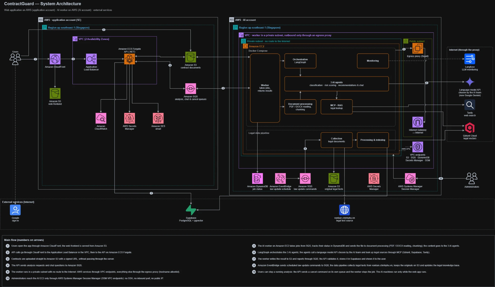

# ContractGuard – AI Contract Risk Analysis on AWS
## A web app takes the contract; three AI agents read every clause, score risk against Vietnamese law and propose rewrites

### 1. Problem and solution overview

*Context*

Small and medium businesses sign many service, purchase and outsourcing contracts, but rarely have a legal team to read
every clause. The risk sits in penalties, liability caps, data protection, termination and governing law, and usually
only shows up once a dispute starts. Having a lawyer review each contract is slow and expensive.

*Target users*

| Group | Need |
| --- | --- |
| Procurement, sales and accounting staff in SMEs | Know quickly which clauses are unfavourable before signing |
| Small legal teams or in-house counsel | Pre-screen contracts and focus on high-risk clauses |
| Managers | See risk scores across 7 domains and the organisation's analysis history |

*Solution*

**ContractGuard** has two parts running in two AWS accounts:

1. **Web application** (application account): React served from Amazon S3 + CloudFront, an ASP.NET Core API on Amazon
   ECS Fargate, Google sign-in, business data in Supabase. Users upload a contract (PDF, DOCX, photo) to S3 with a
   signed URL, read the results, ask a chatbot about the contract and can cancel a running analysis.
2. **AI system** (AI account): receives jobs through Amazon SQS and runs on Amazon EC2 in a private subnet, with three
   agents orchestrated by LangGraph:

| Agent | Responsibility |
| --- | --- |
| Agent 1 – Classification | Splits the contract into clauses, assigns categories, extracts facts (parties, value, effective date…), keeping verbatim text and page numbers |
| Agent 2 – Risk scoring | Checks clauses against risk rules R01–R20 and 20 checks; looks up Vietnamese legal grounds through RAG |
| Agent 3 – Recommendation | Writes a mitigation and a rewritten clause for every finding, with sources; answers the chatbot |

The legal corpus is collected automatically from vanban.chinhphu.vn on an Amazon EventBridge schedule. Risk scores are
**computed by versioned code**; the model never produces the number.

### 2. Problem statement

| Problem | How the system solves it |
| --- | --- |
| Manual review is slow and depends on legal expertise | Three specialised agents work automatically; users read results with citations |
| Language models can invent quotes or legal grounds | Code checks that every quote is a verbatim substring of its clause; wrong findings are dropped and never scored |
| The legal basis changes (new laws, amendments, repeals) | The data pipeline keeps versions per Article with validity dates; RAG returns only provisions in force by default |
| Contracts are in Vietnamese, English or both | Bilingual prompts; explanations follow the user's language, quotes keep their original language |
| An analysis takes minutes; the web app cannot wait | Asynchronous processing through SQS; the web app receives progress and results on a results queue |
| Contracts are sensitive data | The AI worker sits in a private subnet with no direct Internet route; telemetry carries no contract content; IAM permissions follow each role |

### 3. Goals and scope

*Goals and outputs*

1. Users sign in, upload a contract, follow progress (`reading file → splitting clauses → evaluating → scoring`) and get
   the result: clauses, findings with citations, scores for 7 risk domains, recommendations and rewritten clauses.
2. A chatbot answers questions about an analysed contract, using only that contract's clauses.
3. Users can cancel a running analysis; a failed job is reported as `failed` with an error code instead of hanging.
4. The legal corpus updates on a schedule (incremental daily, full weekly) and can be queried by validity date.
5. Central monitoring: API logs in CloudWatch Logs, a trace per AI stage in Langfuse, alerts on failed jobs.

*Success criteria*

| Criterion | How it is measured |
| --- | --- |
| A test contract completes the path web → SQS → AI → S3 → result shown on the web | E2E scenario; check `extraction.json`, DynamoDB `completed`, the `completed` message |
| 100% of results match the `extraction.v2` schema; 0 quotes outside their clause | The backend checks schema and quotes before saving; unit tests |
| No hanging jobs: every job ends as `completed`, `failed` or `cancelled` | DynamoDB outcome table, Langfuse |
| Cancelling stops the job within seconds | Measured in a test scenario (local test: about 1 second) |
| AWS cost stays within the FCAJ credit (about $200 per account) | AWS Budgets, Pricing Calculator (section 6) |
| All unit tests pass | 281 tests on the AI side at the time of writing |

*Scope*

| In scope | Out of scope |
| --- | --- |
| Web app (SPA + API), secure upload, chatbot, cancelling an analysis | Digital signatures, contract lifecycle management, accounting integrations |
| AI system: PDF/DOCX/OCR preprocessing, 3 agents, legal RAG, data pipeline | Binding legal advice; results are for reference only |
| A demo environment on AWS around the showcase; daily staging on Railway | Multi-region production, SLAs, high availability for the AI worker |

*Fit with Cloud and AWS*

The system relies on AWS managed and serverless services: CloudFront, S3, ECS Fargate, SQS, DynamoDB on-demand,
EventBridge Scheduler, Secrets Manager, Systems Manager, VPC Endpoints and IAM. The two accounts exchange data only
through S3 and SQS with cross-account IAM; there is no direct network path between them.

### 4. Solution architecture

*Drawn in draw.io with the AWS Architecture Icons. Source file: `docs/architecture/ContractGuard-Architecture.drawio`
in the AI project repository.*

*Flows (numbers on the diagram)*

| # | Flow |
| --- | --- |
| 1 | Users open the app through Amazon CloudFront; the web frontend is served from Amazon S3 |
| 2 | API calls go through CloudFront to the internal Application Load Balancer in the VPC, then to the API on ECS Fargate |
| 3 | Contracts are uploaded straight to Amazon S3 with a signed URL, without passing through the server |
| 4 | The API sends analysis requests, chat questions and cancel commands to Amazon SQS |
| 5 | The AI worker on EC2 takes jobs from SQS, records status in DynamoDB, sends the file to document processing, then passes the content to the 3 agents |
| 6 | LangGraph orchestrates the 3 agents; they call a language model (currently Google Gemini) and look up legal sources through MCP (Qdrant, Supabase, Tavily) |
| 7 | The worker writes the result to S3 and reports through SQS; the API validates it, stores it in Supabase and shows it to the user |
| 8 | EventBridge sends scheduled law-update commands to SQS; the data pipeline collects texts from vanban.chinhphu.vn, keeps the originals on S3 and updates the legal knowledge base |
| 9 | The worker's private subnet has no route to the Internet: AWS services go through VPC Endpoints, everything else through the egress proxy (hostname allowlist) |
| 10 | A user cancels an analysis: the API sends a command on the cancel queue, the worker stops the job and moves on to the next contract |
| 11 | Administrators reach the AI EC2 only through AWS Systems Manager Session Manager: no SSH, no inbound port, no public IP |

*AWS services and why they were chosen*

| Service | Role | Why |
| --- | --- | --- |
| Amazon CloudFront | Single entry point: serves the SPA and forwards `/api/*` to the ALB | Built-in HTTPS, static caching, keeps the ALB off the Internet (VPC origin); 1 TB/month free tier |
| Amazon S3 (web) | Stores the React build, read through Origin Access Control | Cheap, 11 nines of durability, no server for the frontend |
| Application Load Balancer | Internal load balancer in an isolated subnet, reachable only from CloudFront | Health checks, API kept off the Internet; ready for several tasks |
| Amazon ECS Fargate (ARM64) | Runs the ASP.NET Core API (0.5 vCPU, 1 GB) | Serverless containers, no servers to manage; ARM is cheaper than x86; scale by configuration |
| Amazon VPC (2 AZs, web) | Network for the ALB and Fargate, no NAT Gateway | No NAT keeps fixed cost low; the security group only lets the ALB reach the task |
| Amazon CloudWatch Logs | API logs, kept 2 weeks | Native with ECS; short retention controls cost |
| Amazon SES | Email (member invitations, notifications) | Managed, pay per email |
| Amazon S3 (contracts) | `quarantine/` (uploads), `clean/` (checked files), `results/` (job requests and results) | The two accounts exchange data by prefix; IAM permissions split by prefix |
| Amazon SQS | Analysis, results, chat, cancel and law-update queues; DLQ after 3 receives | Decouples web and AI, survives worker restarts, redelivers messages when a worker dies mid-job |
| Amazon EC2 (AI worker) | Runs 9 Docker Compose containers and 2 systemd services | The CPU embedding and rerank models need plenty of RAM (about 3.5 GB) and disk for the models; one machine mirrors the dev environment |
| Amazon EC2 (egress proxy) | Squid in a public subnet on a t3.micro | Controls outbound Internet traffic with a hostname allowlist, cheaper than a NAT Gateway |
| Amazon EBS gp3 | Disks of both instances: images, models, SQLite volumes | gp3 is cheaper than gp2, IOPS set separately |
| VPC Endpoints | Gateway (S3, DynamoDB) and interface (SQS, Secrets Manager, SSM, STS) | The worker reaches AWS without an Internet route; gateway endpoints are free |
| Amazon DynamoDB (on-demand) | `contract-risk-jobs` (where each contract is now), `contract-risk-job-events` (each job's outcome) | Pay per request; conditional writes stop overwrites when a message is delivered twice |
| Amazon EventBridge Scheduler | Law collection schedule | Serverless, no machine running cron |
| AWS Secrets Manager | Internal tokens and external API keys (Qdrant, Supabase, Tavily, Langfuse); the web's database connection and Google OAuth | No hard-coded credentials; each service gets only its own keys |
| AWS Systems Manager | Session Manager to administer EC2 | No SSH, no bastion; audited through CloudTrail |
| AWS IAM | EC2 instance role, Fargate task role, GitHub OIDC deploy role | No static access keys; least privilege by bucket/prefix, queue and table |

*Services outside AWS*

| Service | Role | Why |
| --- | --- | --- |
| Google sign-in | User sign-in | No new password for users |
| Supabase (PostgreSQL + pgvector) | Web business data; legal tables of the data pipeline | Free plan, does not use AWS credit |
| Google Gemini API (`gemini-3.5-flash-lite`) | Model of the 3 agents, with function calling | Low token price, about 1M-token context |
| Qdrant Cloud | Legal vectors (dense 1024-d + sparse) | Built-in hybrid search, free plan |
| Tavily | Web search when the legal corpus lacks evidence | 1,000 free credits per month |
| Langfuse Cloud | Traces, tokens and errors of each AI stage | Free Hobby plan |

*AI system design (9 containers on the `backend` network + 2 systemd services)*

| Component | Responsibility |
| --- | --- |
| `worker` | Takes SQS jobs, holds a DynamoDB lease, downloads from S3, writes results, deletes the message last; chat and cancel |
| `input-processing` | File checks, PDF/DOCX text, Vietnamese Tesseract OCR, chunks with source positions |
| `langgraph` | Agent 1 per chunk → aggregate → Agent 2 → Agent 3; cache/resume, scoring, builds the result |
| `agent-1`, `agent-2`, `agent-3` | Three agents, each with its own prompts, model and memory |
| `mcp` | Read-only tool gateway for Agents 2/3: legal RAG, Qdrant, Supabase, S3, Tavily |
| `monitoring`, `config` | Sends traces to Langfuse; gives each service its secrets by token and allowlist |
| `contract-data-collector`, `contract-data-processor` | Collect laws, OCR, split Articles, write Supabase + Qdrant |

*AWS Well-Architected Framework*

| Pillar | Applied | Gaps and next steps |
| --- | --- | --- |
| **Security** | No static access keys: EC2 instance role, ECS task role, GitHub OIDC. Secrets in Secrets Manager, `.env` git-ignored, GitHub Push Protection. Worker in a private subnet, no public IP, no inbound Security Group rule, AWS APIs through VPC Endpoints, Internet through an allowlist proxy. ALB only reachable from CloudFront, web bucket behind OAC. Administration through Session Manager. The worker is denied writes to `quarantine/` (roles kept apart). Containers run non-root with a read-only filesystem and no capabilities | The AI containers share one instance role: block IMDS for containers that do not need AWS or split roles. SGs, routes, encryption at rest, CloudTrail and VPC Flow Logs still need verification |
| **Reliability** | SQS decouples web and AI, DLQ after 3 receives; DynamoDB lease and sequence prevent overwrites; idempotency keys; backoff retries for transient model errors; cache to resume after a crash; the message is deleted only after the result is stored; web VPC in 2 AZs | One worker and one proxy, one AZ: if a machine fails, jobs wait in the queue until it is back. Next step: an Auto Scaling group or ECS driven by queue depth |
| **Operational Excellence** | Web infrastructure in AWS CDK (C#); GitHub Actions deploys; scripts start/stop the demo environment; JSON logs; Langfuse traces per job; a Langfuse check after deploy; a test runbook | Add CloudWatch Alarms on the age of the oldest SQS message and a non-empty DLQ; AI logs are not yet in CloudWatch |
| **Performance Efficiency** | Fargate ARM64; asynchronous processing; embedding/rerank models preloaded and offline; hybrid search + rerank | Qdrant Cloud runs in us-west-1; moving it to Singapore would cut latency |
| **Cost Optimization** | No NAT Gateway; free gateway endpoints; DynamoDB on-demand; free plans for Supabase/Qdrant/Tavily/Langfuse; AWS only up around the showcase, daily staging on Railway; logs kept 2 weeks | Details in section 6 |
| **Sustainability** | Machines run only while there are users (the start/stop script includes both AI instances); ARM64 for the API | — |

### 5. Plan and timeline

{}
Adjust the weeks to match your actual worklog.
{}

| Week | Work | Milestone |
| --- | --- | --- |
| 1–2 | Learn AWS basics (IAM, VPC, EC2, S3, SQS, DynamoDB); read the ContractGuard spec and design | Requirements and the web–AI protocol understood |
| 3–4 | Architecture design, 3-agent and LangGraph skeleton, PDF/DOCX/OCR preprocessing | 3-agent flow runs with a fake model |
| 5–6 | SQS/S3/DynamoDB worker, 9 containers packaged | Local E2E with emulated AWS |
| 7–8 | MCP gateway, legal data pipeline, Qdrant, Supabase, hybrid RAG + rerank | Legal lookup returns the right Article |
| 9–10 | Result schema, prompts for the 3 agents, scoring, web queues, chatbot | Real job through the web's queues |
| 11 | Langfuse monitoring, job cancel, DynamoDB status; private-subnet VPC, egress proxy, VPC Endpoints, Session Manager; EC2 deployment | AI stack runs on EC2 in the isolated VPC |
| 12 | E2E tests with the web, AWS demo environment around the showcase, cost measurement, report | Demo and report |

### 6. Budget and cost estimation

*6.1 Actual cost summary*

Source: the "OJT" estimate created with AWS Pricing Calculator on 26 November 2026 from the **AI account's** real usage
in November 2026 (up to the 26th). Prices before discounts, in USD.

| Item | Usage | Derived unit price | Cost (USD) | Share |
| --- | --- | --- | --- | --- |
| EC2 `m7i-flex.large` (AI worker) | 58.8 hours | $0.1197/hour | 7.04 | 53.2% |
| EBS gp3 | 61.2 GB-months | $0.096/GB-month | 5.88 | 44.5% |
| Secrets Manager | 0.38 secret-months, 268 calls | $0.40/secret-month | 0.15 | 1.1% |
| EC2 data transfer | 10.1 GB | — | 0.07 | 0.5% |
| EC2 `t3.micro` (egress proxy) | 4.2 hours | $0.0132/hour | 0.06 | 0.5% |
| DynamoDB on-demand | 12,590 WRU, 12,730 RRU | — | 0.01 | 0.1% |
| Systems Manager | 5 automation steps | — | 0.01 | 0.1% |
| S3 | 0.05 GB-months, 799 requests | — | 0.003 | < 0.1% |
| **Total (before discounts)** | | | **13.22** | 100% |
| Actually billed | | | **0.05** | The rest was covered by Free Tier/credits |

*Findings from the real data*

* **Compute (EC2) and disk (EBS) make up 97.7%.** The serverless services (SQS, DynamoDB, S3, Secrets Manager) together
  stay under 1.5%.
* EBS is billed by size **even while the instance is stopped**: 61.2 GB-months over 26 days is about 70 GB of disk.
* There is no line yet for **interface endpoints** (SQS, Secrets Manager, SSM, STS) or the proxy's **public IPv4**.
  Both are billed per hour and must be added to the estimate.
* Some traffic goes to `us-west-1`: Qdrant Cloud runs in the US.

*6.2 Monthly estimate*

Assumptions:

* **Demo month:** the AI worker and proxy run 8 hours/day × 22 days = 176 hours. The web runs on AWS only for 3 days
  around the showcase; daily staging runs on Railway (outside AWS).
* **24/7:** 730 hours for both accounts.
* Load: 100 analyses and 500 chat questions per month. Each analysis is about 100k input and 30k output tokens; each
  chat question 10k input and 2k output (system design estimate, to be measured with Langfuse).
* EC2, EBS and Secrets Manager unit prices come from the "OJT" estimate. Public IPv4 is $0.005/hour (VPC pricing page).
  The web side uses the web team's design estimate (ALB about $18 and a 0.25 vCPU Fargate task about $8 when running
  24/7), with Fargate doubled for the current 0.5 vCPU / 1 GB task. Gemini `gemini-3.5-flash-lite` paid tier: $0.30 per
  1M input tokens, $2.50 per 1M output tokens.

| Item | Demo month (USD) | 24/7 (USD) | Calculation |
| --- | --- | --- | --- |
| EC2 `m7i-flex.large` (AI worker) | 21.07 | 87.38 | hours × $0.1197 |
| EC2 `t3.micro` (proxy) | 2.32 | 9.64 | hours × $0.0132 |
| Proxy public IPv4 | 0.88 | 3.65 | hours × $0.005 |
| EBS gp3 70 GB | 6.72 | 6.72 | 70 × $0.096, billed while stopped too |
| Secrets Manager, DynamoDB, SQS, S3, SSM | 0.60 | 0.70 | from real usage, mostly within the free tier |
| **AI account** | **31.59** | **108.09** | |
| ALB | 1.78 | 18.00 | 72 hours / 730 hours |
| ECS Fargate ARM64 (0.5 vCPU, 1 GB) | 1.58 | 16.00 | |
| Fargate task public IPv4 | 0.36 | 3.65 | |
| CloudFront, S3, CloudWatch Logs, SES, Secrets Manager | 1.00 | 5.00 | CloudFront and SQS within the free tier |
| **Web account** | **4.72** | **42.65** | |
| Gemini API | 14.50 | 14.50 | 100 × $0.105 + 500 × $0.008 |
| Supabase, Qdrant, Tavily, Langfuse | 0 | 0 | free plans |
| **Total** | **≈ 50.8** | **≈ 165.2** | |

{}
**Interface endpoints are not included**: AWS bills each endpoint per hour in each AZ, even while the instances are
stopped. With 4–5 endpoints in one AZ this could be about $30–50/month if left on all month, the largest item after EC2.
Check it with Pricing Calculator.
{}

*Quick statistics*

| Metric | Value |
| --- | --- |
| Cost of one analysis (Gemini) | about $0.105 |
| Cost of one chat question (Gemini) | about $0.008 |
| Demo month: AWS / model | $36.3 (71%) / $14.5 (29%) |
| Saving from running only during demo hours vs 24/7 | about 69% (≈ $114/month) |
| FCAJ credit per account (about $200) lasts | about 6 demo months on the AI account; about 1.8 months at 24/7 |

*6.3 Cost optimization*

1. **Run only when used:** a script starts/stops the demo environment together with both AI instances; the web runs on
   AWS only around the showcase and is developed daily on Railway.
2. **Egress proxy and free gateway endpoints:** use a `t3.micro` egress proxy for outbound traffic; S3 and DynamoDB
   gateway endpoints are free.
3. **Create only the interface endpoints that are needed**, and delete them during long shutdowns.
4. **Right-size machines and disks:** shrink EBS to real usage, delete volumes and snapshots not attached to any
   instance; consider Savings Plans for long-term use.
5. **Serverless, pay per use:** SQS, DynamoDB on-demand, EventBridge Scheduler, Fargate ARM64.
6. **Data lifecycle:** S3 Lifecycle for `results/` and `quarantine/`; CloudWatch Logs kept 2 weeks.
7. **Model cost:** track tokens in Langfuse; use the Gemini Batch API for bulk evaluation runs (about 50% cheaper).
8. **Budget alerts:** AWS Budgets at 50% and 80% of the credit, email to the whole team.

### 7. Risks and mitigation

* **Risk matrix**
  * Gemini rate limits (429) or 5xx errors: High impact, medium likelihood.
  * Model output breaks the schema or invents quotes: High impact, medium likelihood.
  * Prompt injection inside the contract: High impact, low likelihood.
  * The worker dies mid-job, SQS delivers twice: Medium impact, medium likelihood.
  * The AI instance or the proxy fails: High impact, low likelihood.
  * Credential leak: High impact, low likelihood.
  * AI containers share one instance role: Medium impact, medium likelihood.
  * Credit runs out or a machine is left running: High impact, medium likelihood.
  * Supabase Free pauses after a week of inactivity: Medium impact, medium likelihood.
  * Two APIs (AWS and Railway) read the results queue: Medium impact, medium likelihood.
  * Outdated legal corpus: Medium impact, medium likelihood.

* **Mitigation strategy**
  * Gemini API errors: Client retries 5 times following `retryDelay`; LangGraph retries a node 3 times (backoff 5→60 s) only for transient errors.
  * Hallucinations and invalid schema: Schema check with up to 2 repair requests; wrong quotes are dropped and not scored; the backend validates again before saving.
  * Prompt injection: Treat the contract strictly as data in the prompt; keep MCP tools read-only and scope source document access to its own job.
  * Worker crash and duplicate SQS delivery: DynamoDB lease, idempotency keys, and cache to resume; delete the SQS message only after storing the result; route failures to DLQ after 3 receives.
  * Instance or proxy failure: Containers restart automatically; later scale with an Auto Scaling group or ECS driven by queue depth.
  * Credential security: No static access keys; store secrets in Secrets Manager, use GitHub OIDC and Push Protection; block IMDS for containers that do not need AWS or split roles per workload.
  * Cost overrun: AWS Budgets alerts at 50%/80% of credit, start/stop scripts for the demo environment, and monitoring interface endpoints and EBS volumes.
  * Supabase Free inactivity: Resume the project before the demo, or upgrade to Pro ($25/month) for long-term use.
  * Queue contention (AWS vs. Railway): Stop the Railway API while the AWS environment is active (runbook procedure).
  * Legal corpus freshness: Run incremental daily and full weekly collection with version and validity tracking per Article.

* **Contingency plan**
  * If the AI instance or proxy goes down, jobs remain safely in SQS until the machine is back and resume from cached intermediate state.
  * If a job fails unrecoverably, report `failed` with an error code and move the message to the DLQ instead of hanging.
  * If AWS credits run low or the demo environment is shut down, keep daily staging running on Railway.
  * Use AWS CDK (C#) and GitHub Actions to redeploy or restore the web infrastructure consistently if needed.

### 8. Expected results

* A product running on AWS: users upload a contract, get results with citations, scores and recommendations, and ask the
  chatbot.
* A versioned, self-updating Vietnamese legal corpus usable for RAG.
* A Well-Architected design: no hard-coded credentials, no direct Internet route for the worker, fault-tolerant
  asynchronous processing, cost controlled with real data.
* A base to grow: more contract types, a different model, the worker on ECS or an Auto Scaling group when needed.
