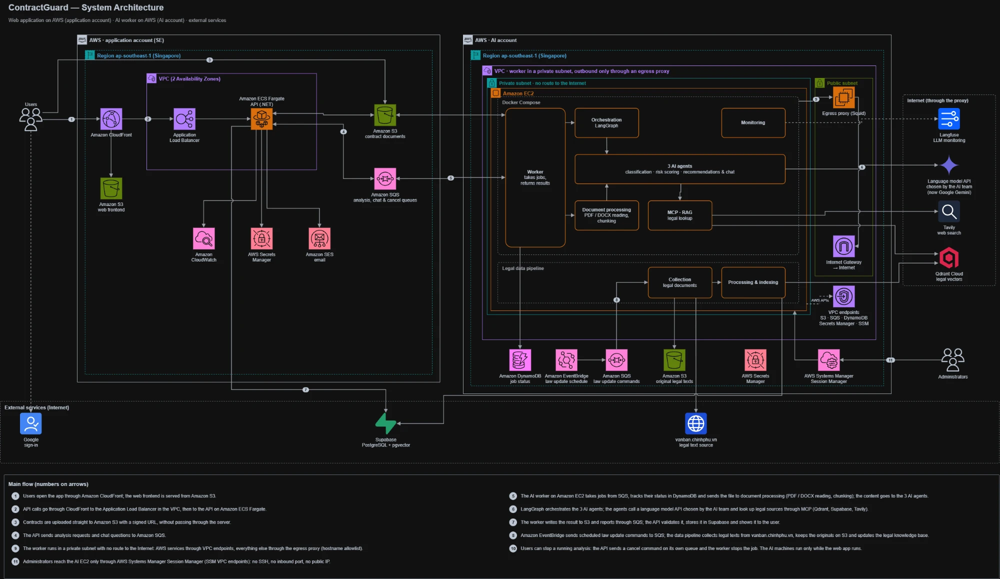

# ContractGuard – Phân tích rủi ro hợp đồng bằng AI trên AWS
## Web app nhận hợp đồng, hệ thống ba AI agent đọc từng điều khoản, chấm điểm rủi ro theo pháp luật Việt Nam và đề xuất sửa đổi

### 1. Tổng quan bài toán và giải pháp

*Bối cảnh*

Doanh nghiệp vừa và nhỏ ký hàng loạt hợp đồng dịch vụ, mua bán, thuê ngoài, nhưng thường không có bộ phận pháp chế để
đọc kỹ từng điều khoản. Rủi ro nằm ở phạt vi phạm, giới hạn bồi thường, bảo mật dữ liệu, chấm dứt hợp đồng, luật áp
dụng, và thường chỉ lộ ra khi đã có tranh chấp. Thuê luật sư rà soát từng hợp đồng thì chậm và tốn kém.

*Đối tượng sử dụng*

| Nhóm | Nhu cầu |
| --- | --- |
| Nhân viên mua hàng, kinh doanh, kế toán ở doanh nghiệp vừa và nhỏ | Biết nhanh điều khoản nào bất lợi trước khi ký |
| Bộ phận pháp chế nhỏ hoặc luật sư nội bộ | Lọc trước hợp đồng, tập trung vào điều khoản rủi ro cao |
| Quản lý | Xem điểm rủi ro theo 7 nhóm và lịch sử phân tích của tổ chức |

*Giải pháp*

**ContractGuard** gồm hai phần chạy trên hai tài khoản AWS:

1. **Ứng dụng web** (tài khoản ứng dụng): React chạy trên Amazon S3 + CloudFront, API ASP.NET Core chạy trên Amazon ECS
   Fargate, đăng nhập Google, dữ liệu nghiệp vụ trong Supabase. Người dùng tải hợp đồng (PDF, DOCX, ảnh) lên S3 bằng
   signed URL, xem kết quả, hỏi chatbot về hợp đồng và có thể hủy một lượt phân tích đang chạy.
2. **Hệ thống AI** (tài khoản AI): nhận việc qua Amazon SQS, chạy trên Amazon EC2 trong private subnet, gồm ba agent
   do LangGraph điều phối:

| Agent | Nhiệm vụ |
| --- | --- |
| Agent 1 – Phân loại | Tách hợp đồng thành điều khoản, gán nhóm, trích dữ kiện (bên ký, giá trị, ngày hiệu lực…), giữ nguyên văn và số trang |
| Agent 2 – Chấm điểm rủi ro | Đối chiếu điều khoản với bộ luật rủi ro R01–R20 và 20 mục kiểm tra; tra cứu căn cứ pháp luật Việt Nam qua RAG |
| Agent 3 – Khuyến nghị | Viết đề xuất giảm thiểu và đoạn điều khoản sửa lại cho từng rủi ro, kèm nguồn; trả lời chatbot |

Kho pháp luật được thu thập tự động từ vanban.chinhphu.vn theo lịch Amazon EventBridge. Điểm rủi ro do **code tính theo
công thức có phiên bản**, model không tự đưa ra con số.

### 2. Vấn đề cần giải quyết

| Vấn đề | Cách hệ thống giải quyết |
| --- | --- |
| Rà soát thủ công chậm, phụ thuộc người có chuyên môn | Ba agent chuyên biệt xử lý tự động; người dùng chỉ đọc kết quả có trích dẫn |
| Model ngôn ngữ có thể "bịa" trích dẫn hoặc căn cứ pháp luật | Code kiểm mọi trích dẫn là chuỗi con nguyên văn của điều khoản; finding sai bị loại, không được tính điểm |
| Căn cứ pháp luật thay đổi (luật mới, sửa đổi, hết hiệu lực) | Data pipeline lưu phiên bản theo Điều, ngày hiệu lực; RAG mặc định chỉ trả bản đang có hiệu lực |
| Hợp đồng tiếng Việt, tiếng Anh hoặc song ngữ | Prompt song ngữ; giải thích theo ngôn ngữ người dùng chọn, trích dẫn giữ ngôn ngữ gốc |
| Phân tích mất vài phút, không thể để web chờ | Xử lý bất đồng bộ qua SQS; web nhận tiến độ và kết quả qua hàng đợi kết quả |
| Hợp đồng là dữ liệu nhạy cảm | Worker AI trong private subnet không có đường Internet trực tiếp; telemetry không chứa nội dung hợp đồng; quyền IAM tách theo vai trò |

### 3. Mục tiêu và phạm vi

*Mục tiêu cụ thể và đầu ra*

1. Người dùng đăng nhập, tải hợp đồng, xem tiến độ (`đọc file → tách điều khoản → đánh giá → chấm điểm`) và kết quả:
   danh sách điều khoản, finding có trích dẫn, điểm 7 nhóm rủi ro, khuyến nghị và đoạn sửa lại.
2. Chatbot trả lời câu hỏi về một hợp đồng đã phân tích, chỉ dựa trên điều khoản của hợp đồng đó.
3. Người dùng hủy được lượt phân tích đang chạy; job lỗi được báo `failed` kèm mã lỗi thay vì treo.
4. Kho pháp luật tự cập nhật theo lịch (incremental hằng ngày, full hằng tuần) và tra cứu được theo hiệu lực.
5. Giám sát tập trung: log API trên CloudWatch Logs, trace từng stage AI trên Langfuse, cảnh báo job lỗi.

*Tiêu chí hoàn thành*

| Tiêu chí | Cách đo |
| --- | --- |
| Một hợp đồng thử đi hết luồng web → SQS → AI → S3 → web hiển thị kết quả | Kịch bản E2E, kiểm `extraction.json`, DynamoDB `completed`, message `completed` |
| 100% kết quả khớp schema `extraction.v2`; 0 trích dẫn không nằm trong điều khoản | Backend kiểm schema và trích dẫn trước khi lưu; unit test |
| Không có job treo: mọi job kết thúc bằng `completed`, `failed` hoặc `cancelled` | Bảng outcome DynamoDB, Langfuse |
| Hủy job dừng trong vài giây | Đo trên kịch bản thử (bản thử nghiệm local: khoảng 1 giây) |
| Chi phí AWS nằm trong credit FCAJ (khoảng $200 mỗi tài khoản) | AWS Budgets, Pricing Calculator (mục 6) |
| Toàn bộ unit test đạt | 281 test phía AI tại thời điểm viết |

*Phạm vi*

| Trong phạm vi | Ngoài phạm vi |
| --- | --- |
| Web app (SPA + API), upload an toàn, chatbot, hủy phân tích | Ký số, quản lý vòng đời hợp đồng, tích hợp phần mềm kế toán |
| Hệ thống AI: tiền xử lý PDF/DOCX/OCR, 3 agent, RAG pháp luật, data pipeline | Tư vấn pháp lý có giá trị ràng buộc; kết quả chỉ để tham khảo |
| Môi trường demo trên AWS quanh buổi showcase; staging hằng ngày trên Railway | Production đa vùng, SLA, high availability cho worker AI |

*Phù hợp định hướng Cloud và AWS*

Hệ thống dựa trên các dịch vụ managed và serverless của AWS: CloudFront, S3, ECS Fargate, SQS, DynamoDB on-demand,
EventBridge Scheduler, Secrets Manager, Systems Manager, VPC Endpoints, IAM. Hai tài khoản tách biệt giao tiếp qua S3
và SQS bằng IAM cross-account, không có kết nối mạng trực tiếp giữa hai bên.

### 4. Kiến trúc giải pháp

*Sơ đồ vẽ bằng draw.io với bộ AWS Architecture Icons. File nguồn: `docs/architecture/ContractGuard-Architecture.drawio`
trong repository dự án AI.*

*Luồng xử lý (số trên sơ đồ)*

| # | Luồng |
| --- | --- |
| 1 | Người dùng mở ứng dụng qua Amazon CloudFront; giao diện web lấy từ Amazon S3 |
| 2 | Lời gọi API đi qua CloudFront tới Application Load Balancer nội bộ trong VPC, rồi tới API trên ECS Fargate |
| 3 | Hợp đồng được tải thẳng lên Amazon S3 bằng signed URL, không đi qua server |
| 4 | API gửi yêu cầu phân tích, câu hỏi chat và lệnh hủy vào Amazon SQS |
| 5 | Worker AI trên EC2 nhận việc từ SQS, ghi trạng thái vào DynamoDB, gửi file sang bước xử lý tài liệu, rồi đưa nội dung cho 3 agent |
| 6 | LangGraph điều phối 3 agent; agent gọi model ngôn ngữ (hiện là Google Gemini) và tra cứu pháp luật qua MCP (Qdrant, Supabase, Tavily) |
| 7 | Worker ghi kết quả lên S3 và báo qua SQS; API kiểm tra kết quả, lưu vào Supabase và hiển thị cho người dùng |
| 8 | EventBridge gửi lệnh cập nhật luật theo lịch vào SQS; data pipeline thu thập văn bản từ vanban.chinhphu.vn, lưu bản gốc trên S3 và cập nhật kho pháp luật |
| 9 | Worker ở private subnet không có route ra Internet: dịch vụ AWS đi qua VPC Endpoints, mọi kết nối khác đi qua egress proxy (allowlist hostname) |
| 10 | Người dùng hủy một lượt phân tích: API gửi lệnh vào queue hủy, worker dừng job và chuyển sang hợp đồng kế tiếp |
| 11 | Quản trị viên vào EC2 AI chỉ qua AWS Systems Manager Session Manager: không SSH, không cổng inbound, không public IP |

*Dịch vụ AWS sử dụng và lý do lựa chọn*

| Dịch vụ | Vai trò | Lý do chọn |
| --- | --- | --- |
| Amazon CloudFront | Điểm vào duy nhất của web: phục vụ SPA và chuyển `/api/*` tới ALB | HTTPS sẵn có, cache tĩnh, ẩn ALB khỏi Internet (VPC origin); free tier 1 TB/tháng |
| Amazon S3 (web) | Lưu bản build React, truy cập qua Origin Access Control | Rẻ, bền 11 số 9, không cần server cho frontend |
| Application Load Balancer | Load balancer nội bộ trong subnet isolated, chỉ CloudFront tới được | Health check, tách API khỏi Internet; sẵn sàng cho nhiều task |
| Amazon ECS Fargate (ARM64) | Chạy API ASP.NET Core (0,5 vCPU, 1 GB) | Serverless container, không quản lý máy; ARM rẻ hơn x86; scale task bằng cấu hình |
| Amazon VPC (2 AZ, web) | Mạng cho ALB và Fargate, không NAT Gateway | Bỏ NAT để giảm chi phí cố định; security group chỉ cho ALB vào task |
| Amazon CloudWatch Logs | Log API, giữ 2 tuần | Tích hợp sẵn với ECS; retention ngắn để kiểm soát chi phí |
| Amazon SES | Gửi email (mời thành viên, thông báo) | Managed, trả theo email |
| Amazon S3 (hợp đồng) | `quarantine/` (file tải lên), `clean/` (file đã kiểm), `results/` (phiếu việc và kết quả) | Hai tài khoản trao đổi qua prefix; quyền IAM chia theo prefix |
| Amazon SQS | Queue phân tích, kết quả, chat, hủy và lệnh cập nhật luật; DLQ sau 3 lần nhận | Tách web khỏi AI, chịu được worker khởi động lại, tự giao lại message khi worker chết giữa chừng |
| Amazon EC2 (AI worker) | Chạy 9 container Docker Compose và 2 service systemd | Model embedding và reranker chạy CPU cần RAM lớn (khoảng 3,5 GB) và đĩa cho model; một máy giống môi trường dev |
| Amazon EC2 (egress proxy) | Squid trong public subnet, máy t3.micro | Kiểm soát đường ra Internet theo allowlist hostname, rẻ hơn NAT Gateway |
| Amazon EBS gp3 | Đĩa của hai EC2: image, model, volume SQLite | gp3 rẻ hơn gp2, IOPS cấu hình riêng |
| VPC Endpoints | Gateway (S3, DynamoDB) và interface (SQS, Secrets Manager, SSM, STS) | Worker gọi AWS mà không cần đường Internet; gateway endpoint miễn phí |
| Amazon DynamoDB (on-demand) | `contract-risk-jobs` (vị trí hiện tại của hợp đồng), `contract-risk-job-events` (kết cục mỗi job) | Trả theo request; ghi có điều kiện chống ghi đè khi message bị giao trùng |
| Amazon EventBridge Scheduler | Lịch thu thập luật | Serverless, không cần máy chạy cron |
| AWS Secrets Manager | Token nội bộ và API key dịch vụ ngoài (Qdrant, Supabase, Tavily, Langfuse); chuỗi kết nối DB và Google OAuth của web | Không hard-code credential; service chỉ nhận đúng key được cấp |
| AWS Systems Manager | Session Manager để quản trị EC2 | Không mở SSH, không cần bastion; có audit qua CloudTrail |
| AWS IAM | Instance role cho EC2, task role cho Fargate, role GitHub OIDC để deploy | Không access key tĩnh; quyền tối thiểu theo bucket/prefix, queue, bảng |

*Dịch vụ ngoài AWS*

| Dịch vụ | Vai trò | Lý do |
| --- | --- | --- |
| Google sign-in | Đăng nhập người dùng | Người dùng không phải tạo mật khẩu mới |
| Supabase (PostgreSQL + pgvector) | Dữ liệu nghiệp vụ của web; bảng pháp luật của data pipeline | Gói Free, không trừ credit AWS |
| Google Gemini API (`gemini-3.5-flash-lite`) | Model của 3 agent, có function calling | Giá theo token thấp, context khoảng 1 triệu token |
| Qdrant Cloud | Vector pháp luật (dense 1024 chiều + sparse) | Hybrid search có sẵn, gói Free |
| Tavily | Tìm web khi kho luật chưa đủ bằng chứng | 1.000 credit miễn phí mỗi tháng |
| Langfuse Cloud | Trace, token, lỗi của từng stage AI | Gói Hobby miễn phí |

*Thiết kế hệ thống AI (9 container trên network `backend` + 2 service systemd)*

| Thành phần | Chức năng |
| --- | --- |
| `worker` | Nhận SQS, giữ lease DynamoDB, tải S3, ghi kết quả, xóa message cuối cùng; chat và hủy job |
| `input-processing` | Kiểm file, trích text PDF/DOCX, OCR Tesseract tiếng Việt, chia chunk có vị trí nguồn |
| `langgraph` | Agent 1 từng chunk → tổng hợp → Agent 2 → Agent 3; cache/resume, tính điểm, dựng kết quả |
| `agent-1`, `agent-2`, `agent-3` | Ba agent, mỗi agent có prompt, model và memory riêng |
| `mcp` | Cổng tool chỉ đọc cho Agent 2/3: RAG pháp luật, Qdrant, Supabase, S3, Tavily |
| `monitoring`, `config` | Gửi trace sang Langfuse; cấp secret cho từng service theo token và allowlist |
| `contract-data-collector`, `contract-data-processor` | Thu thập văn bản luật, OCR, tách Điều, ghi Supabase + Qdrant |

*Tuân thủ AWS Well-Architected Framework*

| Trụ cột | Đã áp dụng | Còn hạn chế và hướng xử lý |
| --- | --- | --- |
| **Security** | Không access key tĩnh: EC2 instance role, ECS task role, GitHub OIDC. Secret trong Secrets Manager, `.env` bị gitignore, GitHub Push Protection. Worker trong private subnet, không public IP, Security Group không inbound, AWS API qua VPC Endpoints, Internet qua proxy allowlist. ALB chỉ nhận từ CloudFront, S3 web dùng OAC. Quản trị bằng Session Manager. Worker bị từ chối ghi `quarantine/` (đúng tách vai trò). Container chạy non-root, filesystem chỉ đọc, bỏ mọi capability | Các container AI dùng chung instance role: cần chặn IMDS với container không cần AWS hoặc tách role. Chưa xác minh đủ SG, route, mã hóa at-rest, CloudTrail, VPC Flow Logs |
| **Reliability** | SQS tách web và AI, DLQ sau 3 lần nhận; lease và sequence trên DynamoDB chống ghi đè; idempotency key; retry có backoff cho lỗi model tạm thời; cache để chạy tiếp sau crash; chỉ xóa message sau khi đã lưu kết quả; VPC web 2 AZ | Worker và proxy mỗi thứ một máy, một AZ: máy hỏng thì job chờ trong queue đến khi bật lại. Hướng mở rộng: Auto Scaling group hoặc ECS theo độ dài queue |
| **Operational Excellence** | Hạ tầng web bằng AWS CDK (C#); deploy bằng GitHub Actions; script bật/tắt môi trường demo; log JSON; trace Langfuse theo job; lệnh kiểm Langfuse sau deploy; runbook kiểm thử | Cần CloudWatch Alarm cho tuổi message lâu nhất của SQS và DLQ không rỗng; chưa gom log AI vào CloudWatch |
| **Performance Efficiency** | Fargate ARM64; xử lý bất đồng bộ; model embedding/reranker tải sẵn, chạy offline; hybrid search + rerank | Qdrant Cloud đang ở us-west-1, nên chuyển sang Singapore để giảm độ trễ |
| **Cost Optimization** | Không NAT Gateway; gateway endpoint miễn phí; DynamoDB on-demand; Supabase/Qdrant/Tavily/Langfuse gói Free; AWS chỉ bật quanh showcase, staging hằng ngày trên Railway; log giữ 2 tuần | Chi tiết ở mục 6 |
| **Sustainability** | Chỉ bật máy khi có người dùng (script bật/tắt kèm 2 EC2 AI); ARM64 cho API | — |

### 5. Kế hoạch và timeline thực hiện

{}
Điều chỉnh tuần cho khớp với worklog thực tế của bạn.
{}

| Tuần | Công việc | Mốc hoàn thành |
| --- | --- | --- |
| 1–2 | Học nền tảng AWS (IAM, VPC, EC2, S3, SQS, DynamoDB); đọc đặc tả và thiết kế ContractGuard | Nắm yêu cầu và giao thức giữa web và AI |
| 3–4 | Thiết kế kiến trúc, dựng khung 3 agent và LangGraph, tiền xử lý PDF/DOCX/OCR | Chạy được luồng 3 agent với model giả |
| 5–6 | Worker SQS/S3/DynamoDB, đóng gói 9 container | E2E local với AWS giả lập |
| 7–8 | MCP gateway, data pipeline pháp luật, Qdrant, Supabase, RAG hybrid + rerank | Tra cứu luật trả đúng Điều |
| 9–10 | Schema kết quả, prompt 3 agent, chấm điểm, nối hàng đợi của web, chatbot | Job thật qua hàng đợi của web |
| 11 | Monitoring Langfuse, hủy job, DynamoDB trạng thái; VPC private subnet, egress proxy, VPC Endpoints, Session Manager; triển khai EC2 | Stack AI chạy trên EC2 trong VPC cô lập |
| 12 | Kiểm thử E2E với web, bật môi trường demo AWS quanh showcase, đo chi phí, hoàn thiện báo cáo | Demo và báo cáo |

### 6. Dự toán ngân sách và chi phí

*6.1 Bảng tóm tắt chi phí thực tế*

Nguồn: estimate "OJT" tạo bằng AWS Pricing Calculator ngày 26/11/2026 từ lượng dùng thật của **tài khoản AI**
trong tháng 11/2026 (đến ngày 26). Giá trước chiết khấu, đơn vị USD.

| Hạng mục | Lượng dùng | Đơn giá suy ra | Chi phí (USD) | Tỷ trọng |
| --- | --- | --- | --- | --- |
| EC2 `m7i-flex.large` (AI worker) | 58,8 giờ | $0,1197/giờ | 7,04 | 53,2% |
| EBS gp3 | 61,2 GB-tháng | $0,096/GB-tháng | 5,88 | 44,5% |
| Secrets Manager | 0,38 secret-tháng, 268 lần gọi | $0,40/secret-tháng | 0,15 | 1,1% |
| Truyền dữ liệu EC2 | 10,1 GB | — | 0,07 | 0,5% |
| EC2 `t3.micro` (egress proxy) | 4,2 giờ | $0,0132/giờ | 0,06 | 0,5% |
| DynamoDB on-demand | 12.590 WRU, 12.730 RRU | — | 0,01 | 0,1% |
| Systems Manager | 5 bước automation | — | 0,01 | 0,1% |
| S3 | 0,05 GB-tháng, 799 request | — | 0,003 | < 0,1% |
| **Tổng (trước chiết khấu)** | | | **13,22** | 100% |
| Đã bị tính thực tế | | | **0,05** | Phần còn lại được Free Tier/credit giảm trừ |

*Nhận xét từ số liệu thật*

* **Máy tính (EC2) và đĩa (EBS) chiếm 97,7%.** Các dịch vụ serverless (SQS, DynamoDB, S3, Secrets Manager) gộp lại
  dưới 1,5%.
* EBS tính theo dung lượng **kể cả khi EC2 tắt**: 61,2 GB-tháng trong 26 ngày tương đương khoảng 70 GB đĩa.
* Chưa có dòng chi phí cho **interface endpoint** (SQS, Secrets Manager, SSM, STS) và **public IPv4** của proxy. Hai mục
  này tính theo giờ, cần thêm vào estimate.
* Có lưu lượng tới `us-west-1`: Qdrant Cloud đang ở Mỹ.

*6.2 Ước tính chi phí theo tháng*

Giả định:

* **Tháng demo:** EC2 AI và proxy bật 8 giờ/ngày × 22 ngày = 176 giờ. Web trên AWS chỉ bật 3 ngày quanh showcase;
  staging hằng ngày chạy trên Railway (ngoài AWS).
* **Chạy liên tục 24/7:** 730 giờ cho cả hai tài khoản.
* Tải: 100 lượt phân tích và 500 câu chat mỗi tháng. Mỗi lượt phân tích khoảng 100k token vào, 30k token ra; mỗi câu
  chat 10k vào, 2k ra (ước lượng trong thiết kế hệ thống, cần đo lại bằng Langfuse).
* Đơn giá EC2, EBS, Secrets Manager lấy từ estimate "OJT". Public IPv4 $0,005/giờ (trang giá VPC). Phía web dùng ước
  lượng trong tài liệu thiết kế của nhóm web (ALB khoảng $18 và Fargate 0,25 vCPU khoảng $8 khi chạy 24/7), nhân đôi
  Fargate vì cấu hình hiện tại là 0,5 vCPU / 1 GB. Gemini `gemini-3.5-flash-lite` gói trả phí: $0,30 / 1M token vào,
  $2,50 / 1M token ra.

| Hạng mục | Tháng demo (USD) | 24/7 (USD) | Cách tính |
| --- | --- | --- | --- |
| EC2 `m7i-flex.large` (AI worker) | 21,07 | 87,38 | giờ × $0,1197 |
| EC2 `t3.micro` (proxy) | 2,32 | 9,64 | giờ × $0,0132 |
| Public IPv4 của proxy | 0,88 | 3,65 | giờ × $0,005 |
| EBS gp3 70 GB | 6,72 | 6,72 | 70 × $0,096, tính cả khi máy tắt |
| Secrets Manager, DynamoDB, SQS, S3, SSM | 0,60 | 0,70 | theo số liệu thật, phần lớn nằm trong free tier |
| **Tài khoản AI** | **31,59** | **108,09** | |
| ALB | 1,78 | 18,00 | 72 giờ / 730 giờ |
| ECS Fargate ARM64 (0,5 vCPU, 1 GB) | 1,58 | 16,00 | |
| Public IPv4 của task Fargate | 0,36 | 3,65 | |
| CloudFront, S3, CloudWatch Logs, SES, Secrets Manager | 1,00 | 5,00 | CloudFront và SQS nằm trong free tier |
| **Tài khoản web** | **4,72** | **42,65** | |
| Gemini API | 14,50 | 14,50 | 100 × $0,105 + 500 × $0,008 |
| Supabase, Qdrant, Tavily, Langfuse | 0 | 0 | gói Free |
| **Tổng** | **≈ 50,8** | **≈ 165,2** | |

{}
Chưa gồm **interface endpoint**: AWS tính theo giờ cho mỗi endpoint ở mỗi AZ, kể cả khi EC2 tắt. Với 4–5 endpoint ở
một AZ, mục này có thể vào khoảng $30–50/tháng nếu để suốt tháng, tức lớn nhất sau EC2. Kiểm lại bằng Pricing Calculator.
{}

*Thống kê nhanh*

| Chỉ số | Giá trị |
| --- | --- |
| Chi phí một lượt phân tích (Gemini) | khoảng $0,105 |
| Chi phí một câu chat (Gemini) | khoảng $0,008 |
| Tháng demo: phần AWS / phần model | $36,3 (71%) / $14,5 (29%) |
| Tiết kiệm khi chỉ bật theo giờ demo so với 24/7 | khoảng 69% (≈ $114/tháng) |
| Credit FCAJ mỗi tài khoản (khoảng $200) đủ cho | khoảng 6 tháng demo ở tài khoản AI; khoảng 1,8 tháng nếu chạy 24/7 |

*6.3 Chiến lược tối ưu chi phí*

1. **Chỉ bật khi dùng:** script bật/tắt môi trường demo kèm 2 EC2 AI; web trên AWS chỉ bật quanh showcase, phát triển
   hằng ngày trên Railway.
2. **Dùng egress proxy và gateway endpoint miễn phí:** dùng egress proxy `t3.micro` cho lưu lượng ra ngoài; gateway
   endpoint S3 và DynamoDB miễn phí.
3. **Chỉ tạo interface endpoint thật cần**, xóa khi tắt môi trường dài ngày.
4. **Đúng cỡ máy và đĩa:** giảm EBS về mức dùng thực tế, xóa volume và snapshot không gắn với máy nào; xem xét Savings
   Plans nếu chạy lâu dài.
5. **Serverless trả theo lượng dùng:** SQS, DynamoDB on-demand, EventBridge Scheduler, Fargate ARM64.
6. **Vòng đời dữ liệu:** S3 Lifecycle cho `results/` và `quarantine/`; CloudWatch Logs giữ 2 tuần.
7. **Chi phí model:** theo dõi token trên Langfuse; dùng Batch API của Gemini cho lượt đánh giá hàng loạt (rẻ khoảng 50%).
8. **Cảnh báo ngân sách:** AWS Budgets ở mức 50% và 80% credit, gửi email cả nhóm.

### 7. Rủi ro và phương án giảm thiểu

* **Ma trận rủi ro**
  * Gemini giới hạn tốc độ (429) hoặc lỗi 5xx: Ảnh hưởng cao, xác suất trung bình.
  * Model trả output sai schema hoặc "bịa" trích dẫn: Ảnh hưởng cao, xác suất trung bình.
  * Prompt injection trong nội dung hợp đồng: Ảnh hưởng cao, xác suất thấp.
  * Worker chết giữa chừng, SQS giao trùng: Ảnh hưởng trung bình, xác suất trung bình.
  * Một EC2 AI hoặc proxy hỏng: Ảnh hưởng cao, xác suất thấp.
  * Lộ credential: Ảnh hưởng cao, xác suất thấp.
  * Container AI dùng chung instance role: Ảnh hưởng trung bình, xác suất trung bình.
  * Hết credit hoặc quên tắt máy: Ảnh hưởng cao, xác suất trung bình.
  * Supabase Free tạm dừng sau 1 tuần không hoạt động: Ảnh hưởng trung bình, xác suất trung bình.
  * Hai API (AWS và Railway) cùng đọc queue kết quả: Ảnh hưởng trung bình, xác suất trung bình.
  * Kho luật lỗi thời: Ảnh hưởng trung bình, xác suất trung bình.

* **Chiến lược giảm thiểu**
  * Lỗi API Gemini: Client retry 5 lần theo `retryDelay`; LangGraph retry node 3 lần (backoff 5→60 giây) chỉ cho lỗi tạm thời.
  * Sai schema và "bịa" trích dẫn: Kiểm schema, yêu cầu sửa tối đa 2 lần; trích dẫn sai bị loại và không tính điểm; backend kiểm lại trước khi lưu.
  * Prompt injection: Giữ hợp đồng chỉ là dữ liệu trong prompt; tool MCP chỉ đọc và chỉ cho phép đọc tài liệu gốc của chính job.
  * Worker chết hoặc SQS giao trùng: Dùng lease DynamoDB, idempotency key và cache để chạy tiếp; chỉ xóa message sau khi đã lưu kết quả; đẩy về DLQ sau 3 lần nhận.
  * Hỏng EC2 hoặc proxy: Container tự restart; hướng mở rộng lâu dài là dùng Auto Scaling group hoặc ECS theo độ dài queue.
  * Bảo mật credential: Không dùng access key tĩnh; lưu secret trong Secrets Manager, dùng GitHub OIDC và Push Protection; chặn IMDS với container không cần AWS hoặc tách role theo workload.
  * Chi phí và quên tắt máy: Cảnh báo AWS Budgets ở mức 50%/80%, script bật/tắt môi trường demo, theo dõi interface endpoint và EBS.
  * Supabase Free tạm dừng: Bật lại project trước buổi demo; nâng gói Pro ($25/tháng) nếu chạy lâu dài.
  * Tranh chấp queue (AWS và Railway): Tắt API Railway khi bật môi trường AWS theo quy trình trong runbook.
  * Kho luật lỗi thời: Thu thập incremental hằng ngày, full hằng tuần; lưu phiên bản và ngày hiệu lực theo từng Điều.

* **Kế hoạch dự phòng**
  * Khi EC2 AI hoặc proxy gặp sự cố, job vẫn nằm an toàn trong SQS chờ máy bật lại và tiếp tục từ cache trung gian.
  * Nếu job lỗi không thể phục hồi, hệ thống báo trạng thái `failed` kèm mã lỗi và chuyển message vào DLQ thay vì treo.
  * Nếu hết credit AWS hoặc tắt môi trường demo, duy trì staging hằng ngày trên Railway để tiếp tục kiểm thử và vận hành.
  * Dùng AWS CDK (C#) và GitHub Actions để triển khai hoặc khôi phục lại cấu hình hạ tầng web khi cần.

### 8. Kết quả kỳ vọng

* Sản phẩm chạy thật trên AWS: người dùng tải hợp đồng, nhận kết quả có trích dẫn, điểm và khuyến nghị, hỏi chatbot.
* Kho pháp luật Việt Nam có phiên bản, tự cập nhật, dùng được cho RAG.
* Kiến trúc theo Well-Architected: không hard-code credential, worker không có đường Internet trực tiếp, xử lý bất đồng
  bộ chịu lỗi, chi phí kiểm soát được bằng số liệu thật.
* Nền tảng để mở rộng: thêm loại hợp đồng, đổi model, chuyển worker sang ECS hoặc Auto Scaling khi cần.
