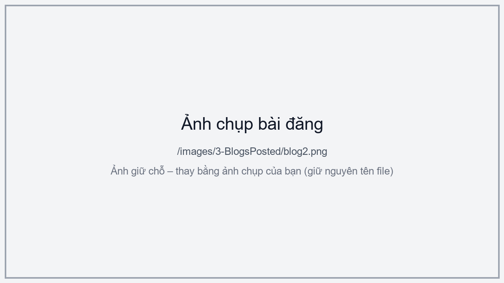

{}
✏️ **Cần điền:** thay toàn bộ nội dung trong dấu `[...]` bằng thông tin của bạn, rồi xóa hộp này.
{}

# [Tiêu đề bài viết]

&emsp; **Link bài đăng:** [https://www.facebook.com/groups/awsstudygroupfcj/posts/...]

&emsp; **Ngày đăng:** [dd/mm/yyyy]

&emsp; **Chủ đề / dịch vụ AWS:** [Ví dụ: Amazon SQS, Cost Optimization]

### Tóm tắt

[Bài viết giải quyết vấn đề gì, dành cho ai.]

### Nội dung chính

* [Ý chính 1]
* [Ý chính 2]
* [Ý chính 3]

### Hình ảnh minh họa

### Tài liệu tham khảo

1. [Tên tài liệu](https://...)
