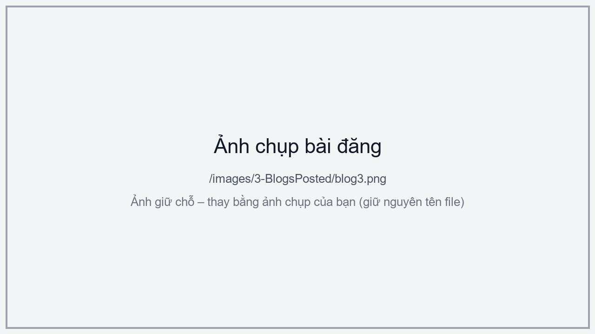

{}
✏️ **To fill in:** replace everything inside `[...]` with your own information, then delete this box.
{}

# [Post title]

&emsp; **Post link:** [https://www.facebook.com/groups/awsstudygroupfcj/posts/...]

&emsp; **Published on:** [mm/dd/yyyy]

&emsp; **Topic / AWS service:** [e.g. Amazon SQS, Cost Optimization]

### Summary

[What problem the post solves and who it is for.]

### Key points

* [Key point 1]
* [Key point 2]
* [Key point 3]

### Illustration

### References

1. [Document title](https://...)
