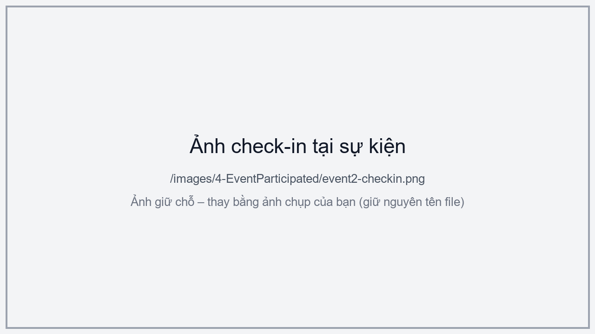

{}
✏️ **Cần điền:** thay toàn bộ nội dung trong dấu `[...]` bằng thông tin của bạn, rồi xóa hộp này.
{}

# Bài thu hoạch "[Tên sự kiện]"

| Mục | Thông tin |
| --- | --- |
| Tên sự kiện | [Tên sự kiện] |
| Thời gian | [hh:mm ngày dd/mm/yyyy] |
| Địa điểm | [Địa điểm] |
| Vai trò tham gia | [Người tham dự / hỗ trợ tổ chức / diễn giả] |
| Diễn giả | [Tên – chức danh] |

### Nội dung chính tiếp thu

* [Nội dung 1]
* [Nội dung 2]
* [Nội dung 3]

### Hình ảnh check-in

{}
Ảnh phải thấy rõ mặt bạn tại sự kiện (backdrop, màn hình trình chiếu hoặc khu check-in).
{}

### Bài học rút ra / đóng góp cá nhân

* [Bài học 1 và cách áp dụng vào dự án]
* [Đóng góp của bạn tại sự kiện, nếu có]
