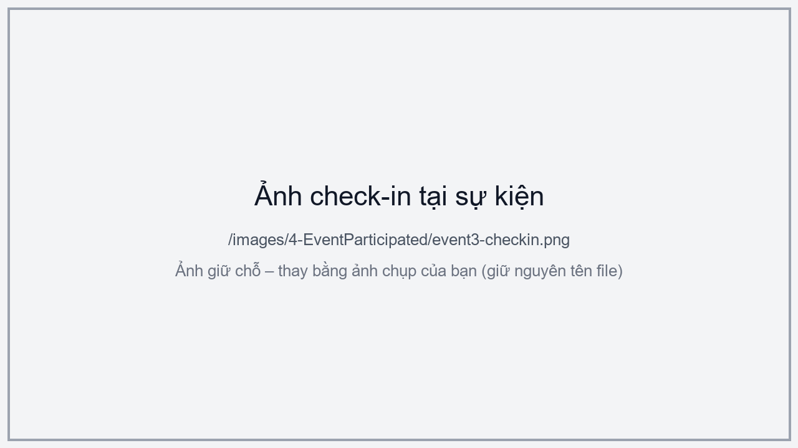

{}
✏️ **To fill in:** replace everything inside `[...]` with your own information, then delete this box.
{}

# Event report: "[Event name]"

| Item | Details |
| --- | --- |
| Event name | [Event name] |
| Time | [hh:mm, mm/dd/yyyy] |
| Location | [Location] |
| Role | [Attendee / organizer support / speaker] |
| Speakers | [Name – title] |

### Key takeaways

* [Takeaway 1]
* [Takeaway 2]
* [Takeaway 3]

### Check-in photo

{}
The photo must clearly show your face at the event (backdrop, presentation screen or check-in area).
{}

### Lessons learned / personal contribution

* [Lesson 1 and how it applies to the project]
* [Your contribution at the event, if any]
