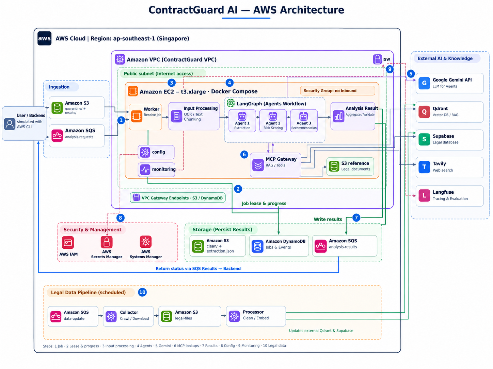

#### The problem

ContractGuard users upload contracts to the web app. The AI side (this repository) receives jobs through SQS, reads
the file from S3, has three agents classify clauses, score risk against Vietnamese law and propose rewrites, then
returns the result through S3/SQS. The web app never calls the model directly: everything goes through queues and S3
objects.

#### Architecture and data flow

{}
📸 **Screenshot to take:** Your own architecture diagram drawn in draw.io with the AWS Architecture Icons (you may reuse the Proposal image). Export a PNG and save it over `static/images/5-Workshop/5.1-Workshop-overview/architecture.png`.
{}

| # | Step | Components |
| --- | --- | --- |
| 1 | Receive the job: long-poll `analysis-requests`, read `results/<job_id>/request.json` and the file in `quarantine/` | SQS, S3, `worker` |
| 2 | Hold the job lease and record progress | DynamoDB `contract-risk-jobs`, `contract-risk-job-events` |
| 3 | Text extraction, OCR, chunking with source positions | `input-processing` |
| 4 | Orchestration: Agent 1 per chunk → aggregate → Agent 2 → Agent 3 | `langgraph`, `agent-1/2/3` |
| 5 | Model calls | Google Gemini API |
| 6 | Legal lookup (hybrid RAG + rerank, web search) | `mcp` → Qdrant, Supabase, Tavily, reference S3 |
| 7 | Python scoring, schema check, write `clean/` + `extraction.json`, send `completed`, delete the message | `langgraph`, `worker`, S3, SQS |
| 8 | Fetch secrets at start-up | `config` → Secrets Manager (IAM role) |
| 9 | Events from every service, trace export | `monitoring` → Langfuse |
| 10 | Scheduled legal collection | SQS `data-update` → collector → S3 + processor → Supabase, Qdrant |

#### Differences from the project's real environment

{}
The real environment uses **two AWS accounts**: the contract queues and bucket belong to the ContractGuard web
account, EC2 belongs to the AI account, and cross-account access uses resource policies. So that you can reproduce it,
the workshop puts everything in **one account** and plays the web back end with the AWS CLI (writing `request.json`
and sending messages yourself).
{}

+ **A subnet with an Internet Gateway and a Security Group with no inbound port** instead of a private subnet + NAT
  Gateway: EC2 still accepts no connection from outside, without paying hourly NAT charges. Traffic to S3 and
  DynamoDB goes through **VPC Gateway Endpoints** (free).
+ **No SSH:** EC2 is managed through **AWS Systems Manager Session Manager**; no key pair, no port 22.
