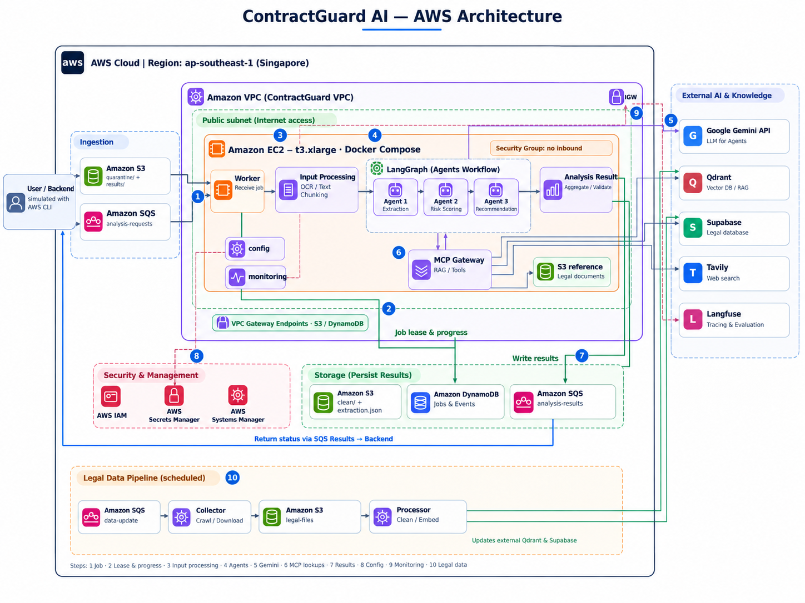

#### Bài toán

Người dùng ContractGuard tải hợp đồng lên web. Phần AI (repository này) nhận việc qua SQS, đọc file từ S3, cho ba
agent phân loại điều khoản, chấm điểm rủi ro theo pháp luật Việt Nam và đề xuất sửa điều khoản, rồi trả kết quả về
S3/SQS. Web không bao giờ gọi trực tiếp model: mọi trao đổi đi qua hàng đợi và object trên S3.

#### Kiến trúc và luồng dữ liệu

{}
📸 **Ảnh cần chụp:** Sơ đồ kiến trúc bạn tự vẽ bằng draw.io với bộ AWS Architecture Icons (có thể dùng lại ảnh ở mục Proposal). Xuất PNG, lưu đè vào `static/images/5-Workshop/5.1-Workshop-overview/architecture.png`.
{}

| # | Bước | Thành phần |
| --- | --- | --- |
| 1 | Nhận việc: long-poll `analysis-requests`, đọc `results/<job_id>/request.json` và file trong `quarantine/` | SQS, S3, `worker` |
| 2 | Giữ lease và ghi tiến độ của job | DynamoDB `contract-risk-jobs`, `contract-risk-job-events` |
| 3 | Trích text, OCR, chia chunk có vị trí nguồn | `input-processing` |
| 4 | Điều phối: Agent 1 từng chunk → tổng hợp → Agent 2 → Agent 3 | `langgraph`, `agent-1/2/3` |
| 5 | Gọi model | Google Gemini API |
| 6 | Tra cứu pháp luật (RAG hybrid + rerank, web search) | `mcp` → Qdrant, Supabase, Tavily, S3 tham chiếu |
| 7 | Tính điểm bằng Python, kiểm schema, ghi `clean/` + `extraction.json`, gửi `completed`, xóa message | `langgraph`, `worker`, S3, SQS |
| 8 | Lấy secret lúc khởi động | `config` → Secrets Manager (IAM role) |
| 9 | Gửi event mọi service, xuất trace | `monitoring` → Langfuse |
| 10 | Thu thập luật theo lịch | SQS `data-update` → collector → S3 + processor → Supabase, Qdrant |

#### Khác biệt so với môi trường thật của dự án

{}
Môi trường thật dùng **hai tài khoản AWS**: hàng đợi và bucket hợp đồng thuộc tài khoản web ContractGuard, EC2 thuộc
tài khoản AI, truy cập chéo tài khoản bằng resource policy. Để bạn tự làm lại được, workshop gộp tất cả vào **một
tài khoản** và đóng vai backend web bằng AWS CLI (tự ghi `request.json` và gửi message).
{}

+ **Subnet có Internet Gateway, Security Group không mở cổng inbound** thay cho private subnet + NAT Gateway: EC2
  vẫn không nhận kết nối nào từ ngoài, nhưng không phải trả phí NAT theo giờ. Lưu lượng tới S3 và DynamoDB đi qua
  **VPC Gateway Endpoint** (miễn phí).
+ **Không có SSH:** quản trị EC2 qua **AWS Systems Manager Session Manager**, không cần key pair hay cổng 22.
