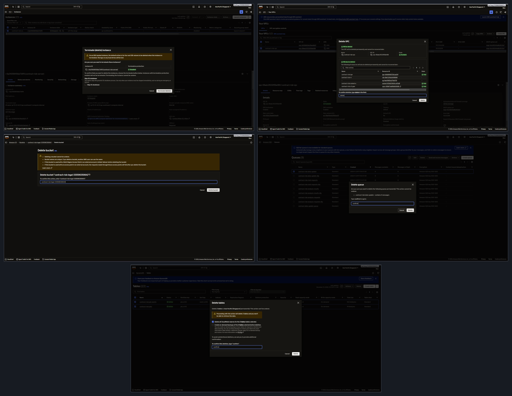
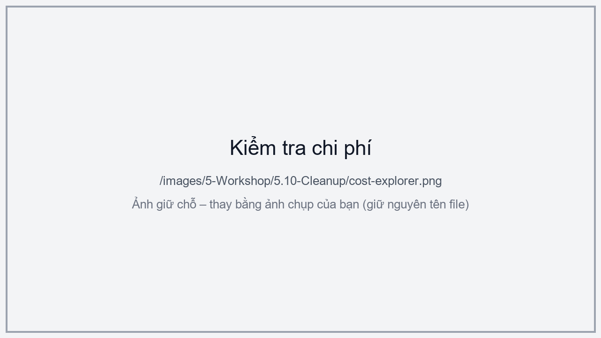

Congratulations on finishing the workshop! Delete every resource in reverse order so no cost keeps accruing.

1. On EC2 (Session Manager), stop the data pipeline and the Docker stack:


```bash
cd /opt/contract-risk-management
sudo systemctl disable --now contract-data-collector contract-data-processor
docker compose down
```


2. In CloudShell, delete the AWS resources:


```bash
source ~/cr.env
# 1. EC2
aws ec2 terminate-instances --instance-ids "$INSTANCE_ID"
aws ec2 wait instance-terminated --instance-ids "$INSTANCE_ID"
# 2. Network
for EP in $(aws ec2 describe-vpc-endpoints --filters Name=vpc-id,Values="$VPC_ID" \
            --query 'VpcEndpoints[].VpcEndpointId' --output text); do
  aws ec2 delete-vpc-endpoints --vpc-endpoint-ids "$EP"
done
aws ec2 delete-security-group --group-id "$SG_ID"
aws ec2 delete-subnet --subnet-id "$SUBNET_ID"
aws ec2 delete-route-table --route-table-id "$RT_ID"
aws ec2 detach-internet-gateway --internet-gateway-id "$IGW_ID" --vpc-id "$VPC_ID"
aws ec2 delete-internet-gateway --internet-gateway-id "$IGW_ID"
aws ec2 delete-vpc --vpc-id "$VPC_ID"
# 3. S3 (empty, then delete)
for B in "$DOCS_BUCKET" "$LEGAL_BUCKET"; do aws s3 rb "s3://$B" --force; done
# 4. SQS (main queues and DLQs)
for Q in analysis-requests analysis-results chat-requests data-update; do
  for N in "contract-risk-$Q" "contract-risk-$Q-dlq"; do
    aws sqs delete-queue --queue-url "$(aws sqs get-queue-url --queue-name "$N" --query QueueUrl --output text)"
  done
done
# 5. DynamoDB
aws dynamodb delete-table --table-name contract-risk-jobs
aws dynamodb delete-table --table-name contract-risk-job-events
# 6. Secrets Manager (immediate, no recovery window)
aws secretsmanager delete-secret --secret-id contract-risk/prod/api-keys --force-delete-without-recovery
# 7. IAM
aws iam remove-role-from-instance-profile --instance-profile-name ContractRisk-EC2-Profile --role-name ContractRisk-EC2-Role
aws iam delete-instance-profile --instance-profile-name ContractRisk-EC2-Profile
aws iam delete-role-policy --role-name ContractRisk-EC2-Role --policy-name contract-risk-runtime
aws iam detach-role-policy --role-name ContractRisk-EC2-Role --policy-arn arn:aws:iam::aws:policy/AmazonSSMManagedInstanceCore
aws iam delete-role --role-name ContractRisk-EC2-Role
rm -f ~/cr.env request.json req-*.json extraction.json
```


{}
`aws s3 rb --force` and `--force-delete-without-recovery` delete permanently and cannot be undone. Double-check the
bucket and secret names before running them.
{}

3. External services: delete the lab's Qdrant cluster and Supabase project (if you no longer need them), revoke the
   Gemini key in Google AI Studio, the Tavily key and the Langfuse keys.
4. Delete the AWS Budgets budget if you no longer need it.


{}
📸 **Screenshot to take:** Combined image: EC2 *Terminated*, the VPC list without `contract-risk-vpc`, no `contract-risk-*` resources left in S3/SQS/DynamoDB.
{}



{}
📸 **Screenshot to take:** Billing → **Cost Explorer** (or **Bills**) one day after clean-up: no service cost still growing.
{}


