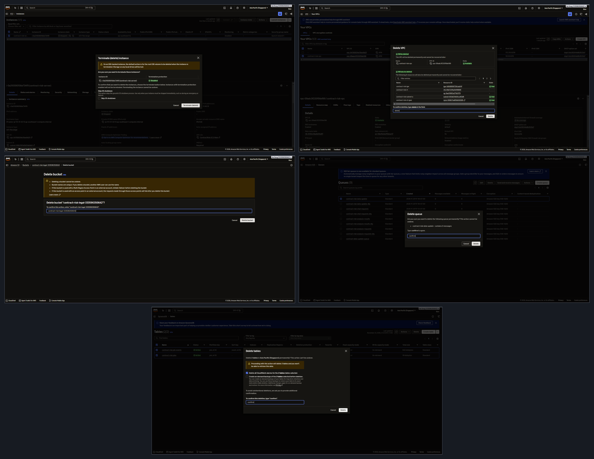
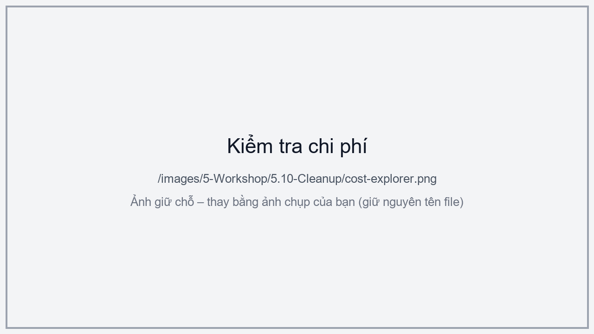

Xin chúc mừng bạn đã hoàn thành workshop! Xóa toàn bộ tài nguyên theo thứ tự ngược lại để không phát sinh chi phí.

1. Trên EC2 (Session Manager), dừng data pipeline và Docker stack:


```bash
cd /opt/contract-risk-management
sudo systemctl disable --now contract-data-collector contract-data-processor
docker compose down
```


2. Trong CloudShell, xóa tài nguyên AWS:


```bash
source ~/cr.env
# 1. EC2
aws ec2 terminate-instances --instance-ids "$INSTANCE_ID"
aws ec2 wait instance-terminated --instance-ids "$INSTANCE_ID"
# 2. Network
for EP in $(aws ec2 describe-vpc-endpoints --filters Name=vpc-id,Values="$VPC_ID" \
            --query 'VpcEndpoints[].VpcEndpointId' --output text); do
  aws ec2 delete-vpc-endpoints --vpc-endpoint-ids "$EP"
done
aws ec2 delete-security-group --group-id "$SG_ID"
aws ec2 delete-subnet --subnet-id "$SUBNET_ID"
aws ec2 delete-route-table --route-table-id "$RT_ID"
aws ec2 detach-internet-gateway --internet-gateway-id "$IGW_ID" --vpc-id "$VPC_ID"
aws ec2 delete-internet-gateway --internet-gateway-id "$IGW_ID"
aws ec2 delete-vpc --vpc-id "$VPC_ID"
# 3. S3 (empty, then delete)
for B in "$DOCS_BUCKET" "$LEGAL_BUCKET"; do aws s3 rb "s3://$B" --force; done
# 4. SQS (main queues and DLQs)
for Q in analysis-requests analysis-results chat-requests data-update; do
  for N in "contract-risk-$Q" "contract-risk-$Q-dlq"; do
    aws sqs delete-queue --queue-url "$(aws sqs get-queue-url --queue-name "$N" --query QueueUrl --output text)"
  done
done
# 5. DynamoDB
aws dynamodb delete-table --table-name contract-risk-jobs
aws dynamodb delete-table --table-name contract-risk-job-events
# 6. Secrets Manager (immediate, no recovery window)
aws secretsmanager delete-secret --secret-id contract-risk/prod/api-keys --force-delete-without-recovery
# 7. IAM
aws iam remove-role-from-instance-profile --instance-profile-name ContractRisk-EC2-Profile --role-name ContractRisk-EC2-Role
aws iam delete-instance-profile --instance-profile-name ContractRisk-EC2-Profile
aws iam delete-role-policy --role-name ContractRisk-EC2-Role --policy-name contract-risk-runtime
aws iam detach-role-policy --role-name ContractRisk-EC2-Role --policy-arn arn:aws:iam::aws:policy/AmazonSSMManagedInstanceCore
aws iam delete-role --role-name ContractRisk-EC2-Role
rm -f ~/cr.env request.json req-*.json extraction.json
```


{}
`aws s3 rb --force` và `--force-delete-without-recovery` xóa vĩnh viễn, không khôi phục được. Kiểm tra đúng tên bucket
và secret trước khi chạy.
{}

3. Dịch vụ ngoài: xóa cluster Qdrant và project Supabase của bài lab (nếu không dùng tiếp), thu hồi key Gemini trong
   Google AI Studio, key Tavily và key Langfuse.
4. Xóa budget trong AWS Budgets nếu không cần nữa.


{}
📸 **Ảnh cần chụp:** Ghép ảnh: EC2 *Terminated*, danh sách VPC không còn `contract-risk-vpc`, S3/SQS/DynamoDB không còn tài nguyên `contract-risk-*`.
{}



{}
📸 **Ảnh cần chụp:** Billing → **Cost Explorer** (hoặc **Bills**) một ngày sau khi dọn: chi phí theo dịch vụ không còn tăng.
{}


