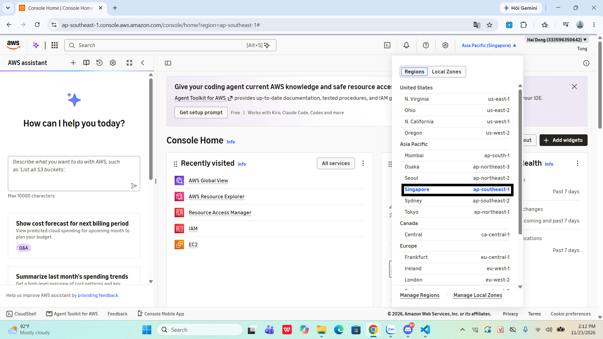
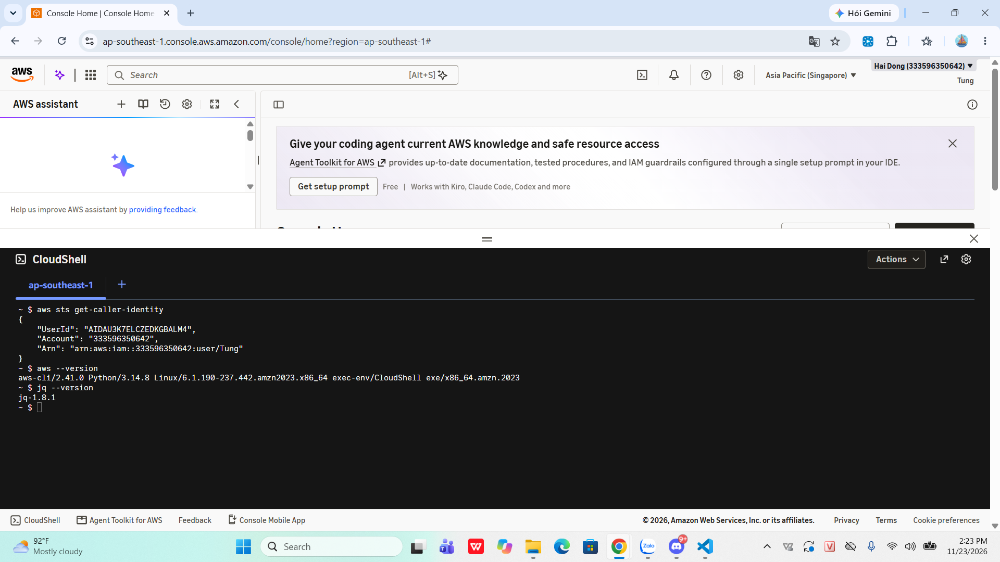
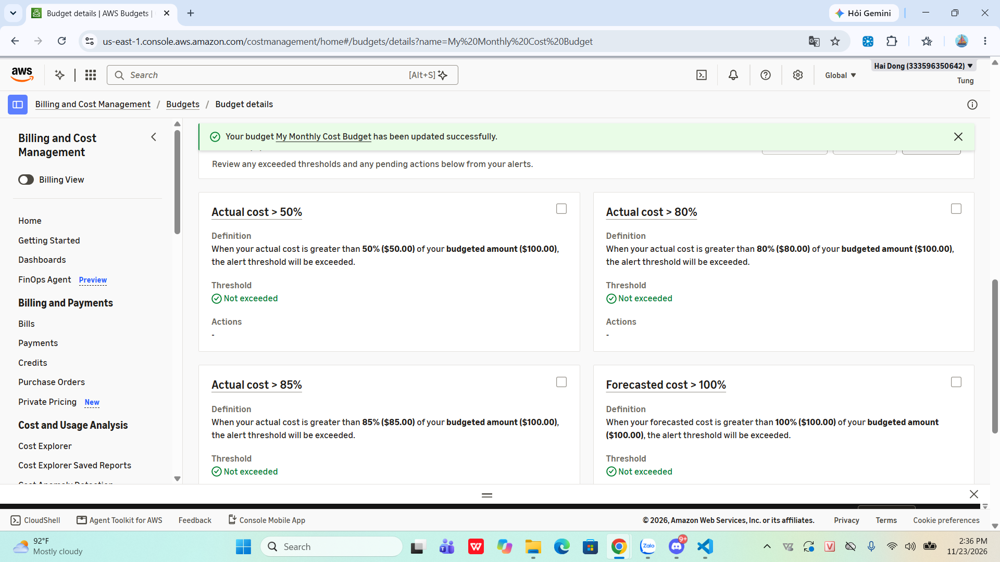
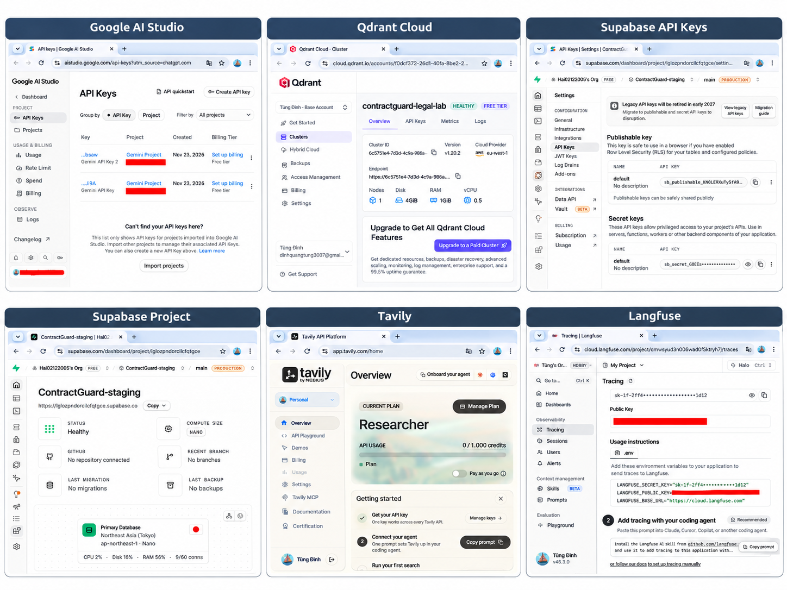

#### AWS account and permissions

+ An AWS account and an IAM user/role with administrator permissions for the lab (create VPC, EC2, IAM roles, SQS,
  S3, DynamoDB, Secrets Manager). Do not use the root user.
+ Recommended region: **ap-southeast-1 (Singapore)**. Every command in this workshop uses it.


{}
📸 **Screenshot to take:** Top right of the AWS Console, the region menu showing **Asia Pacific (Singapore) ap-southeast-1**.
{}




#### Tools

| Tool | Where | Notes |
| --- | --- | --- |
| AWS CloudShell | Creating resources, playing the web back end | Ships AWS CLI v2, `jq`, `python3`; nothing to install locally |
| Session Manager | Getting into EC2 | Built into the AWS Console, no SSH |
| Git, Docker, Docker Compose ≥ 2.24, Python 3.12 | On EC2 | Installed in step 5.5.2 |
| Browser | Console, Langfuse, Supabase, Qdrant | |

Open CloudShell (the `>_` icon in the Console top bar) and check:

```bash
aws sts get-caller-identity
aws --version
jq --version
```


{}
📸 **Screenshot to take:** The open CloudShell window after running `aws sts get-caller-identity` and `jq --version` (Account ID visible).
{}




Create a file for the variables used in later steps (CloudShell keeps the home directory between sessions):

```bash
cat > ~/cr.env <<'EOF'
export AWS_REGION=ap-southeast-1
export AWS_DEFAULT_REGION=ap-southeast-1
EOF
echo "export ACCOUNT_ID=$(aws sts get-caller-identity --query Account --output text)" >> ~/cr.env
source ~/cr.env && echo "$ACCOUNT_ID"
```

{}
Every time you reopen CloudShell, run `source ~/cr.env` before continuing.
{}

#### Cost alerts

Go to **Billing and Cost Management → Budgets → Create budget**, choose the *Monthly cost budget* template, set an
amount that fits your budget and an email alert at 50% and 80%.


{}
📸 **Screenshot to take:** Billing and Cost Management → **Budgets**: the new budget with 50% and 80% alert thresholds.
{}




#### External service accounts

| Service | What you need |
| --- | --- |
| Google AI Studio | A Gemini API key (model `gemini-3.5-flash-lite`) |
| Qdrant Cloud | A cluster (Free tier), its URL and API key |
| Supabase | A project, its `Project URL`, publishable key and secret key |
| Tavily | An API key |
| Langfuse Cloud | A project, its public and secret keys |
| GitHub | Access to clone the `contract-risk-management` repository |


{}
📸 **Screenshot to take:** One combined image: the Google AI Studio API keys page (key hidden), the Qdrant Cloud cluster, the Supabase project, the Tavily API key and the Langfuse project (all key values hidden).
{}




Also prepare a **sample contract with no real data** (a PDF with a text layer, under 20 pages) named
`sample-contract.pdf`.

{}
Never paste an API key into code, a committed file, a screenshot or an SQS message. Keys live only in Secrets Manager
or the `.env` file on EC2.
{}
