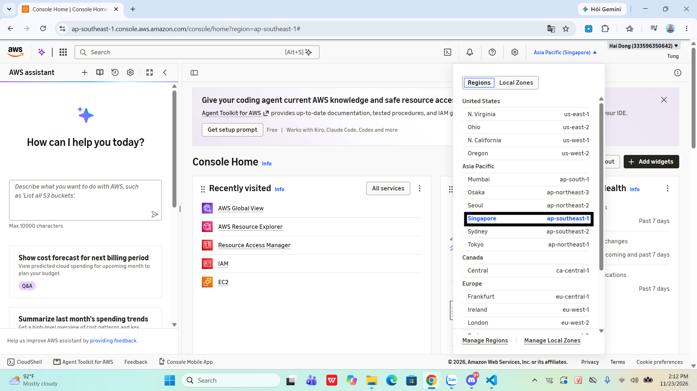
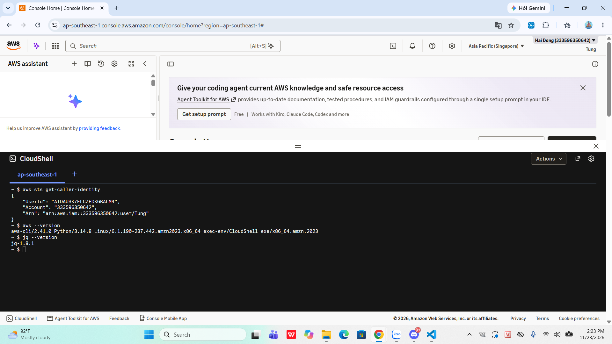
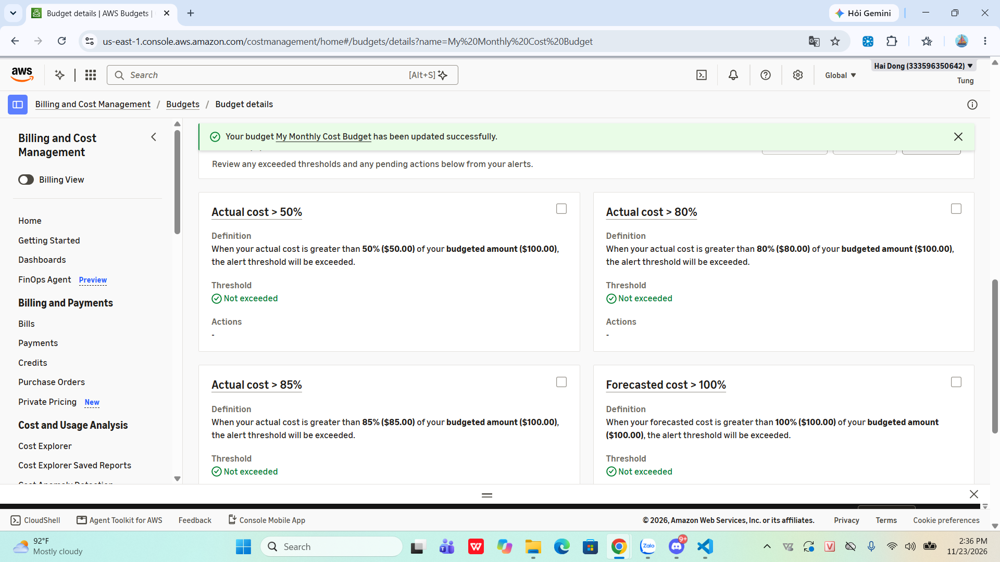
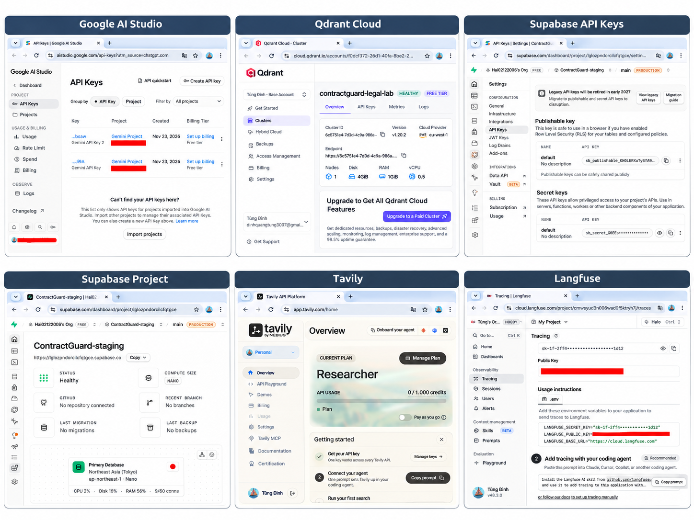

#### Tài khoản AWS và quyền

+ Một tài khoản AWS và một IAM user/role có quyền quản trị cho bài lab (tạo VPC, EC2, IAM role, SQS, S3, DynamoDB,
  Secrets Manager). Không dùng tài khoản root để làm lab.
+ Region khuyến nghị: **ap-southeast-1 (Singapore)**. Mọi lệnh trong workshop dùng region này.


{}
📸 **Ảnh cần chụp:** Góc trên bên phải AWS Console, menu region đang chọn **Asia Pacific (Singapore) ap-southeast-1**.
{}




#### Công cụ

| Công cụ | Dùng ở đâu | Ghi chú |
| --- | --- | --- |
| AWS CloudShell | Tạo tài nguyên, đóng vai backend web | Có sẵn AWS CLI v2, `jq`, `python3`; không cần cài gì trên máy |
| Session Manager | Vào EC2 | Có sẵn trong AWS Console, không cần SSH |
| Git, Docker, Docker Compose ≥ 2.24, Python 3.12 | Trên EC2 | Cài ở bước 5.5.2 |
| Trình duyệt | Console, Langfuse, Supabase, Qdrant | |

Mở CloudShell (biểu tượng `>_` trên thanh trên cùng của Console) và kiểm tra:

```bash
aws sts get-caller-identity
aws --version
jq --version
```


{}
📸 **Ảnh cần chụp:** Cửa sổ CloudShell đã mở, chạy xong lệnh `aws sts get-caller-identity` và `jq --version` (thấy Account ID).
{}




Tạo file lưu biến dùng chung cho các bước sau (CloudShell giữ thư mục home giữa các phiên):

```bash
cat > ~/cr.env <<'EOF'
export AWS_REGION=ap-southeast-1
export AWS_DEFAULT_REGION=ap-southeast-1
EOF
echo "export ACCOUNT_ID=$(aws sts get-caller-identity --query Account --output text)" >> ~/cr.env
source ~/cr.env && echo "$ACCOUNT_ID"
```

{}
Mỗi lần mở lại CloudShell, chạy `source ~/cr.env` trước khi làm tiếp.
{}

#### Cảnh báo chi phí

Vào **Billing and Cost Management → Budgets → Create budget**, chọn mẫu *Monthly cost budget*, đặt số tiền theo
ngân sách của bạn và email nhận cảnh báo ở 50% và 80%.


{}
📸 **Ảnh cần chụp:** Billing and Cost Management → **Budgets**: budget vừa tạo với ngưỡng cảnh báo 50% và 80%.
{}




#### Tài khoản dịch vụ ngoài

| Dịch vụ | Cần chuẩn bị |
| --- | --- |
| Google AI Studio | API key Gemini (dùng model `gemini-3.5-flash-lite`) |
| Qdrant Cloud | Một cluster (gói Free), URL và API key |
| Supabase | Một project, `Project URL`, publishable key và secret key |
| Tavily | API key |
| Langfuse Cloud | Một project, public key và secret key |
| GitHub | Quyền clone repository `contract-risk-management` |


{}
📸 **Ảnh cần chụp:** Ghép 1 ảnh gồm: trang API keys của Google AI Studio (che key), cluster Qdrant Cloud, project Supabase, API key Tavily và project Langfuse (che toàn bộ giá trị key).
{}




Chuẩn bị thêm một **hợp đồng mẫu không chứa dữ liệu thật** (PDF có lớp text, dưới 20 trang), đặt tên
`sample-contract.pdf`.

{}
Không bao giờ dán API key vào code, file được commit, ảnh chụp màn hình hay message SQS. Key chỉ nằm trong Secrets
Manager hoặc file `.env` trên EC2.
{}
