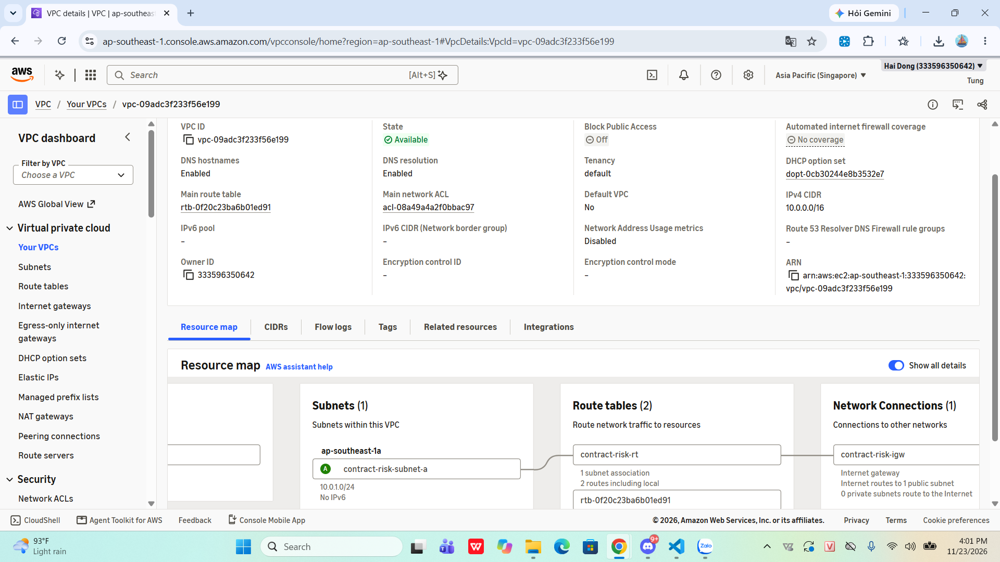
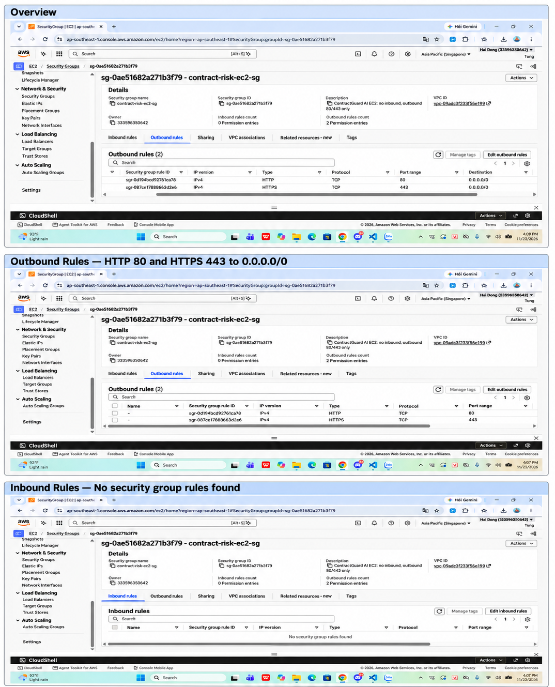

Chạy trong CloudShell.

1. Tạo VPC `10.0.0.0/16`, bật DNS hostname (cần cho Session Manager và endpoint):

```bash
source ~/cr.env
VPC_ID=$(aws ec2 create-vpc --cidr-block 10.0.0.0/16 \
  --tag-specifications 'ResourceType=vpc,Tags=[{Key=Name,Value=contract-risk-vpc}]' \
  --query Vpc.VpcId --output text)
aws ec2 modify-vpc-attribute --vpc-id "$VPC_ID" --enable-dns-hostnames '{"Value":true}'
echo "export VPC_ID=$VPC_ID" >> ~/cr.env
```

2. Tạo subnet `10.0.1.0/24` ở `ap-southeast-1a`, tự gán IPv4 public để EC2 đi ra Internet mà không cần NAT Gateway:

```bash
SUBNET_ID=$(aws ec2 create-subnet --vpc-id "$VPC_ID" --cidr-block 10.0.1.0/24 \
  --availability-zone ap-southeast-1a \
  --tag-specifications 'ResourceType=subnet,Tags=[{Key=Name,Value=contract-risk-subnet-a}]' \
  --query Subnet.SubnetId --output text)
aws ec2 modify-subnet-attribute --subnet-id "$SUBNET_ID" --map-public-ip-on-launch
echo "export SUBNET_ID=$SUBNET_ID" >> ~/cr.env
```

3. Tạo Internet Gateway, route table và route mặc định:

```bash
IGW_ID=$(aws ec2 create-internet-gateway \
  --tag-specifications 'ResourceType=internet-gateway,Tags=[{Key=Name,Value=contract-risk-igw}]' \
  --query InternetGateway.InternetGatewayId --output text)
aws ec2 attach-internet-gateway --internet-gateway-id "$IGW_ID" --vpc-id "$VPC_ID"
RT_ID=$(aws ec2 create-route-table --vpc-id "$VPC_ID" \
  --tag-specifications 'ResourceType=route-table,Tags=[{Key=Name,Value=contract-risk-rt}]' \
  --query RouteTable.RouteTableId --output text)
aws ec2 create-route --route-table-id "$RT_ID" --destination-cidr-block 0.0.0.0/0 --gateway-id "$IGW_ID"
aws ec2 associate-route-table --route-table-id "$RT_ID" --subnet-id "$SUBNET_ID"
echo "export IGW_ID=$IGW_ID RT_ID=$RT_ID" >> ~/cr.env
```


{}
📸 **Ảnh cần chụp:** VPC console → **Your VPCs** → chọn `contract-risk-vpc` → tab **Resource map**: thấy subnet, route table `contract-risk-rt` và Internet Gateway.
{}




4. Tạo Security Group: xóa luật outbound mặc định (mọi thứ), chỉ cho ra TCP 443 (AWS API, Gemini, Qdrant, Supabase,
   Tavily, Langfuse, GitHub, Docker Hub) và TCP 80 (kho gói apt của Ubuntu). **Không thêm luật inbound nào.**

```bash
SG_ID=$(aws ec2 create-security-group --group-name contract-risk-ec2-sg \
  --description "ContractGuard AI EC2: no inbound, outbound 80/443 only" --vpc-id "$VPC_ID" \
  --query GroupId --output text)
aws ec2 revoke-security-group-egress --group-id "$SG_ID" \
  --ip-permissions '[{"IpProtocol":"-1","IpRanges":[{"CidrIp":"0.0.0.0/0"}]}]'
aws ec2 authorize-security-group-egress --group-id "$SG_ID" --ip-permissions \
  '[{"IpProtocol":"tcp","FromPort":443,"ToPort":443,"IpRanges":[{"CidrIp":"0.0.0.0/0"}]},
    {"IpProtocol":"tcp","FromPort":80,"ToPort":80,"IpRanges":[{"CidrIp":"0.0.0.0/0"}]}]'
echo "export SG_ID=$SG_ID" >> ~/cr.env
```

{}
9 container nói chuyện với nhau qua Docker network `backend` bên trong máy, nên không cần mở cổng nào. Service
monitoring chỉ bind `127.0.0.1:8099` cho data pipeline trên cùng máy.
{}


{}
📸 **Ảnh cần chụp:** EC2 console → **Security Groups** → `contract-risk-ec2-sg`: tab **Inbound rules** trống, tab **Outbound rules** chỉ có TCP 80 và 443.
{}


