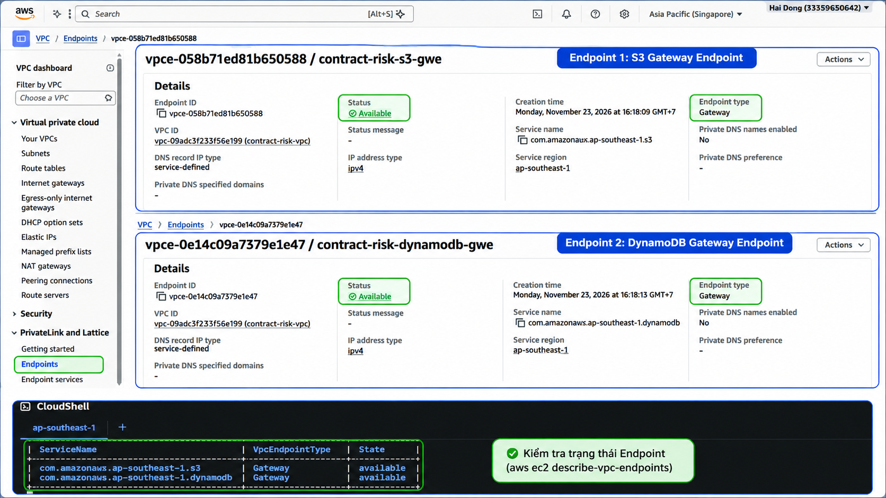
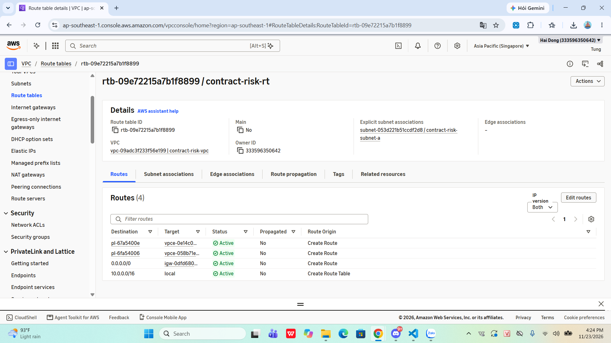

The worker reads and writes S3 and DynamoDB constantly. A Gateway Endpoint adds a route to the service prefix list in
the route table, so traffic stays on the AWS network instead of the Internet Gateway, at no charge.

1. Create endpoints for S3 and DynamoDB attached to the subnet's route table:

```bash
source ~/cr.env
for SVC in s3 dynamodb; do
  aws ec2 create-vpc-endpoint --vpc-id "$VPC_ID" --vpc-endpoint-type Gateway \
    --service-name "com.amazonaws.$AWS_REGION.$SVC" --route-table-ids "$RT_ID" \
    --tag-specifications "ResourceType=vpc-endpoint,Tags=[{Key=Name,Value=contract-risk-$SVC-gwe}]" \
    --query VpcEndpoint.VpcEndpointId --output text
done
```

2. Check their state:

```bash
aws ec2 describe-vpc-endpoints --filters Name=vpc-id,Values="$VPC_ID" \
  --query 'VpcEndpoints[].[ServiceName,VpcEndpointType,State]' --output table
```


{}
📸 **Screenshot to take:** VPC console → **Endpoints**: the `com.amazonaws.ap-southeast-1.s3` and `...dynamodb` endpoints, type **Gateway**, status **Available**.
{}



{}
📸 **Screenshot to take:** VPC console → **Route tables** → `contract-risk-rt` → **Routes** tab: two `pl-...` destinations pointing to `vpce-...` next to the `0.0.0.0/0` → `igw-...` route.
{}




{}
SQS, Secrets Manager and the external APIs still go through the Internet Gateway (TLS). To move EC2 into a fully
private subnet you would add Interface Endpoints for SQS, Secrets Manager and SSM plus a NAT Gateway for
Gemini/Qdrant/Supabase; both are billed per hour (see the Cost estimation section).
{}
