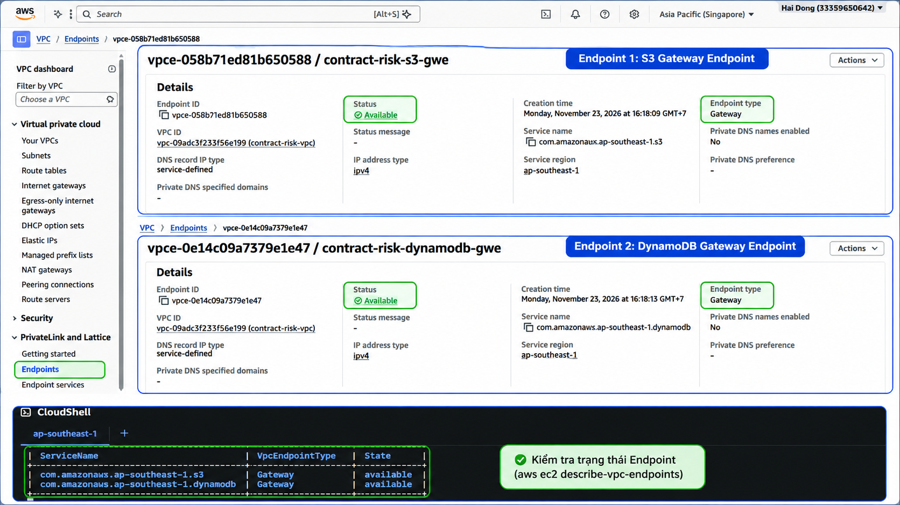
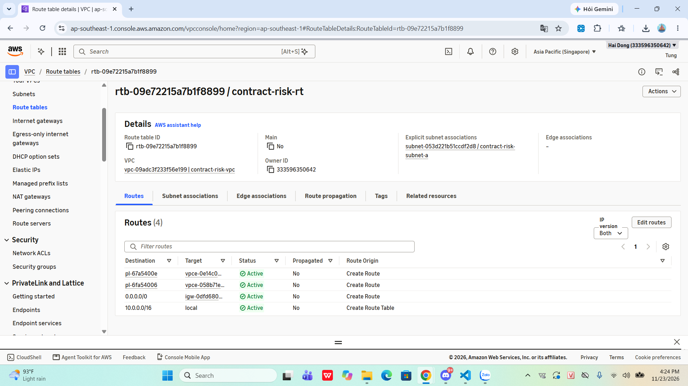

Worker đọc/ghi S3 và DynamoDB liên tục. Gateway Endpoint thêm route tới prefix list của dịch vụ vào route table, nên
lưu lượng đi trong mạng AWS thay vì qua Internet Gateway, và không tính phí.

1. Tạo endpoint cho S3 và DynamoDB, gắn vào route table của subnet:

```bash
source ~/cr.env
for SVC in s3 dynamodb; do
  aws ec2 create-vpc-endpoint --vpc-id "$VPC_ID" --vpc-endpoint-type Gateway \
    --service-name "com.amazonaws.$AWS_REGION.$SVC" --route-table-ids "$RT_ID" \
    --tag-specifications "ResourceType=vpc-endpoint,Tags=[{Key=Name,Value=contract-risk-$SVC-gwe}]" \
    --query VpcEndpoint.VpcEndpointId --output text
done
```

2. Kiểm tra trạng thái:

```bash
aws ec2 describe-vpc-endpoints --filters Name=vpc-id,Values="$VPC_ID" \
  --query 'VpcEndpoints[].[ServiceName,VpcEndpointType,State]' --output table
```


{}
📸 **Ảnh cần chụp:** VPC console → **Endpoints**: hai endpoint `com.amazonaws.ap-southeast-1.s3` và `...dynamodb`, loại **Gateway**, trạng thái **Available**.
{}



{}
📸 **Ảnh cần chụp:** VPC console → **Route tables** → `contract-risk-rt` → tab **Routes**: hai dòng đích `pl-...` trỏ tới `vpce-...` cùng route `0.0.0.0/0` → `igw-...`.
{}




{}
SQS, Secrets Manager và các API bên ngoài vẫn đi qua Internet Gateway (TLS). Muốn đưa EC2 vào private subnet hoàn
toàn, bạn cần thêm Interface Endpoint cho SQS, Secrets Manager, SSM và một NAT Gateway cho Gemini/Qdrant/Supabase;
hai thành phần này tính phí theo giờ (xem phần Dự toán chi phí).
{}
