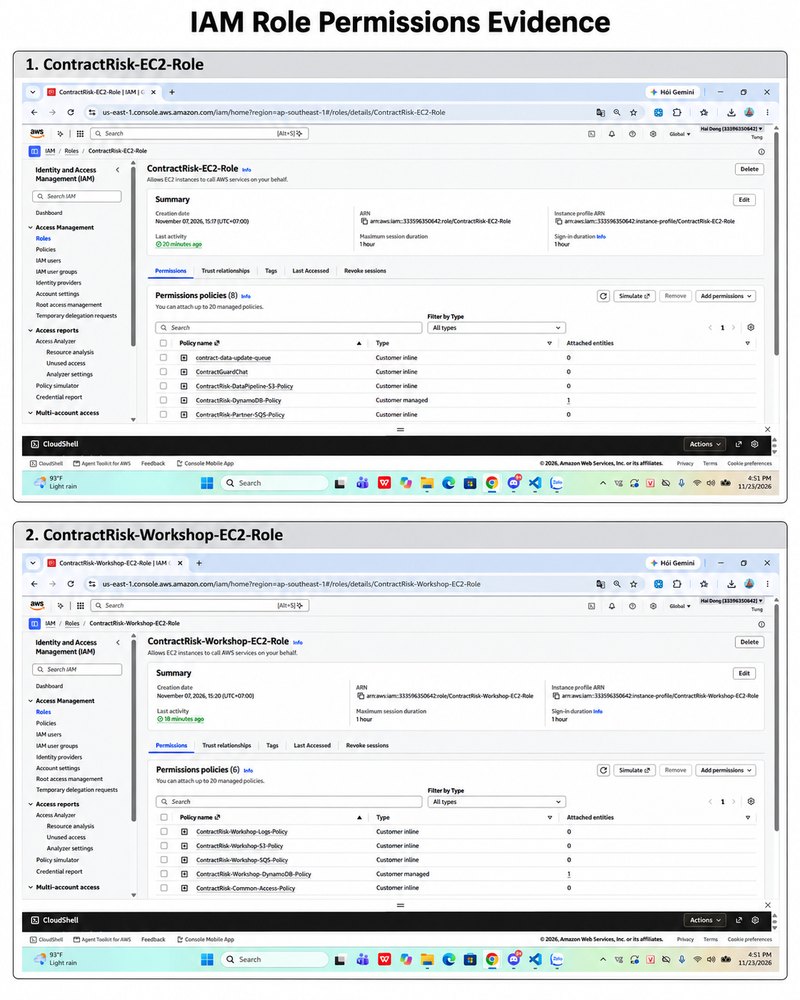
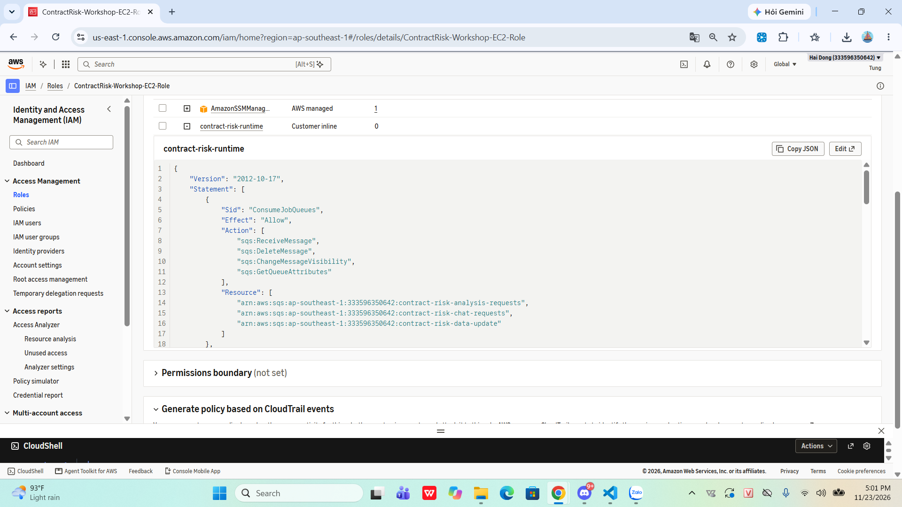

EC2 uses no access key. Containers get temporary credentials of the **instance role** through IMDSv2. The policy below
grants only the operations the code calls: the worker reads `quarantine/`, `clean/` and `request.json`, writes only
`clean/` and `extraction.json`, deletes only in `quarantine/`; DynamoDB only `GetItem`/`PutItem`/`UpdateItem`/
`DescribeTable` on two tables; Secrets Manager only reads one secret.

1. Create the policy file (bucket/queue/table names are the ones created in part 5.4):


```bash
source ~/cr.env
cat > /tmp/runtime-policy.json <<EOF
{
  "Version": "2012-10-17",
  "Statement": [
    {"Sid": "ConsumeJobQueues", "Effect": "Allow",
     "Action": ["sqs:ReceiveMessage", "sqs:DeleteMessage", "sqs:ChangeMessageVisibility", "sqs:GetQueueAttributes"],
     "Resource": ["arn:aws:sqs:$AWS_REGION:$ACCOUNT_ID:contract-risk-analysis-requests",
                  "arn:aws:sqs:$AWS_REGION:$ACCOUNT_ID:contract-risk-chat-requests",
                  "arn:aws:sqs:$AWS_REGION:$ACCOUNT_ID:contract-risk-data-update"]},
    {"Sid": "PublishResults", "Effect": "Allow", "Action": "sqs:SendMessage",
     "Resource": "arn:aws:sqs:$AWS_REGION:$ACCOUNT_ID:contract-risk-analysis-results"},
    {"Sid": "ReadJobInputs", "Effect": "Allow", "Action": "s3:GetObject",
     "Resource": ["arn:aws:s3:::contract-risk-docs-$ACCOUNT_ID/quarantine/*",
                  "arn:aws:s3:::contract-risk-docs-$ACCOUNT_ID/clean/*",
                  "arn:aws:s3:::contract-risk-docs-$ACCOUNT_ID/results/*/request.json"]},
    {"Sid": "WriteJobOutputs", "Effect": "Allow", "Action": "s3:PutObject",
     "Resource": ["arn:aws:s3:::contract-risk-docs-$ACCOUNT_ID/clean/*",
                  "arn:aws:s3:::contract-risk-docs-$ACCOUNT_ID/results/*/extraction.json"]},
    {"Sid": "RemoveQuarantined", "Effect": "Allow", "Action": "s3:DeleteObject",
     "Resource": "arn:aws:s3:::contract-risk-docs-$ACCOUNT_ID/quarantine/*"},
    {"Sid": "LegalBucketList", "Effect": "Allow", "Action": "s3:ListBucket",
     "Resource": "arn:aws:s3:::contract-risk-legal-$ACCOUNT_ID"},
    {"Sid": "LegalBucketRead", "Effect": "Allow", "Action": "s3:GetObject",
     "Resource": "arn:aws:s3:::contract-risk-legal-$ACCOUNT_ID/*"},
    {"Sid": "LegalBucketWrite", "Effect": "Allow", "Action": "s3:PutObject",
     "Resource": "arn:aws:s3:::contract-risk-legal-$ACCOUNT_ID/legal/*"},
    {"Sid": "JobStateTables", "Effect": "Allow",
     "Action": ["dynamodb:GetItem", "dynamodb:PutItem", "dynamodb:UpdateItem", "dynamodb:DescribeTable"],
     "Resource": ["arn:aws:dynamodb:$AWS_REGION:$ACCOUNT_ID:table/contract-risk-jobs",
                  "arn:aws:dynamodb:$AWS_REGION:$ACCOUNT_ID:table/contract-risk-job-events"]},
    {"Sid": "ReadProjectApiKeys", "Effect": "Allow", "Action": "secretsmanager:GetSecretValue",
     "Resource": "arn:aws:secretsmanager:$AWS_REGION:$ACCOUNT_ID:secret:contract-risk/prod/api-keys-*"}
  ]
}
EOF
jq . /tmp/runtime-policy.json > /dev/null && echo "policy JSON OK"
```


2. Create the role, attach the Session Manager managed policy and the inline policy, create the instance profile:


```bash
cat > /tmp/ec2-trust.json <<'EOF'
{"Version": "2012-10-17",
 "Statement": [{"Effect": "Allow", "Principal": {"Service": "ec2.amazonaws.com"}, "Action": "sts:AssumeRole"}]}
EOF
aws iam create-role --role-name ContractRisk-EC2-Role --assume-role-policy-document file:///tmp/ec2-trust.json
aws iam attach-role-policy --role-name ContractRisk-EC2-Role \
  --policy-arn arn:aws:iam::aws:policy/AmazonSSMManagedInstanceCore
aws iam put-role-policy --role-name ContractRisk-EC2-Role --policy-name contract-risk-runtime \
  --policy-document file:///tmp/runtime-policy.json
aws iam create-instance-profile --instance-profile-name ContractRisk-EC2-Profile
aws iam add-role-to-instance-profile --instance-profile-name ContractRisk-EC2-Profile \
  --role-name ContractRisk-EC2-Role
```

{}
📸 **Screenshot to take:** IAM console → **Roles** → `ContractRisk-EC2-Role` → **Permissions** tab: `AmazonSSMManagedInstanceCore` and the `contract-risk-runtime` inline policy visible.
{}



{}
📸 **Screenshot to take:** Open the `contract-risk-runtime` inline policy in **JSON** view (scrolled to the `ConsumeJobQueues`, `WriteJobOutputs`, `JobStateTables` Sids).
{}




{}
Reference: the repository's sample policies are in `infrastructure/aws/` (`config-secrets-policy.json`,
`mcp-s3-readonly-policy.json`, `data-pipeline-policy.json`). The policy above merges them and swaps in the lab's
account and resource names.
{}
