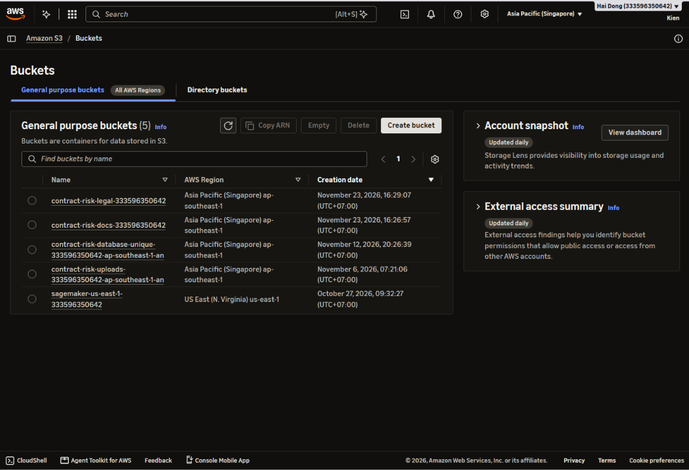
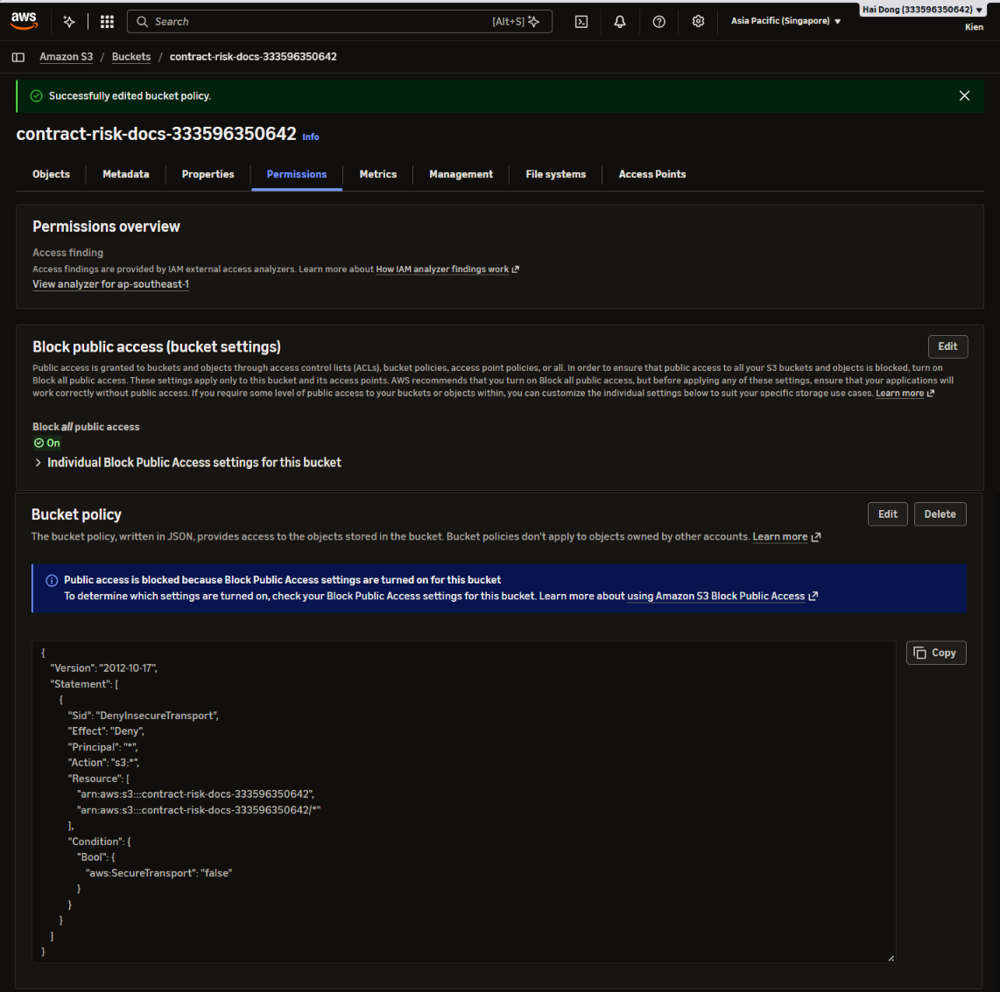

`contract-risk-docs-*` holds contract files and results in the `quarantine/`, `clean/`, `results/<job_id>/` layout.
`contract-risk-legal-*` holds original legal documents under the `legal/` prefix. Both block public access, use
SSE-S3 encryption (the default) and reject any request that does not use HTTPS.

1. Create both buckets:


```bash
source ~/cr.env
echo "export DOCS_BUCKET=contract-risk-docs-$ACCOUNT_ID LEGAL_BUCKET=contract-risk-legal-$ACCOUNT_ID" >> ~/cr.env
source ~/cr.env
for B in "$DOCS_BUCKET" "$LEGAL_BUCKET"; do
  aws s3api create-bucket --bucket "$B" --create-bucket-configuration LocationConstraint="$AWS_REGION"
  aws s3api put-public-access-block --bucket "$B" --public-access-block-configuration \
    BlockPublicAcls=true,IgnorePublicAcls=true,BlockPublicPolicy=true,RestrictPublicBuckets=true
  cat > /tmp/tls-only.json <<EOF
{"Version": "2012-10-17", "Statement": [{"Sid": "DenyInsecureTransport", "Effect": "Deny", "Principal": "*",
  "Action": "s3:*", "Resource": ["arn:aws:s3:::$B", "arn:aws:s3:::$B/*"],
  "Condition": {"Bool": {"aws:SecureTransport": "false"}}}]}
EOF
  aws s3api put-bucket-policy --bucket "$B" --policy file:///tmp/tls-only.json
done
```

{}
📸 **Screenshot to take:** S3 console → **Buckets**: the `contract-risk-docs-...` and `contract-risk-legal-...` buckets in Asia Pacific (Singapore).
{}



{}
📸 **Screenshot to take:** Open the `contract-risk-docs-...` bucket → **Permissions** tab: *Block all public access* = **On** and the `DenyInsecureTransport` bucket policy.
{}




2. (Cost optimisation, optional) Expire files left in `quarantine/` after 7 days:


```bash
cat > /tmp/lifecycle.json <<'EOF'
{"Rules": [{"ID": "expire-quarantine", "Status": "Enabled", "Filter": {"Prefix": "quarantine/"},
            "Expiration": {"Days": 7}}]}
EOF
aws s3api put-bucket-lifecycle-configuration --bucket "$DOCS_BUCKET" --lifecycle-configuration file:///tmp/lifecycle.json
```
