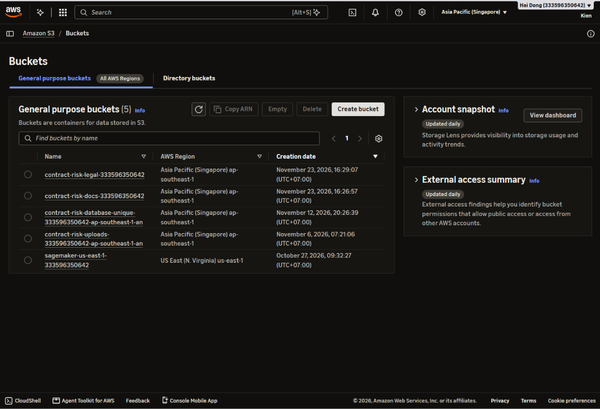
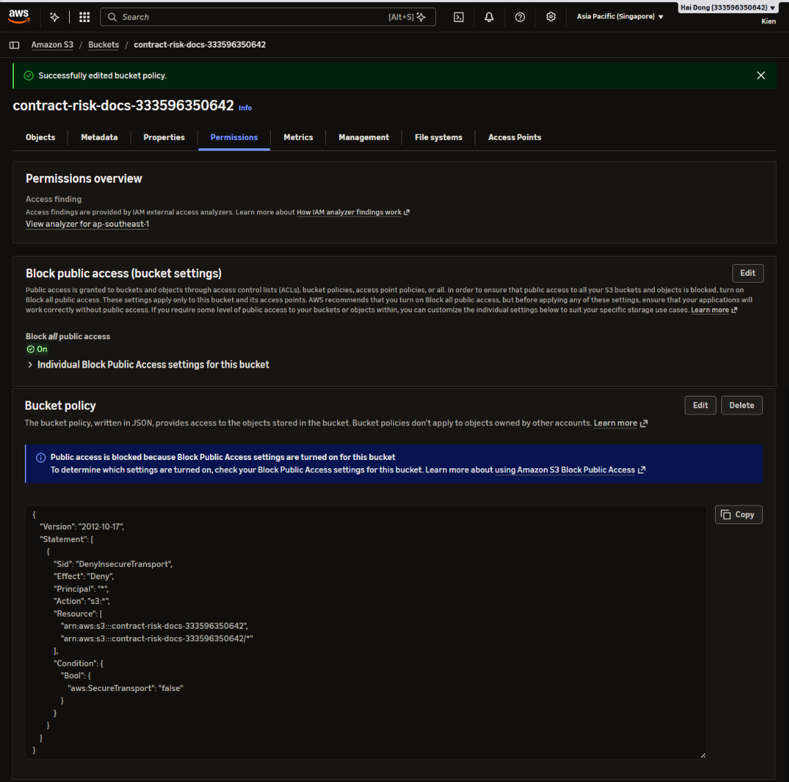

`contract-risk-docs-*` chứa file hợp đồng và kết quả theo bố cục `quarantine/`, `clean/`, `results/<job_id>/`.
`contract-risk-legal-*` chứa văn bản luật gốc dưới prefix `legal/`. Cả hai chặn public, mã hóa SSE-S3 (mặc định) và
từ chối mọi request không dùng HTTPS.

1. Tạo hai bucket:


```bash
source ~/cr.env
echo "export DOCS_BUCKET=contract-risk-docs-$ACCOUNT_ID LEGAL_BUCKET=contract-risk-legal-$ACCOUNT_ID" >> ~/cr.env
source ~/cr.env
for B in "$DOCS_BUCKET" "$LEGAL_BUCKET"; do
  aws s3api create-bucket --bucket "$B" --create-bucket-configuration LocationConstraint="$AWS_REGION"
  aws s3api put-public-access-block --bucket "$B" --public-access-block-configuration \
    BlockPublicAcls=true,IgnorePublicAcls=true,BlockPublicPolicy=true,RestrictPublicBuckets=true
  cat > /tmp/tls-only.json <<EOF
{"Version": "2012-10-17", "Statement": [{"Sid": "DenyInsecureTransport", "Effect": "Deny", "Principal": "*",
  "Action": "s3:*", "Resource": ["arn:aws:s3:::$B", "arn:aws:s3:::$B/*"],
  "Condition": {"Bool": {"aws:SecureTransport": "false"}}}]}
EOF
  aws s3api put-bucket-policy --bucket "$B" --policy file:///tmp/tls-only.json
done
```

{}
📸 **Ảnh cần chụp:** S3 console → **Buckets**: hai bucket `contract-risk-docs-...` và `contract-risk-legal-...` ở region Asia Pacific (Singapore).
{}



{}
📸 **Ảnh cần chụp:** Mở bucket `contract-risk-docs-...` → tab **Permissions**: *Block all public access* = **On** và bucket policy `DenyInsecureTransport`.
{}




2. (Tối ưu chi phí, tùy chọn) Tự xóa file còn sót trong `quarantine/` sau 7 ngày:


```bash
cat > /tmp/lifecycle.json <<'EOF'
{"Rules": [{"ID": "expire-quarantine", "Status": "Enabled", "Filter": {"Prefix": "quarantine/"},
            "Expiration": {"Days": 7}}]}
EOF
aws s3api put-bucket-lifecycle-configuration --bucket "$DOCS_BUCKET" --lifecycle-configuration file:///tmp/lifecycle.json
```
