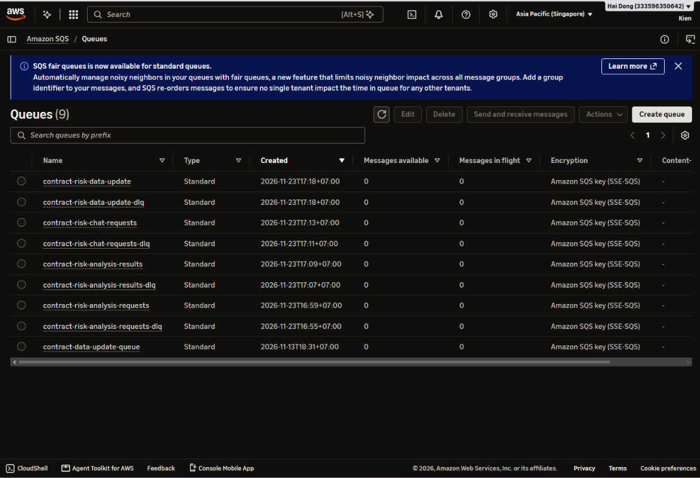
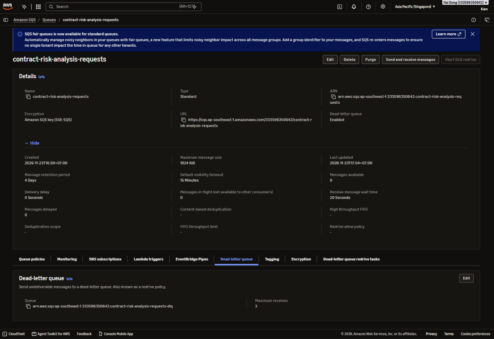

| Queue | Sender → receiver | Visibility timeout |
| --- | --- | --- |
| `contract-risk-analysis-requests` | Web (you, via CLI) → worker | 900 s: long jobs, the worker extends it |
| `contract-risk-analysis-results` | Worker → web (`progress`, `completed`, `failed`, `pong`, `chat_answered`) | 60 s |
| `contract-risk-chat-requests` | Web → the worker's chat process | 300 s |
| `contract-risk-data-update` | Collection schedule → collector (`{"mode":"incremental"}`) | 900 s |

A message received more than 3 times without being deleted moves to the DLQ, so one bad message cannot make the
worker loop forever.


```bash
source ~/cr.env
make_queue() {  # $1 = queue name, $2 = visibility timeout (seconds)
  local dlq_url dlq_arn
  dlq_url=$(aws sqs create-queue --queue-name "$1-dlq" --attributes SqsManagedSseEnabled=true \
    --query QueueUrl --output text)
  dlq_arn=$(aws sqs get-queue-attributes --queue-url "$dlq_url" --attribute-names QueueArn \
    --query Attributes.QueueArn --output text)
  cat > /tmp/attrs.json <<EOF
{"VisibilityTimeout": "$2", "ReceiveMessageWaitTimeSeconds": "20", "SqsManagedSseEnabled": "true",
 "RedrivePolicy": "{\"deadLetterTargetArn\":\"$dlq_arn\",\"maxReceiveCount\":\"3\"}"}
EOF
  aws sqs create-queue --queue-name "$1" --attributes file:///tmp/attrs.json --query QueueUrl --output text
}
REQ_URL=$(make_queue contract-risk-analysis-requests 900)
RES_URL=$(make_queue contract-risk-analysis-results 60)
CHAT_URL=$(make_queue contract-risk-chat-requests 300)
DATA_URL=$(make_queue contract-risk-data-update 900)
echo "export REQ_URL=$REQ_URL RES_URL=$RES_URL CHAT_URL=$CHAT_URL DATA_URL=$DATA_URL" >> ~/cr.env
aws sqs list-queues --queue-name-prefix contract-risk --output table
```

{}
📸 **Screenshot to take:** SQS console → **Queues**, filtered by `contract-risk`: 4 main queues and 4 `-dlq` queues, *Encryption* = SSE-SQS.
{}



{}
📸 **Screenshot to take:** Open `contract-risk-analysis-requests` → **Dead-letter queue** tab: points to `...-dlq`, *Maximum receives* = 3; **Details** tab: *Visibility timeout* = 15 minutes.
{}


