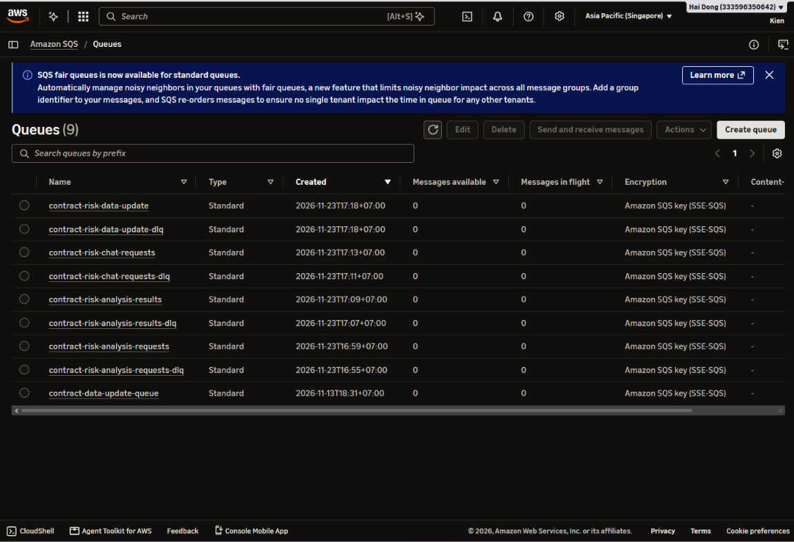
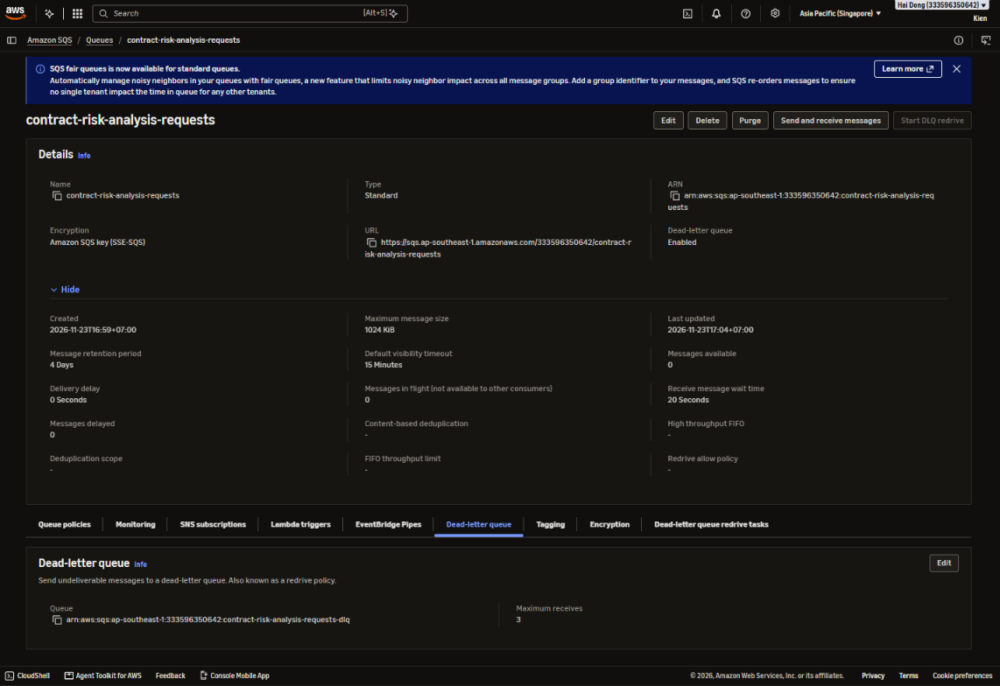

| Queue | Ai gửi → ai nhận | Visibility timeout |
| --- | --- | --- |
| `contract-risk-analysis-requests` | Web (bạn, qua CLI) → worker | 900 s: job dài, worker tự gia hạn |
| `contract-risk-analysis-results` | Worker → web (`progress`, `completed`, `failed`, `pong`, `chat_answered`) | 60 s |
| `contract-risk-chat-requests` | Web → chat process của worker | 300 s |
| `contract-risk-data-update` | Lịch thu thập → collector (`{"mode":"incremental"}`) | 900 s |

Message nhận quá 3 lần chưa xóa được sẽ chuyển sang DLQ, để một message lỗi không làm worker xử lý lặp mãi.


```bash
source ~/cr.env
make_queue() {  # $1 = queue name, $2 = visibility timeout (seconds)
  local dlq_url dlq_arn
  dlq_url=$(aws sqs create-queue --queue-name "$1-dlq" --attributes SqsManagedSseEnabled=true \
    --query QueueUrl --output text)
  dlq_arn=$(aws sqs get-queue-attributes --queue-url "$dlq_url" --attribute-names QueueArn \
    --query Attributes.QueueArn --output text)
  cat > /tmp/attrs.json <<EOF
{"VisibilityTimeout": "$2", "ReceiveMessageWaitTimeSeconds": "20", "SqsManagedSseEnabled": "true",
 "RedrivePolicy": "{\"deadLetterTargetArn\":\"$dlq_arn\",\"maxReceiveCount\":\"3\"}"}
EOF
  aws sqs create-queue --queue-name "$1" --attributes file:///tmp/attrs.json --query QueueUrl --output text
}
REQ_URL=$(make_queue contract-risk-analysis-requests 900)
RES_URL=$(make_queue contract-risk-analysis-results 60)
CHAT_URL=$(make_queue contract-risk-chat-requests 300)
DATA_URL=$(make_queue contract-risk-data-update 900)
echo "export REQ_URL=$REQ_URL RES_URL=$RES_URL CHAT_URL=$CHAT_URL DATA_URL=$DATA_URL" >> ~/cr.env
aws sqs list-queues --queue-name-prefix contract-risk --output table
```

{}
📸 **Ảnh cần chụp:** SQS console → **Queues**, lọc `contract-risk`: 4 queue chính và 4 queue `-dlq`, cột *Encryption* = SSE-SQS.
{}



{}
📸 **Ảnh cần chụp:** Mở queue `contract-risk-analysis-requests` → tab **Dead-letter queue**: trỏ tới `...-dlq`, *Maximum receives* = 3; tab **Details**: *Visibility timeout* = 15 phút.
{}


