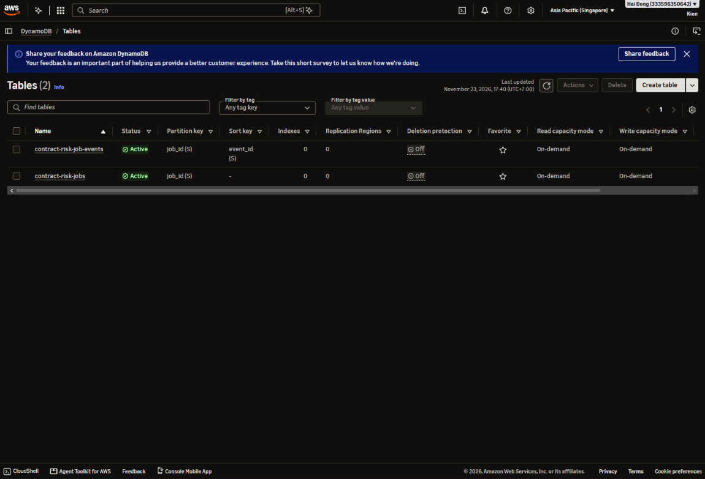

`contract-risk-jobs` holds the current state of each contract (key `contract:<contract_id>`): runtime, lease, stage,
progress. `contract-risk-job-events` holds the append-only history. The worker checks the key schema at start-up
(`DescribeTable`) and writes with conditional transactions so an old owner cannot overwrite a new one when SQS
redelivers a message.


```bash
source ~/cr.env
aws dynamodb create-table --table-name contract-risk-jobs \
  --attribute-definitions AttributeName=job_id,AttributeType=S \
  --key-schema AttributeName=job_id,KeyType=HASH --billing-mode PAY_PER_REQUEST
aws dynamodb create-table --table-name contract-risk-job-events \
  --attribute-definitions AttributeName=job_id,AttributeType=S AttributeName=event_id,AttributeType=S \
  --key-schema AttributeName=job_id,KeyType=HASH AttributeName=event_id,KeyType=RANGE \
  --billing-mode PAY_PER_REQUEST
aws dynamodb wait table-exists --table-name contract-risk-jobs
aws dynamodb wait table-exists --table-name contract-risk-job-events
aws dynamodb list-tables --query 'TableNames[?starts_with(@, `contract-risk`)]'
```

{}
📸 **Screenshot to take:** DynamoDB console → **Tables**: `contract-risk-jobs` (partition key `job_id`) and `contract-risk-job-events` (partition key `job_id`, sort key `event_id`), *Capacity mode* = On-demand, status **Active**.
{}


