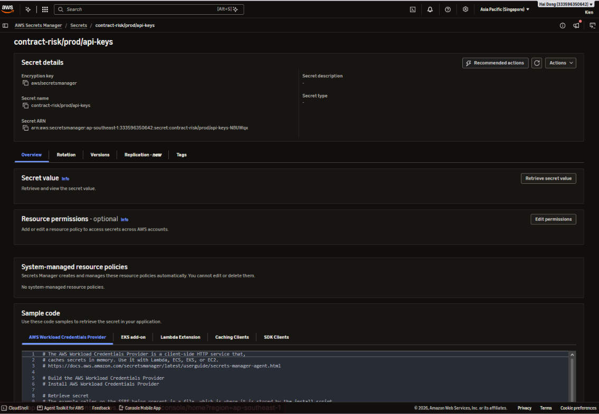

The `config` service reads this JSON secret at start-up and gives each service **only the keys it is allowed**
(`config/policy.json`): for example only `mcp` receives the Qdrant/Supabase/Tavily keys and only `monitoring` receives
the Langfuse keys. The commands read keys with `read -s` (not echoed, not stored in shell history) and generate the two
internal tokens randomly.


```bash
source ~/cr.env
read -rsp "Tavily API key: " TAVILY && echo
read -rp  "Qdrant URL: " QDRANT_URL
read -rsp "Qdrant API key: " QDRANT_KEY && echo
read -rp  "Supabase Project URL: " SUPABASE_URL
read -rsp "Supabase publishable key: " SUPABASE_PUB && echo
read -rsp "Supabase secret key: " SUPABASE_SECRET && echo
read -rsp "Langfuse public key: " LF_PUBLIC && echo
read -rsp "Langfuse secret key: " LF_SECRET && echo
umask 077
jq -n --arg internal "$(openssl rand -hex 32)" --arg mcp "$(openssl rand -hex 32)" \
  --arg tavily "$TAVILY" --arg qurl "$QDRANT_URL" --arg qkey "$QDRANT_KEY" \
  --arg surl "$SUPABASE_URL" --arg spub "$SUPABASE_PUB" --arg ssec "$SUPABASE_SECRET" \
  --arg lpub "$LF_PUBLIC" --arg lsec "$LF_SECRET" \
  '{INTERNAL_API_TOKEN:$internal, MCP_API_TOKEN:$mcp, TAVILY_API_KEY:$tavily,
    QDRANT_URL:$qurl, QDRANT_API_KEY:$qkey, SUPABASE_URL:$surl, SUPABASE_PUBLISHABLE_KEY:$spub,
    SUPABASE_SECRET_KEY:$ssec, LANGFUSE_PUBLIC_KEY:$lpub, LANGFUSE_SECRET_KEY:$lsec}' > /tmp/api-keys.json
aws secretsmanager create-secret --name contract-risk/prod/api-keys \
  --description "ContractGuard AI service keys" --secret-string file:///tmp/api-keys.json
shred -u /tmp/api-keys.json
unset TAVILY QDRANT_KEY SUPABASE_PUB SUPABASE_SECRET LF_PUBLIC LF_SECRET
```


{}
The Gemini key is **not** in this secret: the code only reads `GEMINI_API_KEY` from the `.env` file on EC2
(step 5.5.2). Never write a key into a committed file.
{}


{}
📸 **Screenshot to take:** Secrets Manager console → `contract-risk/prod/api-keys` → the **Secret value** section in *Key/value* view **without clicking Retrieve secret value** (the 10 key names only, no values).
{}


