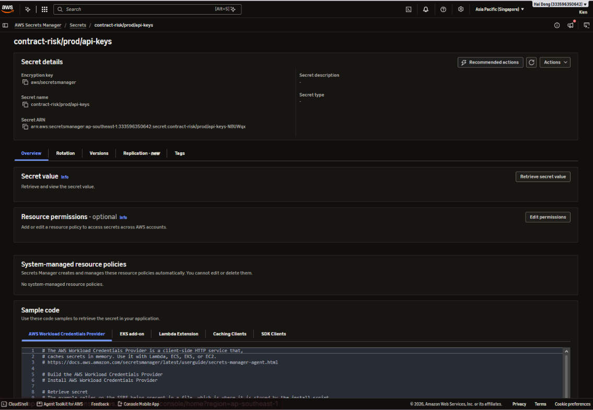

Service `config` đọc secret JSON này lúc khởi động và cấp cho từng service **đúng những khóa nó được phép**
(`config/policy.json`): ví dụ chỉ `mcp` nhận key Qdrant/Supabase/Tavily, chỉ `monitoring` nhận key Langfuse. Lệnh
dưới nhập key bằng `read -s` (không hiện trên màn hình, không lưu vào lịch sử shell) và sinh ngẫu nhiên hai token nội bộ.


```bash
source ~/cr.env
read -rsp "Tavily API key: " TAVILY && echo
read -rp  "Qdrant URL: " QDRANT_URL
read -rsp "Qdrant API key: " QDRANT_KEY && echo
read -rp  "Supabase Project URL: " SUPABASE_URL
read -rsp "Supabase publishable key: " SUPABASE_PUB && echo
read -rsp "Supabase secret key: " SUPABASE_SECRET && echo
read -rsp "Langfuse public key: " LF_PUBLIC && echo
read -rsp "Langfuse secret key: " LF_SECRET && echo
umask 077
jq -n --arg internal "$(openssl rand -hex 32)" --arg mcp "$(openssl rand -hex 32)" \
  --arg tavily "$TAVILY" --arg qurl "$QDRANT_URL" --arg qkey "$QDRANT_KEY" \
  --arg surl "$SUPABASE_URL" --arg spub "$SUPABASE_PUB" --arg ssec "$SUPABASE_SECRET" \
  --arg lpub "$LF_PUBLIC" --arg lsec "$LF_SECRET" \
  '{INTERNAL_API_TOKEN:$internal, MCP_API_TOKEN:$mcp, TAVILY_API_KEY:$tavily,
    QDRANT_URL:$qurl, QDRANT_API_KEY:$qkey, SUPABASE_URL:$surl, SUPABASE_PUBLISHABLE_KEY:$spub,
    SUPABASE_SECRET_KEY:$ssec, LANGFUSE_PUBLIC_KEY:$lpub, LANGFUSE_SECRET_KEY:$lsec}' > /tmp/api-keys.json
aws secretsmanager create-secret --name contract-risk/prod/api-keys \
  --description "ContractGuard AI service keys" --secret-string file:///tmp/api-keys.json
shred -u /tmp/api-keys.json
unset TAVILY QDRANT_KEY SUPABASE_PUB SUPABASE_SECRET LF_PUBLIC LF_SECRET
```


{}
Key Gemini **không** nằm trong secret này: code chỉ đọc `GEMINI_API_KEY` từ file `.env` trên EC2 (bước 5.5.2). Không
ghi key vào file nào được commit.
{}


{}
📸 **Ảnh cần chụp:** Secrets Manager console → `contract-risk/prod/api-keys` → mục **Secret value** ở chế độ *Key/value* nhưng **chưa bấm Retrieve secret value** (chỉ thấy tên 10 khóa, không lộ giá trị).
{}


