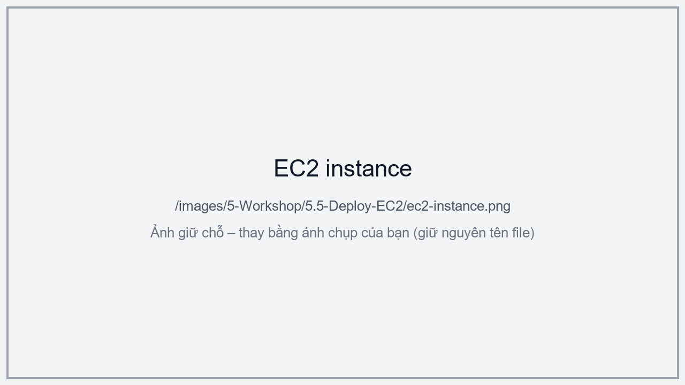
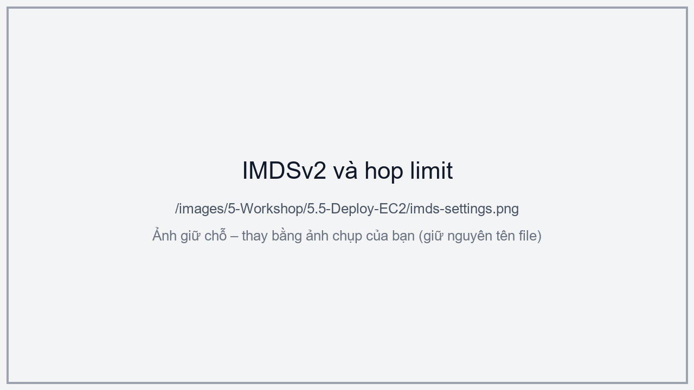
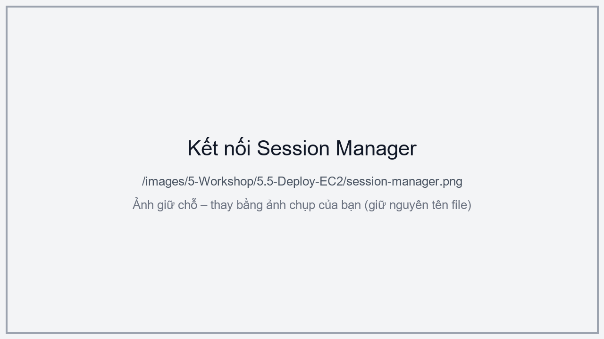

Suggested configuration: Ubuntu 24.04, **t3.xlarge** (4 vCPU, 16 GiB RAM: the embedding and reranker models run on CPU
and each process loads about 2.2 GB of model), an encrypted 60 GB gp3 volume (images + build cache + ~3.3 GB of
models). Pick another instance type to match your cost estimate if needed.

{}
`HttpPutResponseHopLimit=2` is mandatory. With 1, the host gets credentials but Docker containers do not
(`NoCredentialsError`), because IMDS requests from a container cross one more hop through the bridge network.
{}

1. Launch the instance from CloudShell, with no key pair:


```bash
source ~/cr.env
AMI_ID=$(aws ssm get-parameter \
  --name /aws/service/canonical/ubuntu/server/24.04/stable/current/amd64/hvm/ebs-gp3/ami-id \
  --query Parameter.Value --output text)
INSTANCE_ID=$(aws ec2 run-instances --image-id "$AMI_ID" --instance-type t3.xlarge \
  --subnet-id "$SUBNET_ID" --security-group-ids "$SG_ID" \
  --iam-instance-profile Name=ContractRisk-EC2-Profile \
  --metadata-options HttpEndpoint=enabled,HttpTokens=required,HttpPutResponseHopLimit=2 \
  --block-device-mappings '[{"DeviceName":"/dev/sda1","Ebs":{"VolumeSize":60,"VolumeType":"gp3","Encrypted":true}}]' \
  --tag-specifications 'ResourceType=instance,Tags=[{Key=Name,Value=contract-risk-ec2}]' \
  --query 'Instances[0].InstanceId' --output text)
echo "export INSTANCE_ID=$INSTANCE_ID" >> ~/cr.env
aws ec2 wait instance-status-ok --instance-ids "$INSTANCE_ID"
aws ec2 describe-instances --instance-ids "$INSTANCE_ID" \
  --query 'Reservations[0].Instances[0].[State.Name,MetadataOptions.HttpTokens,MetadataOptions.HttpPutResponseHopLimit]'
```

{}
📸 **Screenshot to take:** EC2 console → **Instances** → `contract-risk-ec2`: *Instance state* = Running, *Status check* = 2/2, the **Security** tab showing IAM role `ContractRisk-EC2-Role` and Security Group `contract-risk-ec2-sg`.
{}



{}
📸 **Screenshot to take:** Select the instance → **Actions → Instance settings → Modify instance metadata options**: *IMDSv2* = Required, *Metadata response hop limit* = 2 (take the screenshot, then Cancel).
{}




2. Connect with Session Manager: EC2 console → select `contract-risk-ec2` → **Connect** → **Session Manager** →
   **Connect**, then switch to the `ubuntu` user:

```bash
sudo su - ubuntu
```


{}
📸 **Screenshot to take:** EC2 console → select the instance → **Connect** → **Session Manager** tab → **Connect**: the browser terminal after running `sudo su - ubuntu` and `whoami`.
{}


