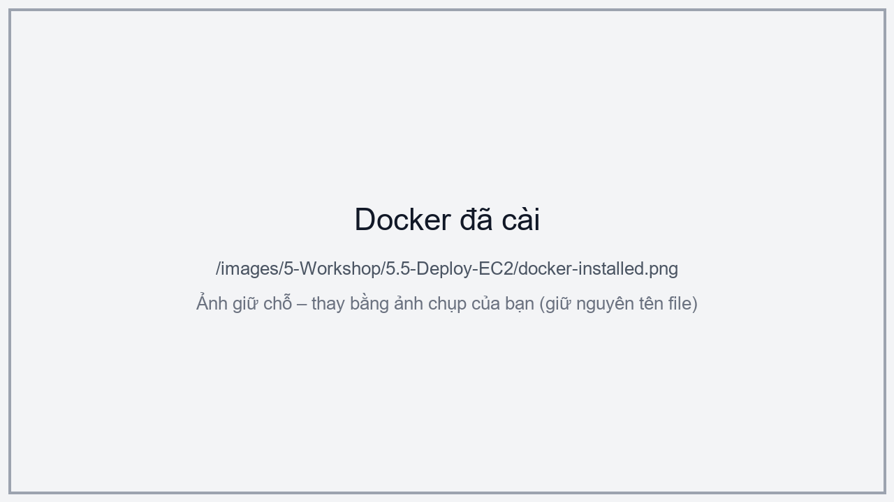
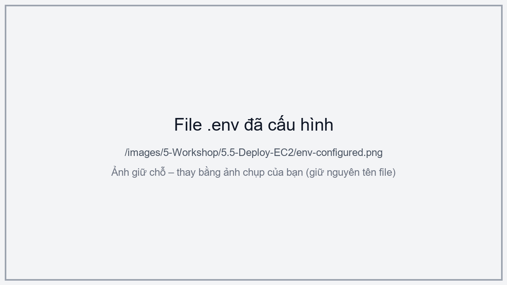
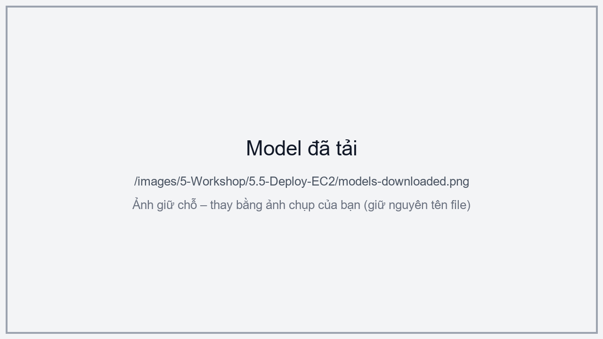

Run these on EC2 (Session Manager, user `ubuntu`), except step 3 which runs in CloudShell.

1. Install Docker Engine + the Compose plugin from Docker's official repository, Git, Python 3.12 and the AWS CLI:


```bash
sudo apt-get update
sudo apt-get install -y ca-certificates curl git python3.12-venv
sudo install -m 0755 -d /etc/apt/keyrings
sudo curl -fsSL https://download.docker.com/linux/ubuntu/gpg -o /etc/apt/keyrings/docker.asc
echo "deb [arch=$(dpkg --print-architecture) signed-by=/etc/apt/keyrings/docker.asc] \
https://download.docker.com/linux/ubuntu $(. /etc/os-release && echo "$VERSION_CODENAME") stable" \
  | sudo tee /etc/apt/sources.list.d/docker.list > /dev/null
sudo apt-get update
sudo apt-get install -y docker-ce docker-ce-cli containerd.io docker-buildx-plugin docker-compose-plugin
sudo snap install aws-cli --classic
sudo usermod -aG docker ubuntu
exit   # exit, then run "sudo su - ubuntu" again to pick up the docker group
```


2. Check the tools and clone the repository into `/opt` (the data pipeline runs with `ProtectHome=true`, so it cannot
   read a checkout under `/home`). For a private repo, enter your username and a Personal Access Token when Git asks;
   **never** put the token in the URL.


```bash
docker version && docker compose version && python3.12 --version && aws sts get-caller-identity
sudo install -d -m 755 -o ubuntu -g ubuntu /opt/contract-risk-management
git clone https://github.com/<ORG>/contract-risk-management.git /opt/contract-risk-management
cd /opt/contract-risk-management && git rev-parse --short HEAD
```

{}
📸 **Screenshot to take:** The Session Manager terminal after `docker version && docker compose version && aws sts get-caller-identity`: Compose ≥ 2.24 and an `Arn` containing `assumed-role/ContractRisk-EC2-Role`.
{}




3. **In CloudShell**, print the configuration lines with your resource names and copy them:


```bash
source ~/cr.env
cat <<EOF
set_env APP_ENV production
set_env MODEL_PROVIDER gemini
set_env GEMINI_MODEL gemini-3.5-flash-lite
set_env AWS_REGION $AWS_REGION
set_env API_KEYS_SECRET_ID contract-risk/prod/api-keys
set_env WORKER_ENABLED false
set_env WORKER_SQS_QUEUE_URL $REQ_URL
set_env WORKER_RESULTS_QUEUE_URL $RES_URL
set_env WORKER_CHAT_QUEUE_URL $CHAT_URL
set_env WORKER_DYNAMODB_TABLE contract-risk-jobs
set_env WORKER_DYNAMODB_EVENTS_TABLE contract-risk-job-events
set_env WORKER_INPUT_BUCKET $DOCS_BUCKET
set_env WORKER_OUTPUT_BUCKET $DOCS_BUCKET
set_env WORKER_OUTPUT_PREFIX results
set_env MCP_S3_BUCKETS $LEGAL_BUCKET
set_env SUPABASE_TABLES legal_documents,legal_document_versions,legal_articles,legal_relations
set_env LANGFUSE_ENABLED true
set_env MONITORING_WORKER_ENABLED true
set_env DATA_SQS_QUEUE_URL $DATA_URL
set_env DATA_S3_BUCKET $LEGAL_BUCKET
set_env DATA_S3_PREFIX legal
set_env HF_HUB_OFFLINE 1
EOF
```


4. **On EC2**, create `.env` (generates 8 random `CONFIG_TOKEN_*`), define the `set_env` helper, paste the copied
   lines, then type the Gemini key with `read -s` so it never appears on screen:


```bash
cd /opt/contract-risk-management
umask 077
python3.12 scripts/init_env.py
chmod 600 .env
set_env() { if grep -q "^$1=" .env; then sed -i "s|^$1=.*|$1=$2|" .env; else echo "$1=$2" >> .env; fi; }
set_env IMAGE_TAG "release-$(git rev-parse --short HEAD)"
read -rsp "Gemini API key: " GK && echo && set_env GEMINI_API_KEY "$GK" && unset GK
```


Check (without printing the key):


```bash
grep -E "^(APP_ENV|MODEL_PROVIDER|WORKER_SQS_QUEUE_URL|WORKER_INPUT_BUCKET|MCP_S3_BUCKETS|LANGFUSE_ENABLED|IMAGE_TAG)=" .env
grep -c "^GEMINI_API_KEY=." .env   # 1 = key is set (the value is not printed)
git check-ignore -v .env           # .env is never committed
```

{}
📸 **Screenshot to take:** The output of the 3 `.env` checks in step 4 (your queue/bucket values, `1` for the Gemini key, `.gitignore:...:.env`). **Do not capture the `GEMINI_API_KEY` value.**
{}




5. Download the embedding and reranker models (`models/` is not in Git; the runtime is offline with `HF_HUB_OFFLINE=1`):


```bash
python3.12 -m venv .venv312
.venv312/bin/python -m pip install -q -r infrastructure/requirements/mcp.txt
.venv312/bin/python scripts/download_models.py
chmod -R a+rX models && du -sh models
```

{}
📸 **Screenshot to take:** The `du -sh models` output after `download_models.py` finishes (about 3.3 GB).
{}


