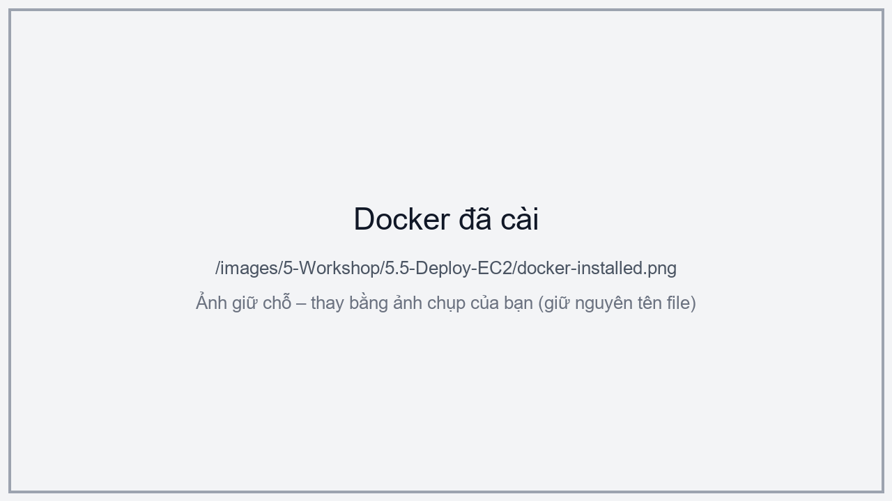
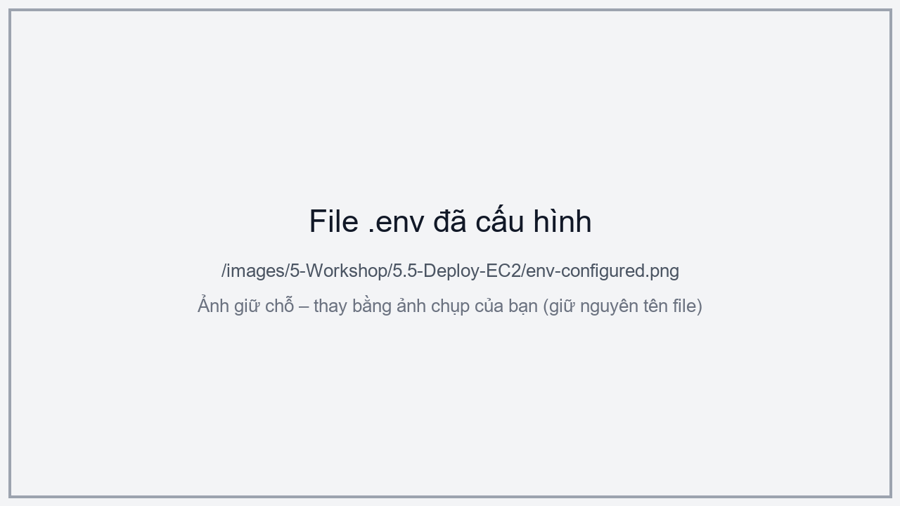
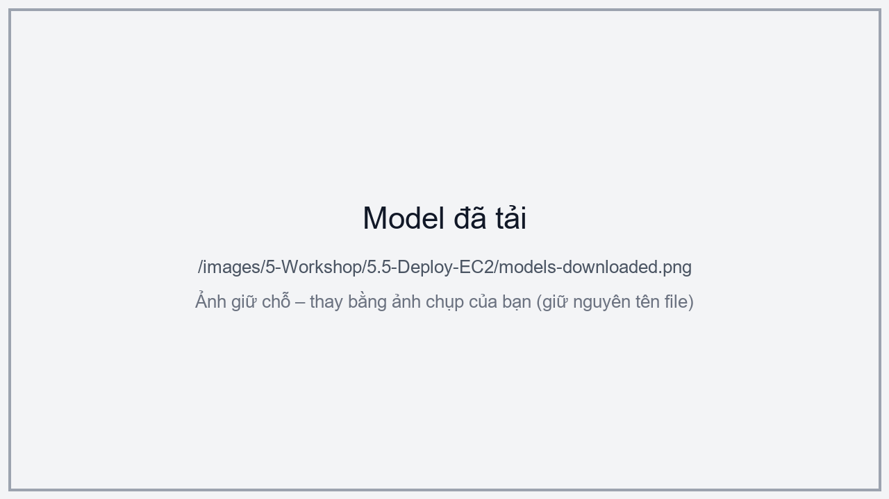

Các lệnh chạy trên EC2 (Session Manager, user `ubuntu`), trừ bước 3 chạy trong CloudShell.

1. Cài Docker Engine + Compose plugin từ kho chính thức của Docker, Git, Python 3.12 và AWS CLI:


```bash
sudo apt-get update
sudo apt-get install -y ca-certificates curl git python3.12-venv
sudo install -m 0755 -d /etc/apt/keyrings
sudo curl -fsSL https://download.docker.com/linux/ubuntu/gpg -o /etc/apt/keyrings/docker.asc
echo "deb [arch=$(dpkg --print-architecture) signed-by=/etc/apt/keyrings/docker.asc] \
https://download.docker.com/linux/ubuntu $(. /etc/os-release && echo "$VERSION_CODENAME") stable" \
  | sudo tee /etc/apt/sources.list.d/docker.list > /dev/null
sudo apt-get update
sudo apt-get install -y docker-ce docker-ce-cli containerd.io docker-buildx-plugin docker-compose-plugin
sudo snap install aws-cli --classic
sudo usermod -aG docker ubuntu
exit   # thoát rồi chạy lại "sudo su - ubuntu" để nhận nhóm docker
```


2. Kiểm tra công cụ và clone repository vào `/opt` (data pipeline chạy với `ProtectHome=true` nên không đọc được
   thư mục trong `/home`). Repo private: khi Git hỏi, nhập username và Personal Access Token; **không** ghi token vào URL.


```bash
docker version && docker compose version && python3.12 --version && aws sts get-caller-identity
sudo install -d -m 755 -o ubuntu -g ubuntu /opt/contract-risk-management
git clone https://github.com/<ORG>/contract-risk-management.git /opt/contract-risk-management
cd /opt/contract-risk-management && git rev-parse --short HEAD
```

{}
📸 **Ảnh cần chụp:** Terminal Session Manager sau lệnh `docker version && docker compose version && aws sts get-caller-identity`: Compose ≥ 2.24 và `Arn` chứa `assumed-role/ContractRisk-EC2-Role`.
{}




3. **Trong CloudShell**, in ra các dòng cấu hình với đúng tên tài nguyên của bạn rồi copy lại:


```bash
source ~/cr.env
cat <<EOF
set_env APP_ENV production
set_env MODEL_PROVIDER gemini
set_env GEMINI_MODEL gemini-3.5-flash-lite
set_env AWS_REGION $AWS_REGION
set_env API_KEYS_SECRET_ID contract-risk/prod/api-keys
set_env WORKER_ENABLED false
set_env WORKER_SQS_QUEUE_URL $REQ_URL
set_env WORKER_RESULTS_QUEUE_URL $RES_URL
set_env WORKER_CHAT_QUEUE_URL $CHAT_URL
set_env WORKER_DYNAMODB_TABLE contract-risk-jobs
set_env WORKER_DYNAMODB_EVENTS_TABLE contract-risk-job-events
set_env WORKER_INPUT_BUCKET $DOCS_BUCKET
set_env WORKER_OUTPUT_BUCKET $DOCS_BUCKET
set_env WORKER_OUTPUT_PREFIX results
set_env MCP_S3_BUCKETS $LEGAL_BUCKET
set_env SUPABASE_TABLES legal_documents,legal_document_versions,legal_articles,legal_relations
set_env LANGFUSE_ENABLED true
set_env MONITORING_WORKER_ENABLED true
set_env DATA_SQS_QUEUE_URL $DATA_URL
set_env DATA_S3_BUCKET $LEGAL_BUCKET
set_env DATA_S3_PREFIX legal
set_env HF_HUB_OFFLINE 1
EOF
```


4. **Trên EC2**, tạo `.env` (sinh 8 token `CONFIG_TOKEN_*` ngẫu nhiên), định nghĩa hàm `set_env`, dán các dòng vừa copy,
   rồi nhập key Gemini bằng `read -s` để key không hiện trên màn hình:


```bash
cd /opt/contract-risk-management
umask 077
python3.12 scripts/init_env.py
chmod 600 .env
set_env() { if grep -q "^$1=" .env; then sed -i "s|^$1=.*|$1=$2|" .env; else echo "$1=$2" >> .env; fi; }
set_env IMAGE_TAG "release-$(git rev-parse --short HEAD)"
read -rsp "Gemini API key: " GK && echo && set_env GEMINI_API_KEY "$GK" && unset GK
```


Kiểm tra (không in giá trị key):


```bash
grep -E "^(APP_ENV|MODEL_PROVIDER|WORKER_SQS_QUEUE_URL|WORKER_INPUT_BUCKET|MCP_S3_BUCKETS|LANGFUSE_ENABLED|IMAGE_TAG)=" .env
grep -c "^GEMINI_API_KEY=." .env   # 1 = key is set (the value is not printed)
git check-ignore -v .env           # .env is never committed
```

{}
📸 **Ảnh cần chụp:** Kết quả 3 lệnh kiểm tra `.env` ở bước 4 (giá trị queue/bucket của bạn, dòng `1` cho key Gemini, `.gitignore:...:.env`). **Không chụp nội dung `GEMINI_API_KEY`.**
{}




5. Tải model embedding và reranker (`models/` không đi theo Git, runtime chạy offline với `HF_HUB_OFFLINE=1`):


```bash
python3.12 -m venv .venv312
.venv312/bin/python -m pip install -q -r infrastructure/requirements/mcp.txt
.venv312/bin/python scripts/download_models.py
chmod -R a+rX models && du -sh models
```

{}
📸 **Ảnh cần chụp:** Kết quả `du -sh models` sau khi `download_models.py` chạy xong (khoảng 3,3 GB).
{}


