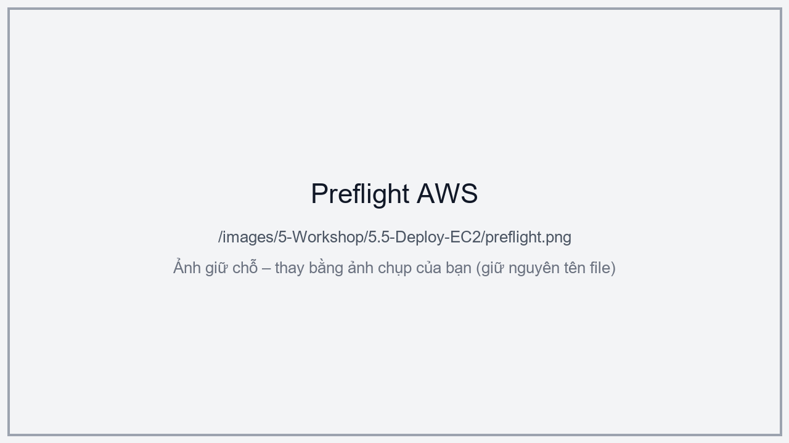
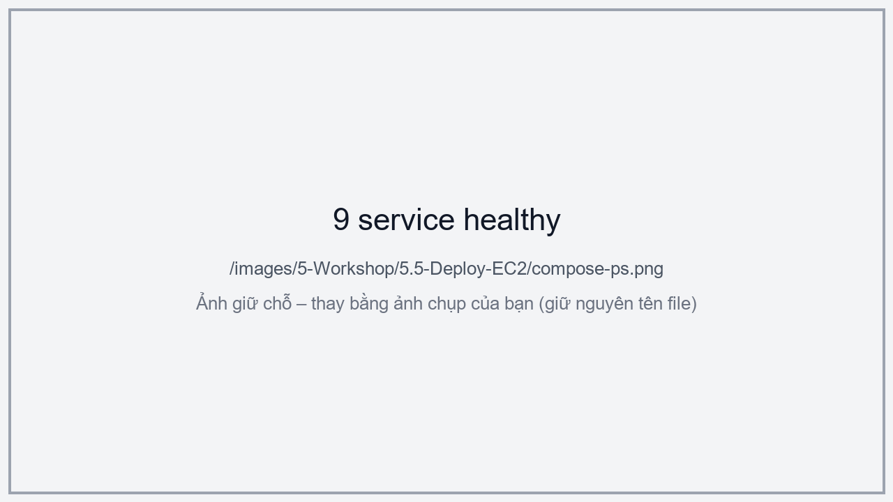
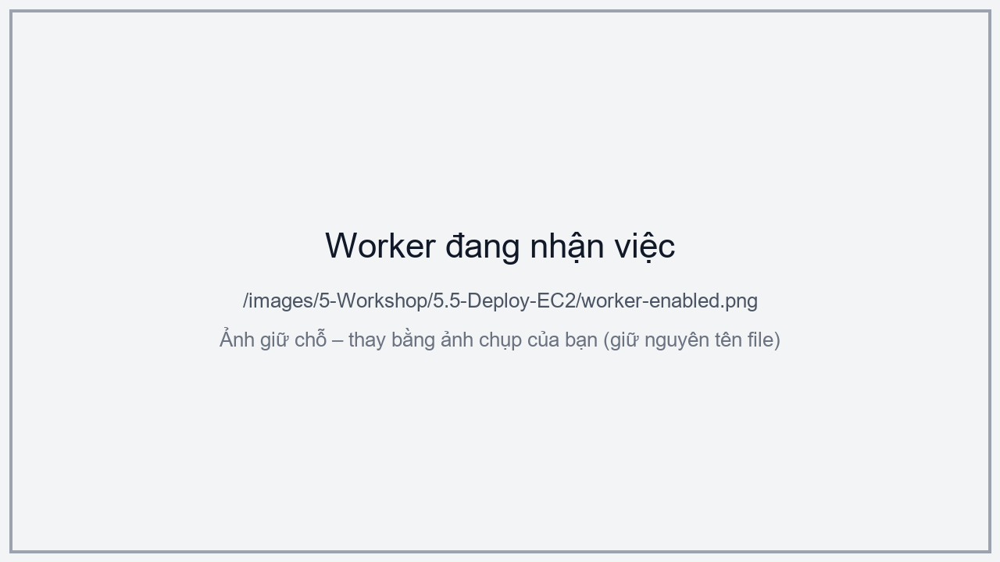

1. `setup.sh` checks Compose ≥ 2.24 and a production `.env` (no API key inside, all 8 `CONFIG_TOKEN_*`, `models/`
   present). `deploy.sh` builds the 9 images, runs a **preflight** from inside a container (role credentials through
   IMDS, read access to the reference bucket), then `up -d --wait`:


```bash
cd /opt/contract-risk-management
sh infrastructure/ec2/setup.sh
sh infrastructure/ec2/deploy.sh
docker compose ps
```

{}
📸 **Screenshot to take:** The part of the `deploy.sh` log showing `AWS identity from container: ...ContractRisk-EC2-Role...` and `MCP S3 read-only access OK`.
{}



{}
📸 **Screenshot to take:** The `docker compose ps` output: the 9 services `config`, `monitoring`, `input-processing`, `agent-1`, `agent-2`, `agent-3`, `langgraph`, `mcp`, `worker` all *Up (healthy)*.
{}




2. Check each service's readiness and the worker configuration (SQS, S3, DynamoDB with the right schema):


```bash
for S in agent-1 agent-2 agent-3 langgraph mcp; do
  echo "== $S"; docker compose exec -T "$S" python -m common.service_health
done
docker compose exec -T worker python -m workers --check-config
```


3. Once every service is healthy, enable the worker so it starts taking jobs:


```bash
set_env() { if grep -q "^$1=" .env; then sed -i "s|^$1=.*|$1=$2|" .env; else echo "$1=$2" >> .env; fi; }
set_env WORKER_ENABLED true
docker compose up -d --no-deps --wait worker
docker compose logs --tail 50 worker
```

{}
📸 **Screenshot to take:** `docker compose logs --tail 50 worker` after setting `WORKER_ENABLED=true`: the worker starts long-polling, no configuration error.
{}




{}
With `WORKER_ENABLED=false` the worker idles (healthy but not reading the queue). Enable it last so no job is taken
before the other services are ready.
{}
