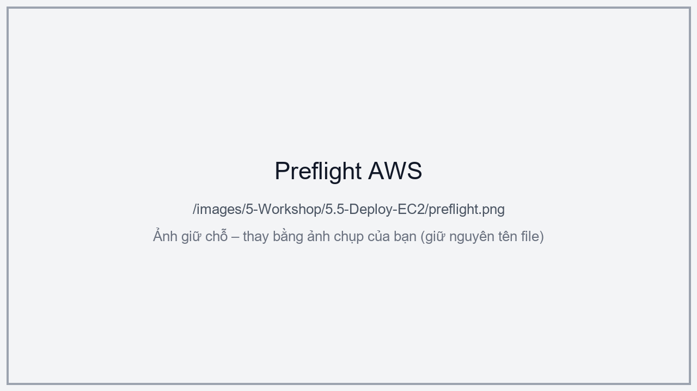
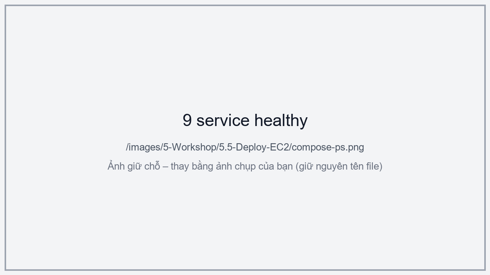
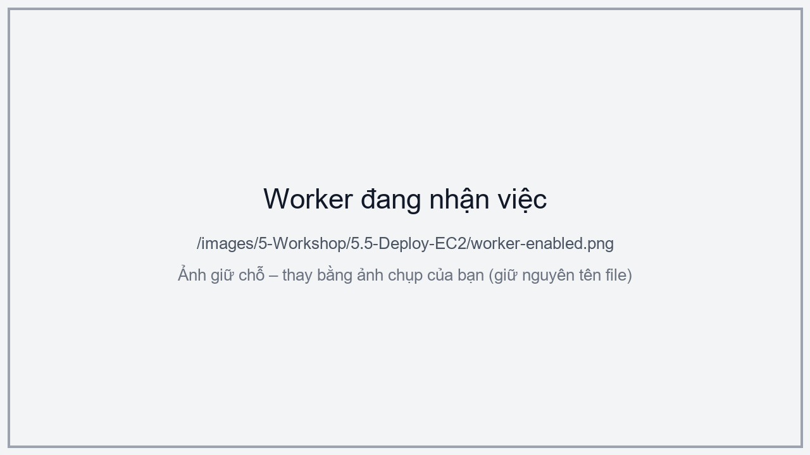

1. `setup.sh` kiểm Compose ≥ 2.24, `.env` production (không có API key trong `.env`, đủ 8 `CONFIG_TOKEN_*`, có
   `models/`). `deploy.sh` build 9 image, chạy **preflight** từ bên trong container (lấy được credential của role qua
   IMDS, đọc được bucket tham chiếu) rồi `up -d --wait`:


```bash
cd /opt/contract-risk-management
sh infrastructure/ec2/setup.sh
sh infrastructure/ec2/deploy.sh
docker compose ps
```

{}
📸 **Ảnh cần chụp:** Đoạn log của `deploy.sh` có dòng `AWS identity from container: ...ContractRisk-EC2-Role...` và `MCP S3 read-only access OK`.
{}



{}
📸 **Ảnh cần chụp:** Kết quả `docker compose ps`: 9 service `config`, `monitoring`, `input-processing`, `agent-1`, `agent-2`, `agent-3`, `langgraph`, `mcp`, `worker` đều *Up (healthy)*.
{}




2. Kiểm tra readiness từng service và cấu hình worker (SQS, S3, DynamoDB đúng schema):


```bash
for S in agent-1 agent-2 agent-3 langgraph mcp; do
  echo "== $S"; docker compose exec -T "$S" python -m common.service_health
done
docker compose exec -T worker python -m workers --check-config
```


3. Khi mọi service healthy, bật worker để bắt đầu nhận việc:


```bash
set_env() { if grep -q "^$1=" .env; then sed -i "s|^$1=.*|$1=$2|" .env; else echo "$1=$2" >> .env; fi; }
set_env WORKER_ENABLED true
docker compose up -d --no-deps --wait worker
docker compose logs --tail 50 worker
```

{}
📸 **Ảnh cần chụp:** `docker compose logs --tail 50 worker` sau khi bật `WORKER_ENABLED=true`: worker bắt đầu long-poll queue, không có lỗi cấu hình.
{}




{}
Với `WORKER_ENABLED=false` worker chạy ở chế độ idle (healthy nhưng không đọc queue). Bật sau cùng để không nhận job
khi các service khác chưa sẵn sàng.
{}
