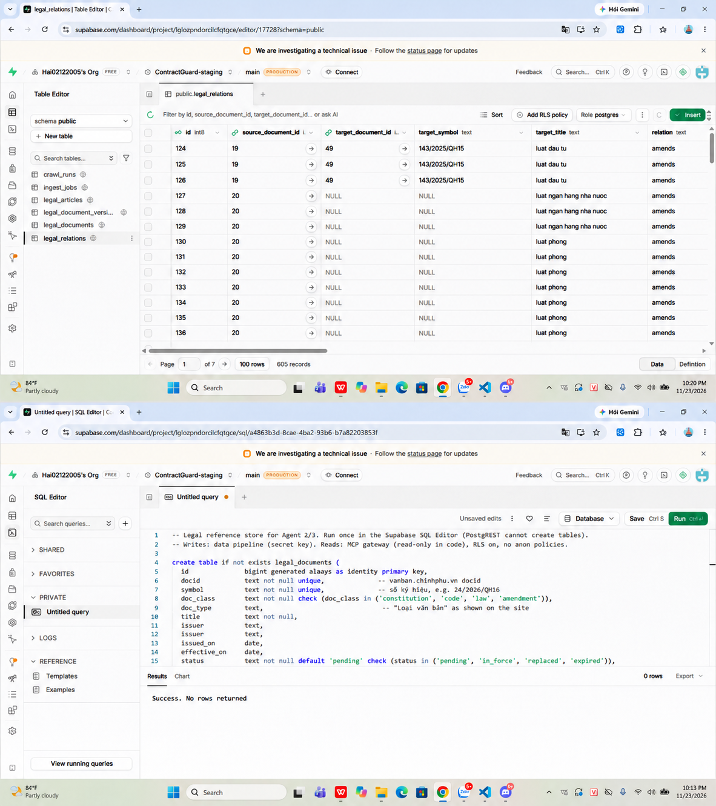
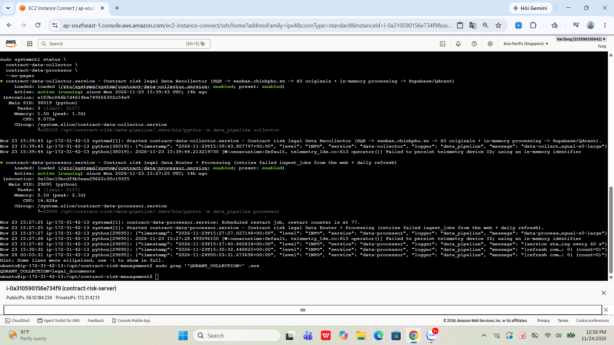
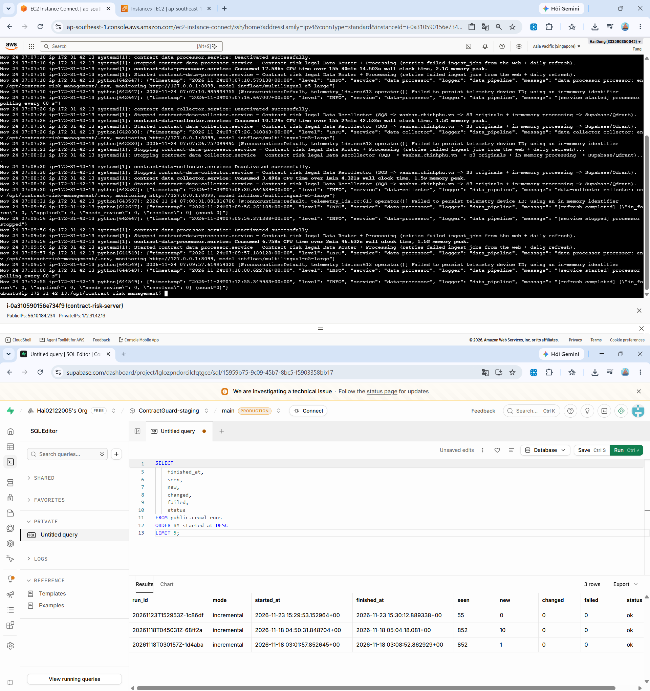
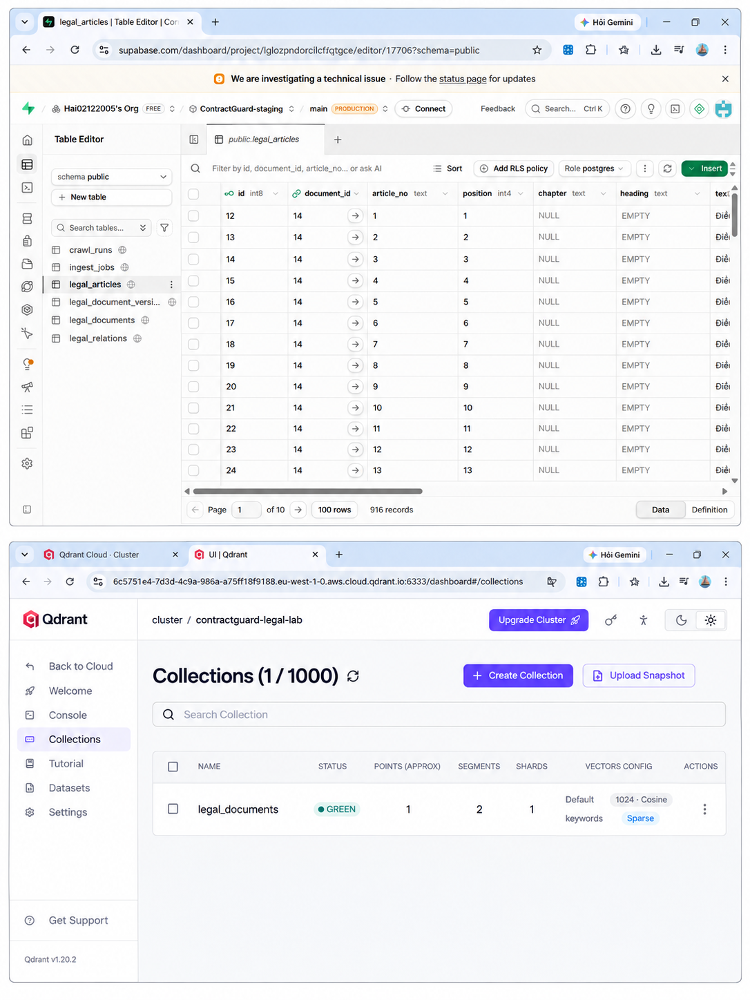

The legal corpus used by RAG is loaded by two systemd services running outside Docker on the same EC2 host:
+ **collector**: takes a message from the `contract-risk-data-update` SQS queue, downloads documents from
  vanban.chinhphu.vn, stores the originals in the reference S3 bucket and hands the bytes in memory to the processor;
+ **processor**: text extraction/OCR, splitting per Article, validity and amendment relations, writes Supabase and
  dense + sparse vectors to Qdrant; retries failed jobs periodically.

1. **Create the schema in Supabase:** open the project → **SQL Editor**, run
   `data_pipeline/migrations/001_legal_schema.sql`, then `002_versions_without_s3_json.sql`.


{}
📸 **Screenshot to take:** Supabase → **SQL Editor** after running `001_legal_schema.sql` (*Success*), and the **Table Editor** listing `legal_documents`, `legal_document_versions`, `legal_articles`, `legal_relations`, `ingest_jobs`, `crawl_runs`.
{}




2. **Install and try one document** (`--limit 1` really writes to S3/Supabase/Qdrant), then start both services:


```bash
cd /opt/contract-risk-management
sudo sh infrastructure/ec2/data_pipeline_setup.sh
sudo -u contract-data test -r .env && sudo -u contract-data test -r models && echo "readable"
sudo systemctl stop contract-data-collector
sudo -u contract-data env PYTHONPATH="$PWD" \
  /opt/contract-risk/data-pipeline/.venv/bin/python -m data_pipeline collect --mode incremental --limit 1
sudo systemctl start contract-data-processor contract-data-collector
sudo systemctl status contract-data-collector contract-data-processor --no-pager
```

{}
📸 **Screenshot to take:** The `systemctl status` output of `contract-data-collector` and `contract-data-processor`: *active (running)*.
{}




3. **Trigger one collection run through SQS** (from CloudShell). One message is one run; use `full` to sweep the
   whole list:


```bash
source ~/cr.env
aws sqs send-message --queue-url "$DATA_URL" --message-body '{"mode":"incremental"}'
```


4. Follow the logs on EC2:


```bash
sudo journalctl -u contract-data-collector -u contract-data-processor -n 100 --no-pager
```

{}
📸 **Screenshot to take:** `journalctl` after sending `{"mode":"incremental"}`: run_id, number of documents processed, no error.
{}



{}
📸 **Screenshot to take:** Two images combined: the Supabase **Table Editor** showing rows in `legal_articles`; the Qdrant Cloud `legal_documents` collection with *Points count* > 0; optionally `aws s3 ls s3://<LEGAL_BUCKET>/legal/ --recursive | head`.
{}




{}
To automate it, a schedule (for example EventBridge Scheduler) can send `{"mode":"incremental"}` daily and
`{"mode":"full"}` weekly to this queue. The first run can take a while because embeddings are computed on CPU.
{}
