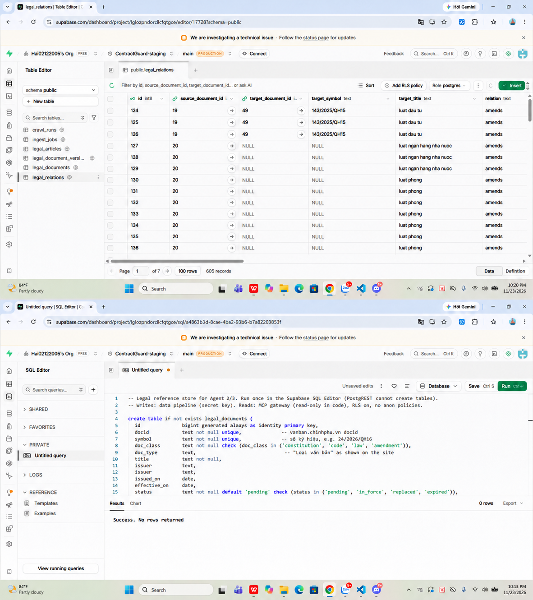
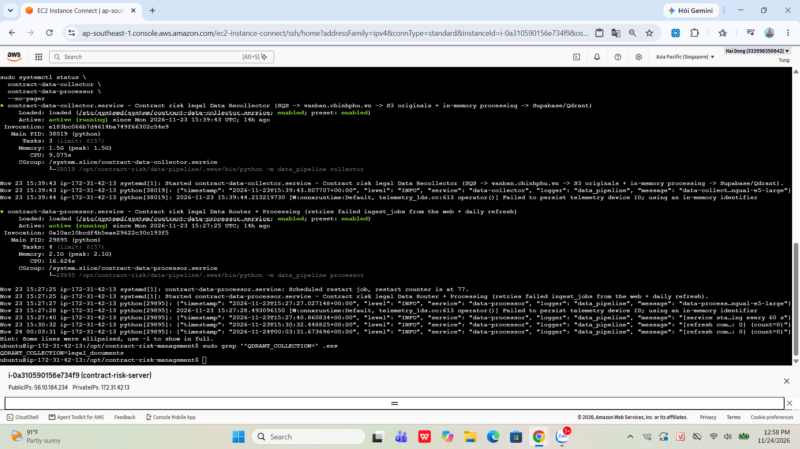
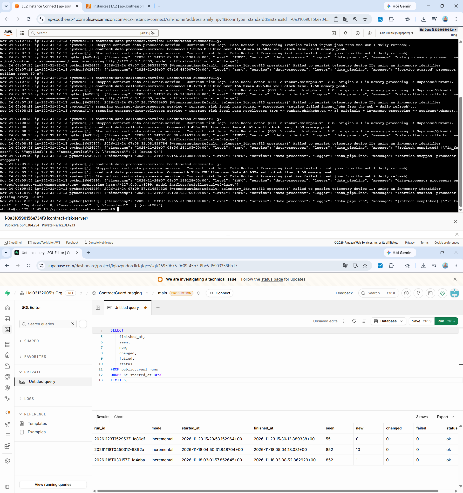
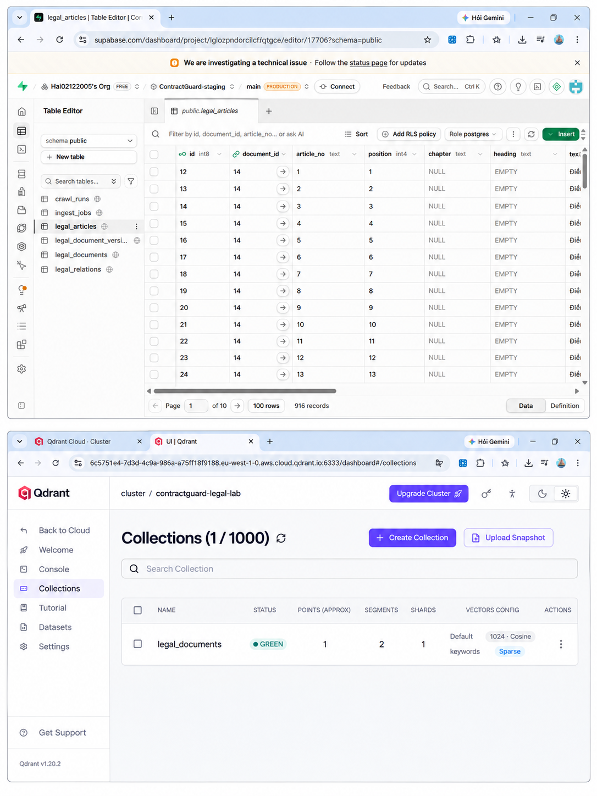

Kho pháp luật cho RAG được nạp bởi hai service systemd chạy ngoài Docker trên cùng EC2:
+ **collector**: nhận message từ SQS `contract-risk-data-update`, tải văn bản từ vanban.chinhphu.vn, lưu bản gốc lên
  S3 tham chiếu, chuyển bytes trong RAM sang processor;
+ **processor**: trích text/OCR, tách theo Điều, tính hiệu lực và quan hệ sửa đổi, ghi Supabase và vector dense +
  sparse vào Qdrant; định kỳ retry job lỗi.

1. **Tạo schema trong Supabase:** mở project → **SQL Editor**, chạy lần lượt nội dung
   `data_pipeline/migrations/001_legal_schema.sql` rồi `002_versions_without_s3_json.sql`.


{}
📸 **Ảnh cần chụp:** Supabase → **SQL Editor** sau khi chạy `001_legal_schema.sql` (thông báo *Success*), và **Table Editor** liệt kê `legal_documents`, `legal_document_versions`, `legal_articles`, `legal_relations`, `ingest_jobs`, `crawl_runs`.
{}




2. **Cài và chạy thử một văn bản** (`--limit 1` ghi thật vào S3/Supabase/Qdrant), sau đó bật hai service:


```bash
cd /opt/contract-risk-management
sudo sh infrastructure/ec2/data_pipeline_setup.sh
sudo -u contract-data test -r .env && sudo -u contract-data test -r models && echo "readable"
sudo systemctl stop contract-data-collector
sudo -u contract-data env PYTHONPATH="$PWD" \
  /opt/contract-risk/data-pipeline/.venv/bin/python -m data_pipeline collect --mode incremental --limit 1
sudo systemctl start contract-data-processor contract-data-collector
sudo systemctl status contract-data-collector contract-data-processor --no-pager
```

{}
📸 **Ảnh cần chụp:** Kết quả `systemctl status` của `contract-data-collector` và `contract-data-processor`: *active (running)*.
{}




3. **Kích hoạt một lượt thu thập qua SQS** (từ CloudShell). Mỗi message là một lượt; `full` để quét toàn bộ danh sách:


```bash
source ~/cr.env
aws sqs send-message --queue-url "$DATA_URL" --message-body '{"mode":"incremental"}'
```


4. Theo dõi log trên EC2:


```bash
sudo journalctl -u contract-data-collector -u contract-data-processor -n 100 --no-pager
```

{}
📸 **Ảnh cần chụp:** `journalctl` sau khi gửi message `{"mode":"incremental"}`: thấy run_id, số văn bản đã xử lý, không có lỗi.
{}



{}
📸 **Ảnh cần chụp:** Ghép 2 ảnh: Supabase **Table Editor** bảng `legal_articles` có dòng; Qdrant Cloud collection `legal_documents` có *Points count* > 0; có thể thêm `aws s3 ls s3://<LEGAL_BUCKET>/legal/ --recursive | head`.
{}




{}
Để tự động hóa, có thể dùng một lịch (ví dụ EventBridge Scheduler) gửi message `{"mode":"incremental"}` hằng ngày và
`{"mode":"full"}` hằng tuần vào queue này. Lần thu thập đầu có thể kéo dài vì phải tính embedding trên CPU.
{}
