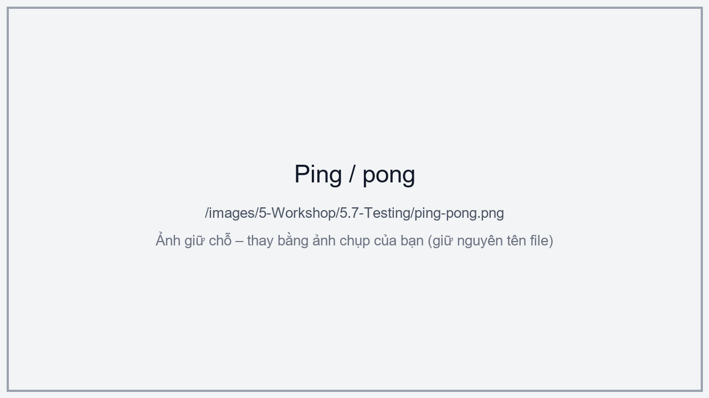
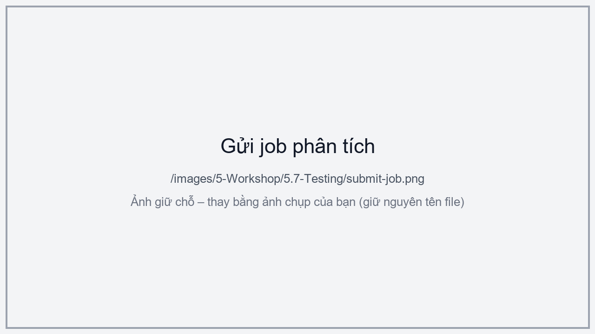
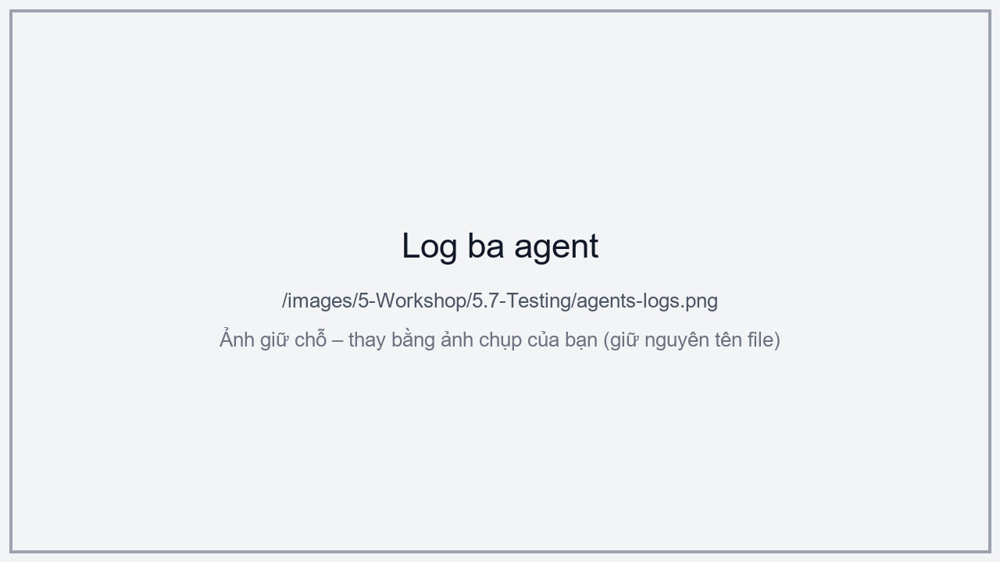
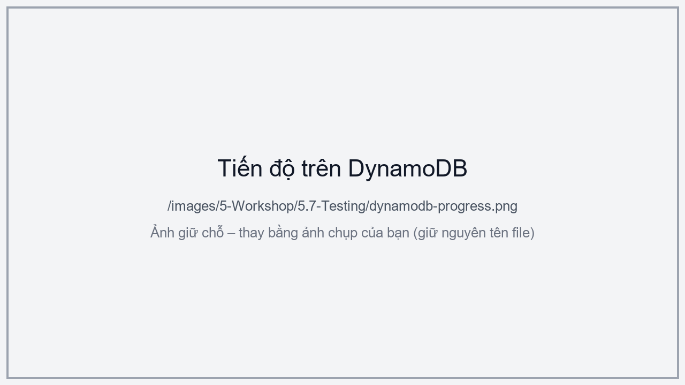
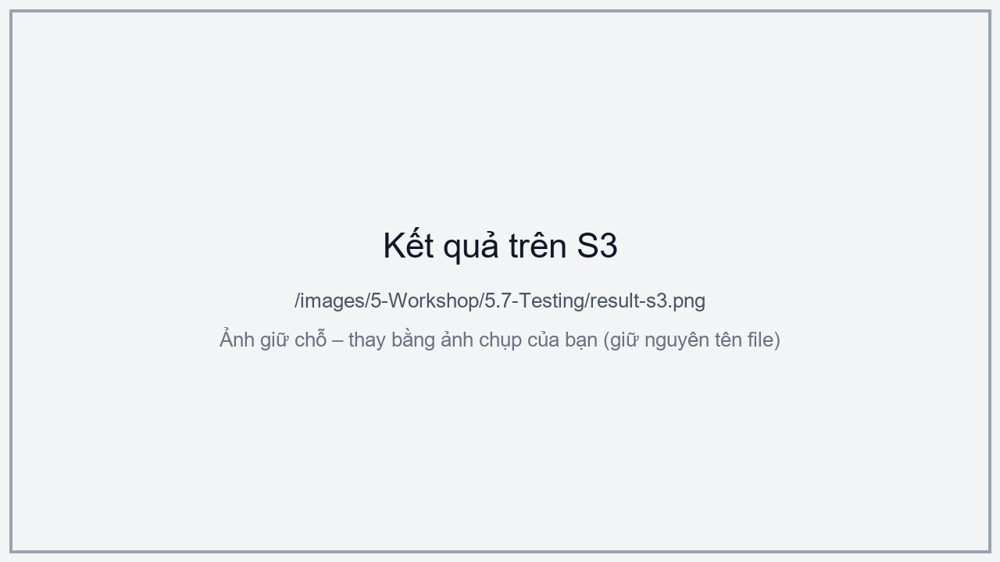

Upload `sample-contract.pdf` to CloudShell first (**Actions → Upload file**).

1. **Ping/pong handshake** to make sure the worker reads the queue and can publish results:


```bash
source ~/cr.env
PING_ID=$(python3 -c "import uuid; print(uuid.uuid4())")
aws sqs send-message --queue-url "$REQ_URL" \
  --message-body "{\"message_version\":\"1\",\"event_type\":\"ping\",\"job_id\":\"$PING_ID\"}"
aws sqs receive-message --queue-url "$RES_URL" --wait-time-seconds 20 --max-number-of-messages 10 \
  --query 'Messages[].Body' --output text
```

{}
📸 **Screenshot to take:** CloudShell: the `ping` command and the `receive-message` output with an `"event_type": "pong"` message for the same `job_id`.
{}




2. **Submit an analysis job** following the protocol: file in `quarantine/`, ticket `results/<job_id>/request.json`,
   `analysis_requested` message:


```bash
source ~/cr.env
JOB_ID=$(python3 -c "import uuid; print(uuid.uuid4())")
CONTRACT_ID=$(python3 -c "import uuid; print(uuid.uuid4())")
echo "export JOB_ID=$JOB_ID CONTRACT_ID=$CONTRACT_ID" >> ~/cr.env
aws s3 cp sample-contract.pdf "s3://$DOCS_BUCKET/quarantine/lab-user/$JOB_ID.pdf"
cat > request.json <<EOF
{
  "schema_version": "1.0.0",
  "job_id": "$JOB_ID",
  "tenant_id": "lab-tenant",
  "contract_id": "$CONTRACT_ID",
  "contract_version": "1",
  "source_file_key": "quarantine/lab-user/$JOB_ID.pdf",
  "clean_file_key": "clean/lab-workspace/$CONTRACT_ID/v1/source.pdf",
  "result_key": "results/$JOB_ID/extraction.json",
  "declared_file_type": "pdf",
  "output_language": "vi",
  "context": {"own_party": "buyer", "contract_type": "service_agreement", "has_personal_data": true},
  "limits": {"max_pages": 100, "max_bytes": 20971520}
}
EOF
aws s3 cp request.json "s3://$DOCS_BUCKET/results/$JOB_ID/request.json"
aws sqs send-message --queue-url "$REQ_URL" --message-body \
  "{\"message_version\":\"1\",\"event_type\":\"analysis_requested\",\"job_id\":\"$JOB_ID\",\"request_key\":\"results/$JOB_ID/request.json\"}"
date -u +"submitted at %H:%M:%S UTC"
```

{}
📸 **Screenshot to take:** CloudShell after the job submission block: the `upload:` lines for the file and `request.json`, the SQS `MessageId` and the submission time.
{}




3. **Follow it on EC2** (Session Manager):


```bash
cd /opt/contract-risk-management
docker compose logs -f --tail 20 worker langgraph agent-1 agent-2 agent-3
```

{}
📸 **Screenshot to take:** EC2 logs while the job runs: the worker taking the job, langgraph calling `agent_1` per chunk, then `agent_2`, `agent_3`, and the completion line.
{}




4. **Check progress in DynamoDB** (this is also how the web app reads the job's progress bar):


```bash
source ~/cr.env
aws dynamodb get-item --table-name contract-risk-jobs \
  --key "{\"job_id\":{\"S\":\"contract:$CONTRACT_ID\"}}" \
  --projection-expression "active_job_id, stage, progress" --output json
```

{}
📸 **Screenshot to take:** The `get-item` output: `stage` (e.g. `agent_2_risk_scoring...`) and increasing `progress`; take another one after the job finishes.
{}




5. **Check the result** once the logs report completion:


```bash
source ~/cr.env
aws sqs receive-message --queue-url "$RES_URL" --wait-time-seconds 20 --max-number-of-messages 10 \
  --query 'Messages[].Body' --output text
aws s3 ls "s3://$DOCS_BUCKET/results/$JOB_ID/"
aws s3 ls "s3://$DOCS_BUCKET/clean/lab-workspace/$CONTRACT_ID/v1/"
aws s3 ls "s3://$DOCS_BUCKET/quarantine/lab-user/" | grep "$JOB_ID" || echo "quarantine copy removed"
aws s3 cp "s3://$DOCS_BUCKET/results/$JOB_ID/extraction.json" .
jq 'keys' extraction.json
jq '{clauses: (.clauses | length), findings: (.findings | length), checks: (.checks | length), scoring: .scoring}' extraction.json
```

{}
📸 **Screenshot to take:** The check block output: the `progress` and `completed` messages (with `result_key`), the `extraction.json` file, the `clean/.../source.pdf` copy, the removed `quarantine/` copy, and the `jq` summary (clauses, findings, checks, scoring).
{}




**Pass criteria:** a `completed` message carrying `result_key`; a valid `extraction.json` with clauses, findings,
20 checks and a `scoring` block; the `clean/` copy exists; the `quarantine/` copy is deleted; the `analysis-requests`
message is deleted (queue back to 0). Record the **processing time** (submission to the `completed` message) for the
report.
