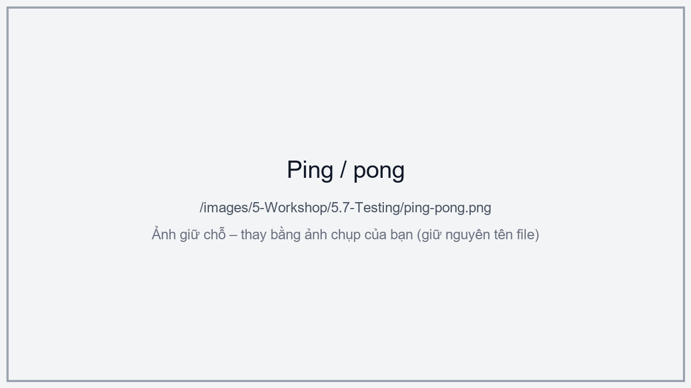
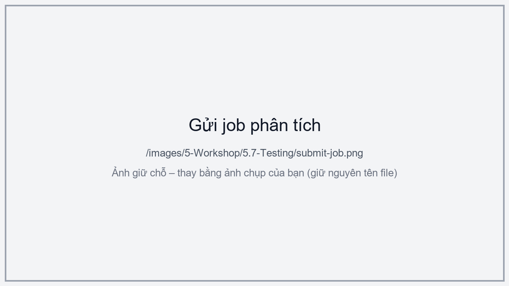
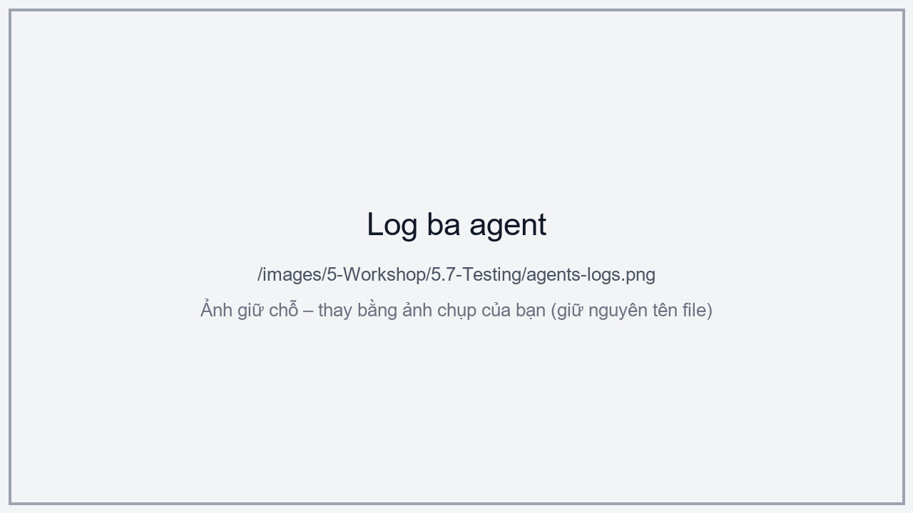
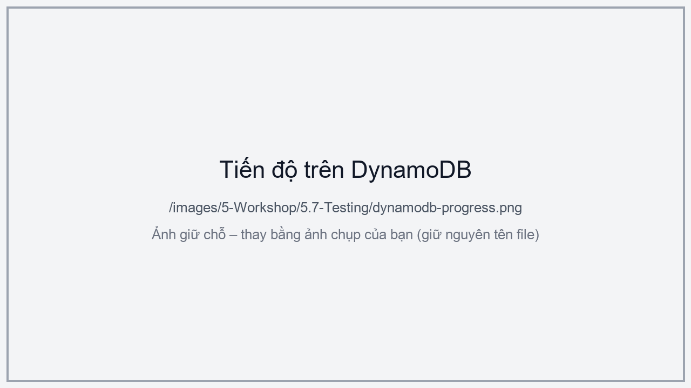
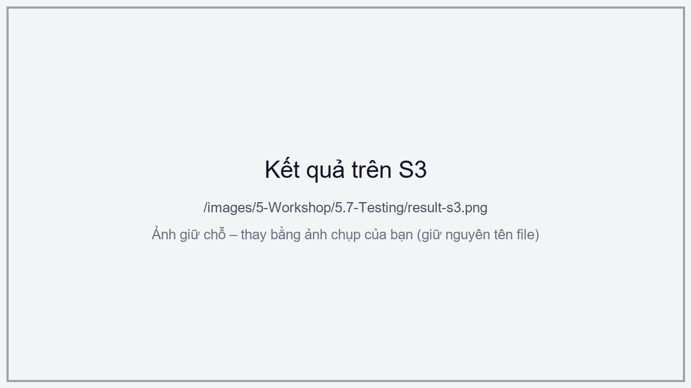

Tải `sample-contract.pdf` lên CloudShell trước (**Actions → Upload file**).

1. **Bắt tay ping/pong** để chắc worker đang đọc queue và gửi được kết quả:


```bash
source ~/cr.env
PING_ID=$(python3 -c "import uuid; print(uuid.uuid4())")
aws sqs send-message --queue-url "$REQ_URL" \
  --message-body "{\"message_version\":\"1\",\"event_type\":\"ping\",\"job_id\":\"$PING_ID\"}"
aws sqs receive-message --queue-url "$RES_URL" --wait-time-seconds 20 --max-number-of-messages 10 \
  --query 'Messages[].Body' --output text
```

{}
📸 **Ảnh cần chụp:** CloudShell: lệnh gửi `ping` và kết quả `receive-message` có message `"event_type": "pong"` cùng `job_id`.
{}




2. **Gửi một job phân tích** đúng giao thức: file vào `quarantine/`, phiếu `results/<job_id>/request.json`, message
   `analysis_requested`:


```bash
source ~/cr.env
JOB_ID=$(python3 -c "import uuid; print(uuid.uuid4())")
CONTRACT_ID=$(python3 -c "import uuid; print(uuid.uuid4())")
echo "export JOB_ID=$JOB_ID CONTRACT_ID=$CONTRACT_ID" >> ~/cr.env
aws s3 cp sample-contract.pdf "s3://$DOCS_BUCKET/quarantine/lab-user/$JOB_ID.pdf"
cat > request.json <<EOF
{
  "schema_version": "1.0.0",
  "job_id": "$JOB_ID",
  "tenant_id": "lab-tenant",
  "contract_id": "$CONTRACT_ID",
  "contract_version": "1",
  "source_file_key": "quarantine/lab-user/$JOB_ID.pdf",
  "clean_file_key": "clean/lab-workspace/$CONTRACT_ID/v1/source.pdf",
  "result_key": "results/$JOB_ID/extraction.json",
  "declared_file_type": "pdf",
  "output_language": "vi",
  "context": {"own_party": "buyer", "contract_type": "service_agreement", "has_personal_data": true},
  "limits": {"max_pages": 100, "max_bytes": 20971520}
}
EOF
aws s3 cp request.json "s3://$DOCS_BUCKET/results/$JOB_ID/request.json"
aws sqs send-message --queue-url "$REQ_URL" --message-body \
  "{\"message_version\":\"1\",\"event_type\":\"analysis_requested\",\"job_id\":\"$JOB_ID\",\"request_key\":\"results/$JOB_ID/request.json\"}"
date -u +"submitted at %H:%M:%S UTC"
```

{}
📸 **Ảnh cần chụp:** CloudShell sau khi chạy khối lệnh gửi job: dòng `upload:` của file và `request.json`, `MessageId` của SQS và giờ gửi.
{}




3. **Theo dõi trên EC2** (Session Manager):


```bash
cd /opt/contract-risk-management
docker compose logs -f --tail 20 worker langgraph agent-1 agent-2 agent-3
```

{}
📸 **Ảnh cần chụp:** Log trên EC2 khi job đang chạy: thấy worker nhận job, langgraph gọi `agent_1` theo từng chunk rồi `agent_2`, `agent_3`, và dòng hoàn tất.
{}




4. **Xem tiến độ trên DynamoDB** (đây cũng là cách web đọc thanh % của job):


```bash
source ~/cr.env
aws dynamodb get-item --table-name contract-risk-jobs \
  --key "{\"job_id\":{\"S\":\"contract:$CONTRACT_ID\"}}" \
  --projection-expression "active_job_id, stage, progress" --output json
```

{}
📸 **Ảnh cần chụp:** Kết quả `get-item`: `stage` (ví dụ `agent_2_risk_scoring...`) và `progress` tăng dần; chụp thêm một lần sau khi job xong.
{}




5. **Kiểm tra kết quả** khi log báo hoàn tất:


```bash
source ~/cr.env
aws sqs receive-message --queue-url "$RES_URL" --wait-time-seconds 20 --max-number-of-messages 10 \
  --query 'Messages[].Body' --output text
aws s3 ls "s3://$DOCS_BUCKET/results/$JOB_ID/"
aws s3 ls "s3://$DOCS_BUCKET/clean/lab-workspace/$CONTRACT_ID/v1/"
aws s3 ls "s3://$DOCS_BUCKET/quarantine/lab-user/" | grep "$JOB_ID" || echo "quarantine copy removed"
aws s3 cp "s3://$DOCS_BUCKET/results/$JOB_ID/extraction.json" .
jq 'keys' extraction.json
jq '{clauses: (.clauses | length), findings: (.findings | length), checks: (.checks | length), scoring: .scoring}' extraction.json
```

{}
📸 **Ảnh cần chụp:** Kết quả khối lệnh kiểm tra: message `progress` và `completed` (có `result_key`), file `extraction.json`, bản `clean/.../source.pdf`, bản trong `quarantine/` đã bị xóa, và tóm tắt `jq` (số clause, finding, check, scoring).
{}




**Tiêu chí đạt:** có message `completed` mang `result_key`; `extraction.json` hợp lệ có clauses, findings, 20 checks
và khối `scoring`; bản `clean/` tồn tại; bản `quarantine/` đã xóa; message trong `analysis-requests` đã được xóa
(queue về 0). Ghi lại **thời gian xử lý** (từ giờ gửi tới message `completed`) để đưa vào báo cáo.
