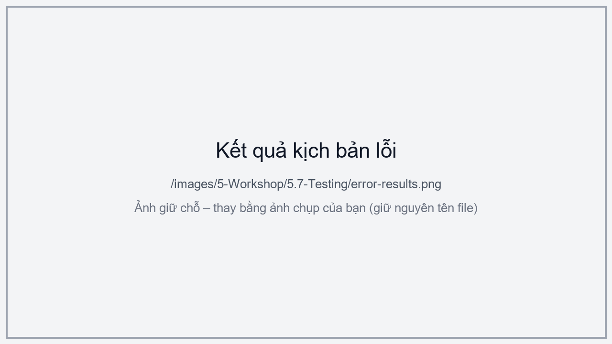
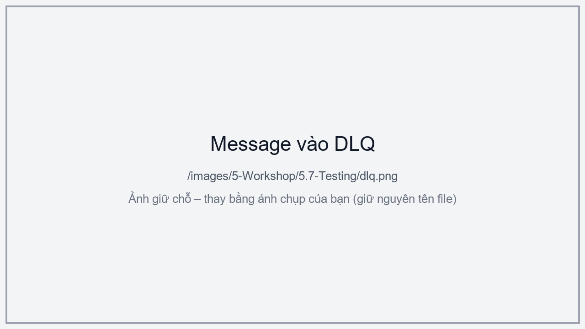
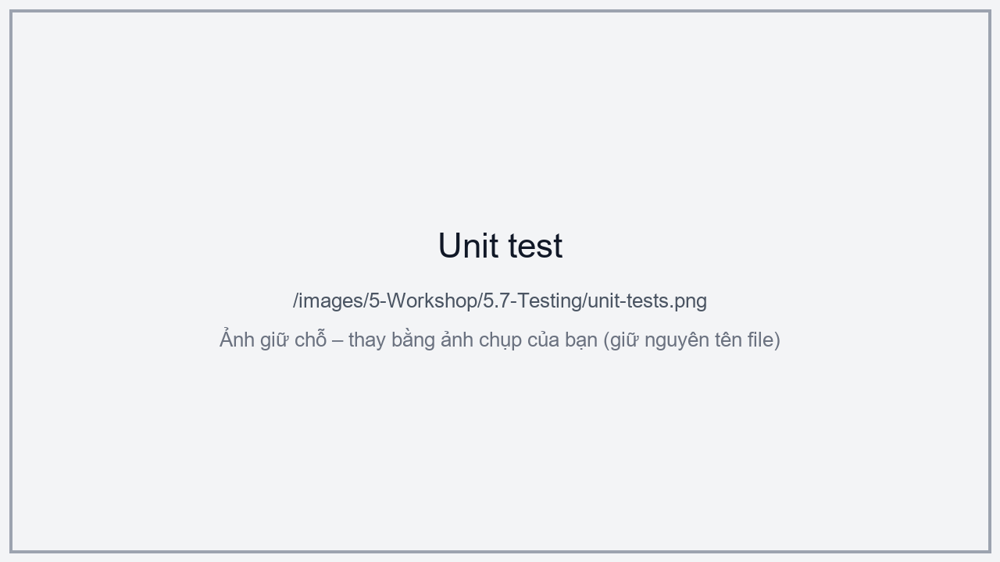

The system must reject bad input with a `failed` message carrying an error code instead of a stuck job. The `submit`
helper below resends the valid ticket from step 5.7.1 with one field changed.


```bash
source ~/cr.env
submit() {  # $1 = scenario name, $2 = jq filter applied to the valid request.json
  local id; id=$(python3 -c "import uuid; print(uuid.uuid4())")
  aws s3 cp sample-contract.pdf "s3://$DOCS_BUCKET/quarantine/lab-user/$id.pdf" > /dev/null
  jq --arg id "$id" '.job_id=$id | .source_file_key="quarantine/lab-user/\($id).pdf"
                     | .result_key="results/\($id)/extraction.json" | '"$2" request.json > "req-$1.json"
  aws s3 cp "req-$1.json" "s3://$DOCS_BUCKET/results/$id/request.json" > /dev/null
  aws sqs send-message --queue-url "$REQ_URL" --message-body \
    "{\"message_version\":\"1\",\"event_type\":\"analysis_requested\",\"job_id\":\"$id\",\"request_key\":\"results/$id/request.json\"}" > /dev/null
  echo "$1 -> $id"
}
submit wrong-type '.declared_file_type="docx"'
submit too-many-pages '.limits.max_pages=1'
aws sqs send-message --queue-url "$REQ_URL" --message-body "not a json message"
sleep 60
aws sqs receive-message --queue-url "$RES_URL" --wait-time-seconds 20 --max-number-of-messages 10 \
  --query 'Messages[].Body' --output text
```

{}
📸 **Screenshot to take:** CloudShell: the `failed` messages received, showing the `error_code` (e.g. `ERR-AI-001`, `ERR-UPL-004`) and `failure_reason` of each job.
{}




After 3 receives without success the broken message moves to the DLQ (with a 900 s visibility timeout this takes about
45 minutes; check back later):


```bash
source ~/cr.env
aws sqs get-queue-attributes --queue-url "${REQ_URL}-dlq" \
  --attribute-names ApproximateNumberOfMessages --output text
```

{}
📸 **Screenshot to take:** SQS console → `contract-risk-analysis-requests-dlq` → **Send and receive messages → Poll for messages**: the `not a json message` message (or the `ApproximateNumberOfMessages` output).
{}




Record what you observe:

| Scenario | Expected | Actual result |
| --- | --- | --- |
| `declared_file_type` differs from the real file type | `failed` with an input error code (`ERR-AI-001`) | [fill in] |
| `limits.max_pages` below the page count | `failed`, `ERR-UPL-004` | [fill in] |
| Body is not valid JSON | Not processed; moved to the DLQ after 3 receives | [fill in] |
| The same `analysis_requested` sent twice (SQS redelivery) | The worker reuses the runtime for the `job_id`, overwrites the result, never runs two copies in parallel | [fill in] |
| Worker stopped mid-job (`docker compose stop worker`, then `start`) | The message reappears after the visibility timeout and the job resumes from the cache | [fill in] |

#### Automated tests

The repository ships an offline unit test suite (AWS mocked with Moto, fake model, real LangGraph):


```bash
cd /opt/contract-risk-management
.venv312/bin/python -m pip install -q -r infrastructure/requirements/test.txt -r infrastructure/requirements/data_pipeline.txt
.venv312/bin/python -m pip install -q --no-deps -e .
.venv312/bin/python -B -m unittest discover -s tests/unit -p "test_*.py" 2>&1 | tail -3
```

{}
📸 **Screenshot to take:** The last three lines of the unit test command: `Ran ... tests` and `OK`.
{}


