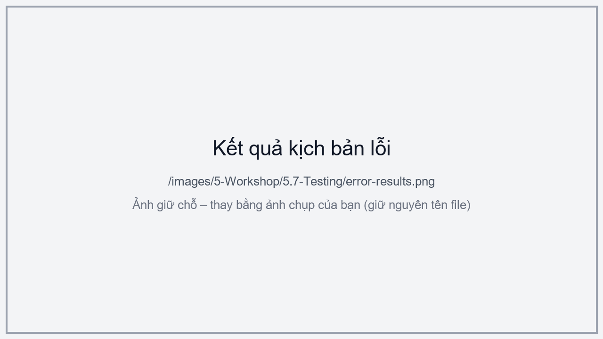
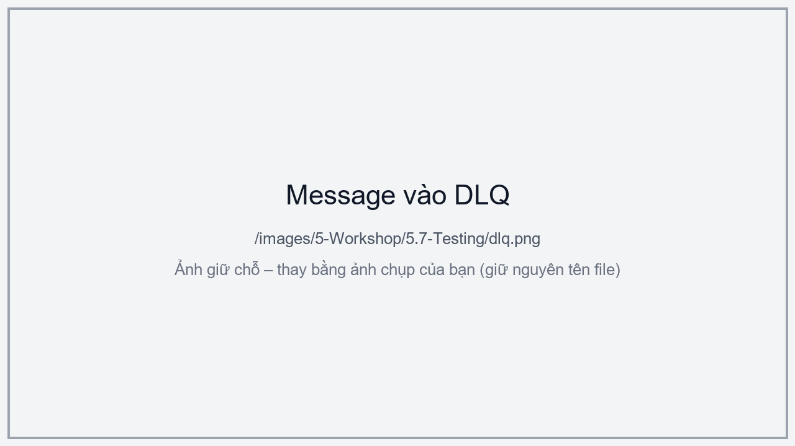
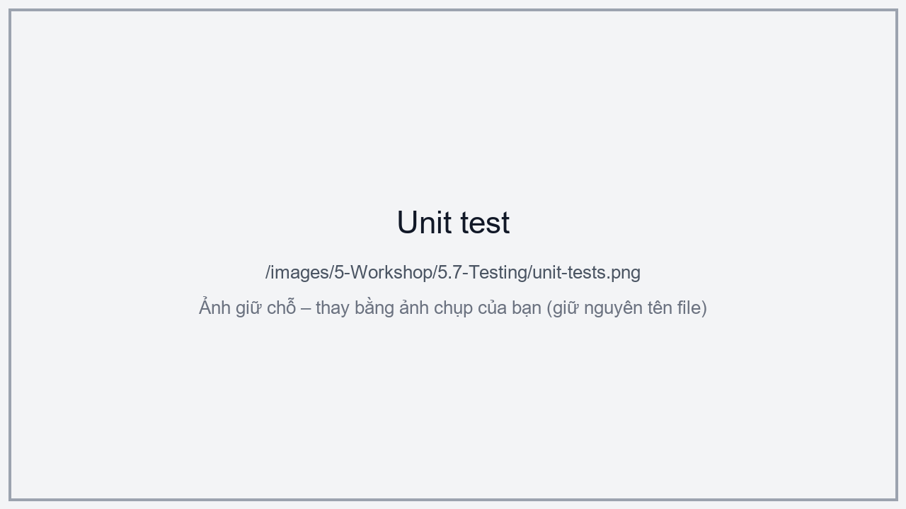

Hệ thống phải từ chối đầu vào sai bằng một message `failed` có mã lỗi thay vì treo job. Hàm `submit` dưới đây gửi lại
phiếu hợp lệ ở bước 5.7.1 nhưng sửa một trường.


```bash
source ~/cr.env
submit() {  # $1 = scenario name, $2 = jq filter applied to the valid request.json
  local id; id=$(python3 -c "import uuid; print(uuid.uuid4())")
  aws s3 cp sample-contract.pdf "s3://$DOCS_BUCKET/quarantine/lab-user/$id.pdf" > /dev/null
  jq --arg id "$id" '.job_id=$id | .source_file_key="quarantine/lab-user/\($id).pdf"
                     | .result_key="results/\($id)/extraction.json" | '"$2" request.json > "req-$1.json"
  aws s3 cp "req-$1.json" "s3://$DOCS_BUCKET/results/$id/request.json" > /dev/null
  aws sqs send-message --queue-url "$REQ_URL" --message-body \
    "{\"message_version\":\"1\",\"event_type\":\"analysis_requested\",\"job_id\":\"$id\",\"request_key\":\"results/$id/request.json\"}" > /dev/null
  echo "$1 -> $id"
}
submit wrong-type '.declared_file_type="docx"'
submit too-many-pages '.limits.max_pages=1'
aws sqs send-message --queue-url "$REQ_URL" --message-body "not a json message"
sleep 60
aws sqs receive-message --queue-url "$RES_URL" --wait-time-seconds 20 --max-number-of-messages 10 \
  --query 'Messages[].Body' --output text
```

{}
📸 **Ảnh cần chụp:** CloudShell: các message `failed` nhận được, thấy `error_code` (ví dụ `ERR-AI-001`, `ERR-UPL-004`) và `failure_reason` của từng job.
{}




Sau 3 lần nhận không xử lý được, message hỏng sẽ sang DLQ (với visibility 900 s, việc này mất khoảng 45 phút; có thể
kiểm tra lại sau):


```bash
source ~/cr.env
aws sqs get-queue-attributes --queue-url "${REQ_URL}-dlq" \
  --attribute-names ApproximateNumberOfMessages --output text
```

{}
📸 **Ảnh cần chụp:** SQS console → `contract-risk-analysis-requests-dlq` → **Send and receive messages → Poll for messages**: thấy message `not a json message` (hoặc kết quả `ApproximateNumberOfMessages`).
{}




Ghi lại kết quả quan sát được:

| Kịch bản | Kỳ vọng | Kết quả thực tế |
| --- | --- | --- |
| `declared_file_type` khác loại file thật | `failed`, mã lỗi đầu vào (`ERR-AI-001`) | [điền] |
| `limits.max_pages` nhỏ hơn số trang | `failed`, `ERR-UPL-004` | [điền] |
| Body không phải JSON hợp lệ | Không xử lý; sang DLQ sau 3 lần nhận | [điền] |
| Gửi trùng cùng một `analysis_requested` (SQS giao lại) | Worker dùng lại runtime theo `job_id`, ghi đè kết quả, không xử lý song song hai bản | [điền] |
| Tắt worker giữa chừng (`docker compose stop worker` rồi `start`) | Message hiện lại sau visibility timeout, job chạy tiếp từ cache | [điền] |

#### Kiểm thử tự động

Repository có bộ unit test chạy offline (AWS giả lập bằng Moto, model giả, LangGraph thật):


```bash
cd /opt/contract-risk-management
.venv312/bin/python -m pip install -q -r infrastructure/requirements/test.txt -r infrastructure/requirements/data_pipeline.txt
.venv312/bin/python -m pip install -q --no-deps -e .
.venv312/bin/python -B -m unittest discover -s tests/unit -p "test_*.py" 2>&1 | tail -3
```

{}
📸 **Ảnh cần chụp:** Ba dòng cuối của lệnh unit test: `Ran ... tests` và `OK`.
{}


