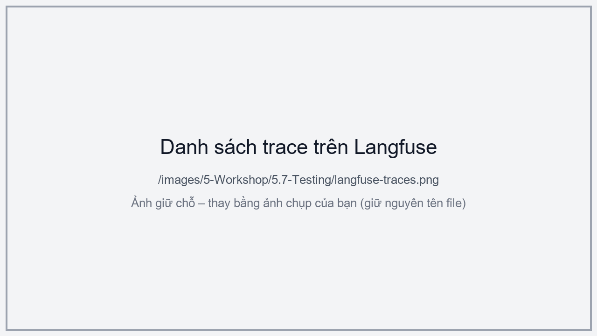
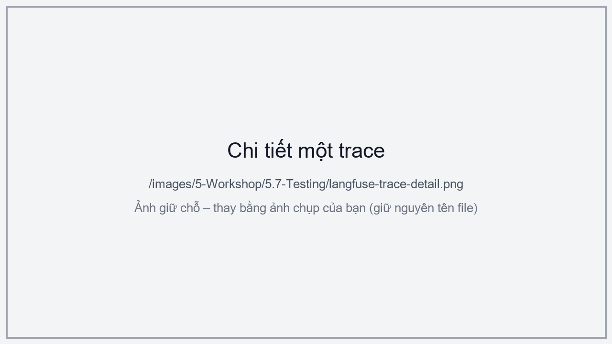
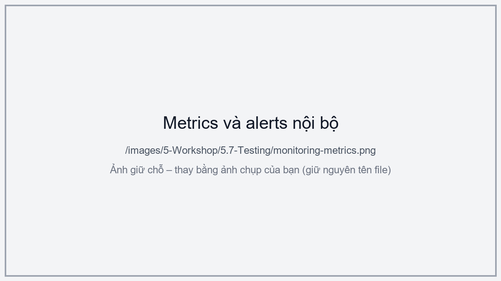

Every service sends events (stage, timing, tokens, errors) to the `monitoring` container. Monitoring **strips contract
content and secrets**, stores them in SQLite, then exports OTLP to Langfuse Cloud when `LANGFUSE_ENABLED=true` and the
keys are in Secrets Manager (step 5.4.4). Langfuse is an observation channel only: the worker never waits for
telemetry to complete a job.

1. Open Langfuse → project → **Tracing** and find the traces of the job from step 5.7.1:


{}
📸 **Screenshot to take:** Langfuse → your project → **Tracing**: the traces of the job you ran, *Environment* = production.
{}



{}
📸 **Screenshot to take:** Open one trace: the observation tree `worker.*`, `langgraph.*`, `agent_1_classification`, `agent_2_risk_scoring`, `tool.*`, `agent_3_recommendation`, with per-step timing, model `gemini-3.5-flash-lite` and token usage.
{}




2. Read the internal metrics and alerts on EC2 (the API only binds `127.0.0.1` and authenticates with
   `INTERNAL_API_TOKEN`):


```bash
cd /opt/contract-risk-management
TOKEN=$(aws secretsmanager get-secret-value --secret-id contract-risk/prod/api-keys \
  --query SecretString --output text | python3 -c "import json,sys; print(json.load(sys.stdin)['INTERNAL_API_TOKEN'])")
curl -s -H "Authorization: Bearer $TOKEN" "http://127.0.0.1:8099/v1/metrics?window_minutes=60" | python3 -m json.tool
curl -s -H "Authorization: Bearer $TOKEN" "http://127.0.0.1:8099/v1/alerts" | python3 -m json.tool
unset TOKEN
```

{}
📸 **Screenshot to take:** The output of the 2 `curl` commands on EC2: the metrics JSON (p95, errors, tokens per stage) and the alert list (e.g. `job_failed` from the error scenarios in 5.7.2).
{}




Built-in alerts: `job_failed`, `model_throttled` (Gemini returning 429/5xx repeatedly), `slow_stage`, plus the data
pipeline alerts (`data_run_*`, `data_document_failed`, `data_sqs_retry`).

3. Detailed logs: `docker compose logs <service>` for containers (JSON logs carrying `job_id`, `trace_id`),
   `journalctl -u contract-data-collector` for the data pipeline.
