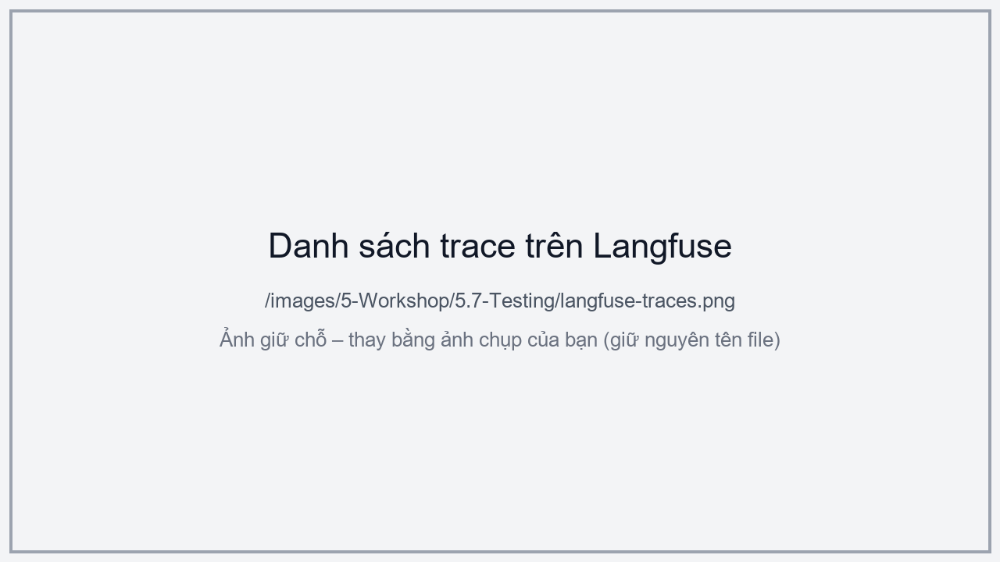
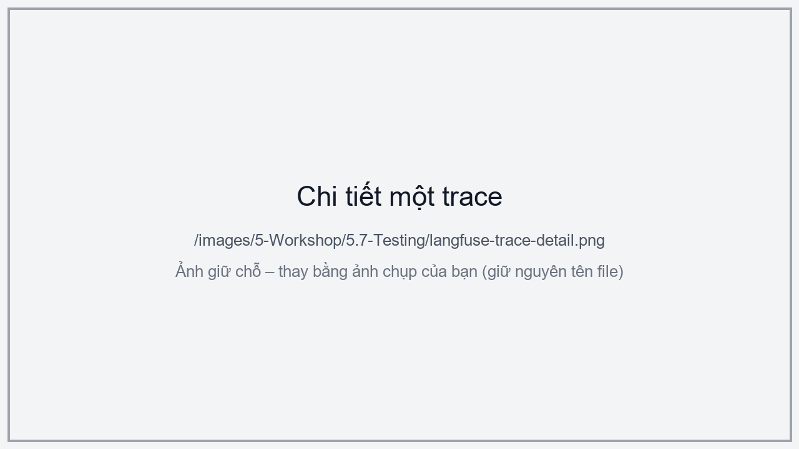
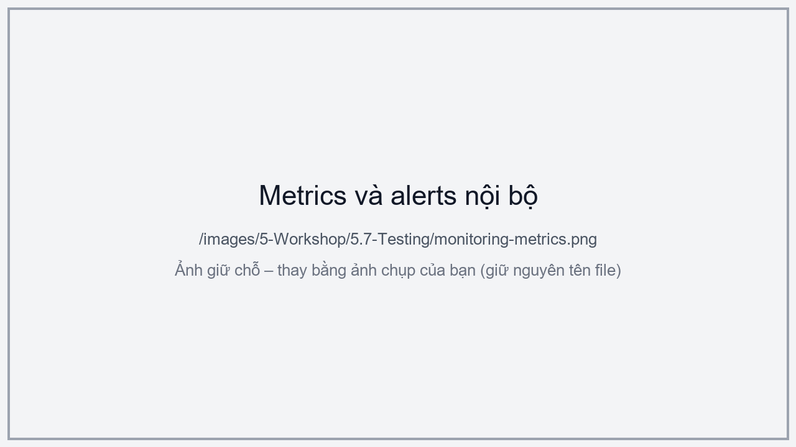

Mọi service gửi event (stage, thời gian, token, lỗi) tới container `monitoring`. Monitoring **lọc bỏ nội dung hợp đồng
và secret**, lưu SQLite, rồi xuất OTLP sang Langfuse Cloud khi `LANGFUSE_ENABLED=true` và có key trong Secrets Manager
(bước 5.4.4). Langfuse chỉ là kênh quan sát: worker không chờ telemetry để hoàn tất job.

1. Mở Langfuse → project → **Tracing**, tìm các trace của job ở bước 5.7.1:


{}
📸 **Ảnh cần chụp:** Langfuse → project của bạn → **Tracing**: danh sách trace của job vừa chạy, cột *Environment* = production.
{}



{}
📸 **Ảnh cần chụp:** Mở một trace: cây observation `worker.*`, `langgraph.*`, `agent_1_classification`, `agent_2_risk_scoring`, `tool.*`, `agent_3_recommendation`, có thời gian từng bước, model `gemini-3.5-flash-lite` và token usage.
{}




2. Đọc metrics và alerts nội bộ trên EC2 (API chỉ bind `127.0.0.1`, xác thực bằng `INTERNAL_API_TOKEN`):


```bash
cd /opt/contract-risk-management
TOKEN=$(aws secretsmanager get-secret-value --secret-id contract-risk/prod/api-keys \
  --query SecretString --output text | python3 -c "import json,sys; print(json.load(sys.stdin)['INTERNAL_API_TOKEN'])")
curl -s -H "Authorization: Bearer $TOKEN" "http://127.0.0.1:8099/v1/metrics?window_minutes=60" | python3 -m json.tool
curl -s -H "Authorization: Bearer $TOKEN" "http://127.0.0.1:8099/v1/alerts" | python3 -m json.tool
unset TOKEN
```

{}
📸 **Ảnh cần chụp:** Kết quả 2 lệnh `curl` trên EC2: JSON metrics (p95, lỗi, token theo stage) và danh sách alert (ví dụ `job_failed` từ các kịch bản lỗi ở 5.7.2).
{}




Alert có sẵn: `job_failed`, `model_throttled` (Gemini trả 429/5xx nhiều lần), `slow_stage`, cùng các alert của data
pipeline (`data_run_*`, `data_document_failed`, `data_sqs_retry`).

3. Log chi tiết: `docker compose logs <service>` cho container (log JSON có `job_id`, `trace_id`), `journalctl -u
   contract-data-collector` cho data pipeline.
