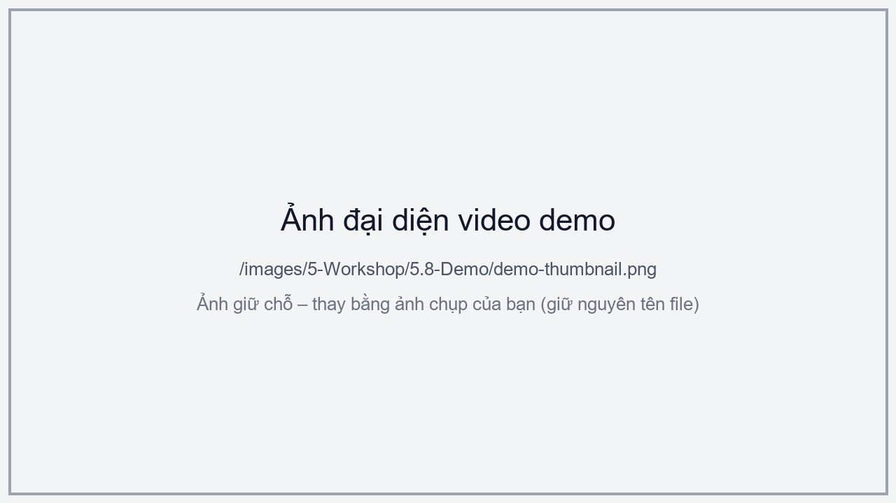

{}
✏️ **To fill in:** the demo video link (YouTube *Unlisted* or a publicly shared Google Drive file) and the production
link if any. Under FCAJ rules, no product demo means 0 points for the Demo item.
{}

&emsp; **Demo video:** [Paste the video link]

&emsp; **Production / ContractGuard web link:** [Paste the link, if any]

{}
📸 **Screenshot to take:** A frame from the demo video (or its YouTube/Drive page) so readers can click through to watch it.
{}

#### Video script (5–8 minutes)

Record the screen with OBS Studio or Xbox Game Bar (`Win + G`) at 1080p or better, hiding every key and token.

| Time | What to record |
| --- | --- |
| 0:00–0:45 | The architecture diagram and the SQS → worker → 3 agents → S3 flow |
| 0:45–1:30 | AWS Console: EC2 running, Security Group with no inbound rule, VPC Endpoints, IAM role |
| 1:30–2:00 | Session Manager: `docker compose ps` with 9 healthy services |
| 2:00–3:30 | CloudShell: ping/pong, then submitting the sample contract |
| 3:30–5:00 | Agent logs, DynamoDB progress, the Langfuse trace |
| 5:00–6:30 | The result: `extraction.json` (findings, quotes, scores) and the `completed` message; open the ContractGuard result page if available |
| 6:30–7:30 | One error scenario returning `failed` with an error code |
