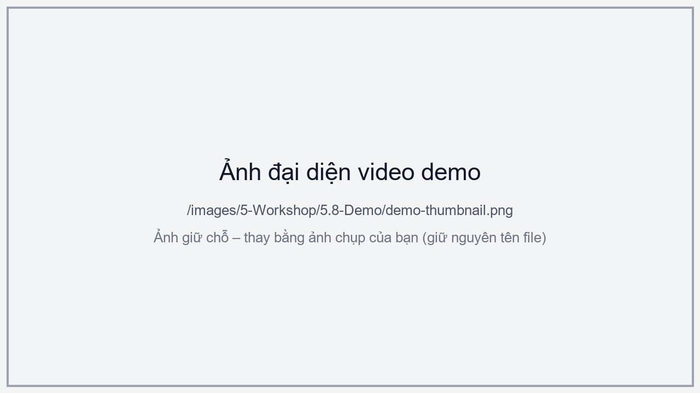

{}
✏️ **Cần điền:** link video demo (YouTube chế độ *Unlisted* hoặc Google Drive chia sẻ công khai) và link production nếu có.
Theo quy định FCAJ, không có demo sản phẩm thì mục Demo nhận 0 điểm.
{}

&emsp; **Video demo:** [Dán link video]

&emsp; **Link production / web ContractGuard:** [Dán link, nếu có]

{}
📸 **Ảnh cần chụp:** Ảnh chụp khung hình đầu video demo (hoặc trang YouTube/Drive của video) để người đọc bấm vào xem.
{}

#### Kịch bản quay video (5–8 phút)

Quay màn hình bằng OBS Studio hoặc Xbox Game Bar (`Win + G`), độ phân giải tối thiểu 1080p, che mọi key và token.

| Thời lượng | Nội dung cần quay |
| --- | --- |
| 0:00–0:45 | Sơ đồ kiến trúc, giới thiệu luồng SQS → worker → 3 agent → S3 |
| 0:45–1:30 | AWS Console: EC2 chạy, Security Group không có inbound, VPC Endpoint, IAM role |
| 1:30–2:00 | Session Manager: `docker compose ps` với 9 service healthy |
| 2:00–3:30 | CloudShell: gửi ping/pong, gửi job phân tích hợp đồng mẫu |
| 3:30–5:00 | Log agent chạy, tiến độ DynamoDB, trace trên Langfuse |
| 5:00–6:30 | Kết quả: `extraction.json` (finding, trích dẫn, điểm) và message `completed`; nếu có web ContractGuard thì mở trang kết quả |
| 6:30–7:30 | Một kịch bản lỗi trả `failed` có mã lỗi |
